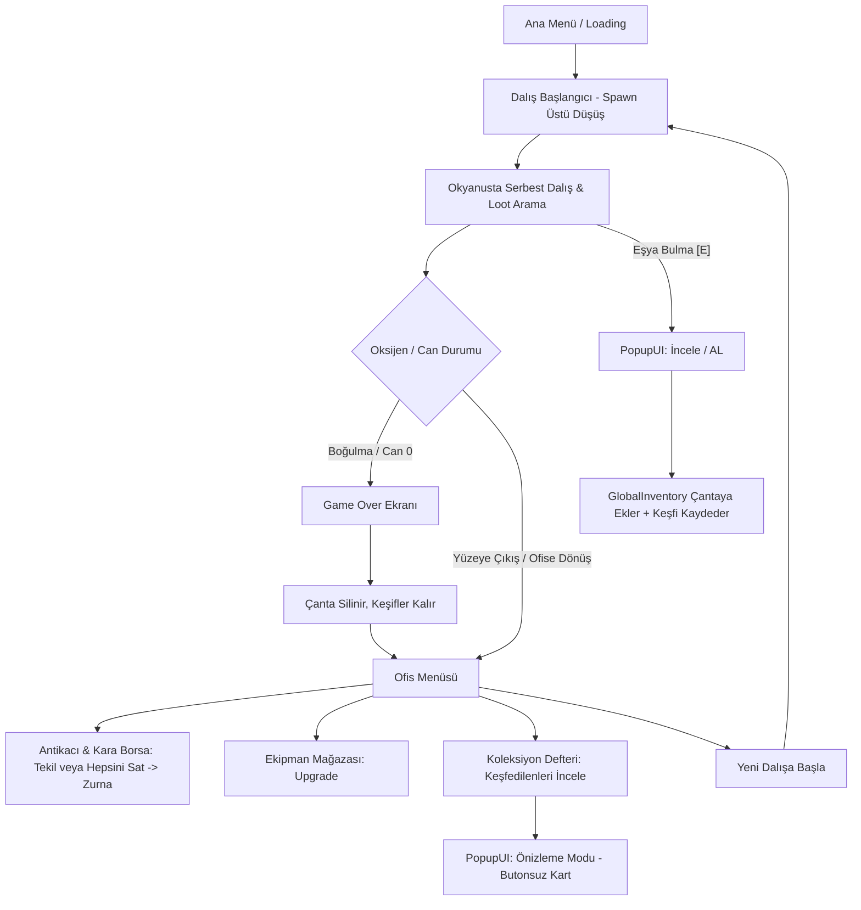

# Dive&Find — Proje Mimari ve Sistem Dokümantasyonu

Bu doküman, **Dive&Find** oyununun motor yapısını, sahne hiyerarşisini, kod mimarisini, veri modellerini, matematiksel formüllerini ve sistemler arası sinyal ağını detaylıca açıklar.

---

## 1. Oyun Döngüsü & Genel Bakış (Core Game Loop)

---

## 2. Autoload (Singleton) Sistemleri

Proje genelinde `project.godot` üzerinden 3 temel Autoload tanımlıdır:

| Autoload Adı | Script Dosyası | Sorumluluk Alanı | Temel Değişkenler & Sinyaller |
| :--- | :--- | :--- | :--- |
| **`GlobalInventory`** | [`Scripts/global_inventory.gd`](file:///home/hakan/dive&find/Scripts/global_inventory.gd) | Çanta içeriği, eşya ekleme/çıkarma, kalıcı keşif defteri, `.tres` dosya önbelleği | `collected_items: Array[ItemData]` `discovered_items: Dictionary` `_all_items_cache: Array[ItemData]` Signals: `inventory_updated`, `collection_updated(item)` |
| **`GlobalEconomy`** | [`Scripts/GlobalEconomy.gd`](file:///home/hakan/dive&find/Scripts/GlobalEconomy.gd) | Para (Zurna) yönetimi, harcama ve bakiye sorgulama | `money: int` Signals: `money_changed(new_amount)` |
| **`GlobalSoundManager`** | [`Scripts/global_sound_manager.gd`](file:///home/hakan/dive&find/Scripts/global_sound_manager.gd) | Shuffle müzik çalma listesi, SFX havuzu ve dinamik buton tık sesi bağlayıcı | `soundtrack: Array[String]` `sfx_paths: Dictionary` `play_sfx(sound_name)` |

---

## 3. Veri Modelleri & Kategori Renk Sistemi

### 3.1. Eşya Verisi — `ItemData`
- **Script**: [`Scripts/ItemData.gd`](file:///home/hakan/dive&find/Scripts/ItemData.gd) (`extends Resource`, `class_name ItemData`)
- **Dosyalar**: `res://all_items_tres/*.tres` (30 Adet Tanımlı Eşya)
- **Kategori Dağılımı ve Standart Renkler**:

| Kategori (`category`) | Görsel Renk Tonu | Hex / RGBA | Anlamı & Kullanım |
| :--- | :--- | :--- | :--- |
| **`Trash`** | Gri / Taş | `Color(0.65, 0.65, 0.65)` | Düşük değerli atıklar (lvl1-lvl2) |
| **`Resource`** | Cyan / Açık Mavi | `Color(0.25, 0.75, 0.95)` | Yaygın hammadde ve materyaller (lvl2-lvl7) |
| **`Rare Found`** | Mor / Magenta | `Color(0.75, 0.40, 0.95)` | Nadir buluntular ve elektronikler (lvl3-lvl4) |
| **`Valuable`** | Altın Sarısı | `Color(0.95, 0.80, 0.20)` | Yüksek değerli eşyalar (lvl4-lvl6) |
| **`Special`** | Mercan / Kırmızı | `Color(0.95, 0.30, 0.45)` | Özel buluntular ve kara borsa ganimetleri (lvl7) |

- **Kullanıldığı Yerler**:
  - [`inventory_slot.gd`](file:///home/hakan/dive&find/Scripts/inventory_slot.gd) $\rightarrow$ `RarityBackground.color`
  - [`collection_slot.gd`](file:///home/hakan/dive&find/Scripts/collection_slot.gd) $\rightarrow$ `rarity_bg.color` (Keşfedilenler için)
  - [`inventory.gd`](file:///home/hakan/dive&find/Scripts/inventory.gd) $\rightarrow$ Detay panelinde kategori rozeti ve metin rengi
  - [`item_seller.gd`](file:///home/hakan/dive&find/Scripts/item_seller.gd) $\rightarrow$ Satış panelinde kategori gösterimi ve Kara Borsa filtresi (`category == "Special"`)

### 3.2. Ekipman Geliştirme Verisi — `EquipmentUpgradeData`
- **Script**: [`Scripts/EquipmentUpgradeData.gd`](file:///home/hakan/dive&find/Scripts/EquipmentUpgradeData.gd)
- **Formül**: $\text{Cost} = \text{round}(\text{base\_cost} \times \text{cost\_multiplier}^{\text{level}})$

---

## 4. Oynanış ve Karakter Fiziği — `player_controller.gd`

- **Sınıf**: [`Scripts/player_controller.gd`](file:///home/hakan/dive&find/Scripts/player_controller.gd) (`extends CharacterBody2D`, Grup: `"player"`)
- **Hareket & Yüzme**: `max_speed`, `acceleration`, `friction`, `sink_speed`, `max_sink_velocity`.
- **Yüzey Sekme Kuvveti**: `InfiniteMapManager.water_surface_y` üstüne çıkmaya çalıştıkça aşağı iten yay kuvveti (`surface_push_force`).
- **Derinlik & Oksijen**:
  $$\text{depth\_m} = \max\left(0, \frac{\text{global\_position.y} - \text{water\_surface\_y}}{\text{pixels\_per\_meter}}\right)$$
  $$\text{drain\_rate} = \text{base\_oxygen\_drain\_rate} \times \left(\frac{1.0 + \frac{\text{depth\_m}}{\text{depth\_penalty\_ref}}}{1.0 + (\text{tube\_level} - 1) \times \text{efficiency\_gain}}\right)$$
- **Can & Boğulma**: Oksijen $\%15$ altındayken yavaş, $\%0$ iken agresif can kaybı. Can sıfırlanınca `Scenes/game_over.tscn` açılır.

---

## 5. Sonsuz Harita & Katman Mimarisi — `map_maker.gd`

- **Script**: [`Scripts/map_maker.gd`](file:///home/hakan/dive&find/Scripts/map_maker.gd) (`class_name InfiniteMapManager`)
- **Katmanlar**: Sky $\rightarrow$ lvl0 (Yüzey) $\rightarrow$ lvl1-lvl7 (Okyanus Katmanları) $\rightarrow$ Ground (Zemin).
- **Dinamik Yükleme**: Kamera hareketine göre chunk'lar dinamik yüklenir ve silinir.

---

## 6. Eşya Üretim ve Katman Havuzlama — `item_spawner.gd`

- **Script**: [`Scripts/item_spawner.gd`](file:///home/hakan/dive&find/Scripts/item_spawner.gd) (`class_name ItemSpawner`)
- **Katman Eşleşmesi**:
  - Katman 1: `Trash`
  - Katman 2: `Trash`, `Resource`
  - Katman 3: `Resource`, `Rare Found`
  - Katman 4: `Resource`, `Rare Found`, `Valuable`
  - Katman 5-6: `Valuable`, `Resource`
  - Katman 7: `Resource`, `Special`
- Ağırlıklı rastgele seçim: `rarity` (weight) üzerinden hesaplanır.

---

## 7. Kullanıcı Arayüzü (UI/UX) & Menü Mimarisi

### 7.1. Ana Menü ([`Scripts/main_menu.gd`](file:///home/hakan/dive&find/Scripts/main_menu.gd) & `Scenes/main_menu.tscn`)
- **Sürüm Yönetimi**: `@export var game_version: String = "v0.0.2 (Devbuild)"` değişkeni hem ana ekranın sağ üst köşesindeki `VersionLabel` etiketini hem de Bilgi panelindeki sürüm metnini otomatik senkronize eder.
- Yumuşak giriş/açılış animasyonları (Tween).
- Ses slider'ları ve tam ekran ayarları (`user://settings.cfg`).

### 7.2. Pop-up Kartı & Önizleme Modu ([`Scripts/popupui.gd`](file:///home/hakan/dive&find/Scripts/popupui.gd))
- **Dalışta Toplama Modu**: `setup(data, item, false)` $\rightarrow$ "AL [E]" butonu aktif, çantaya ekleme ve VFX tetikler.
- **Koleksiyon Önizleme Modu**: `setup(data, null, true)` $\rightarrow$ "AL" butonu gizlenir, buton "KAPAT [ESC]" olur, sadece bilgi kartı olarak incelenir. `ESC`, `E`, `Space`, `Enter` ile kapanır.

### 7.3. Koleksiyon Defteri ([`Scripts/collection.gd`](file:///home/hakan/dive&find/Scripts/collection.gd) & [`Scripts/collection_slot.gd`](file:///home/hakan/dive&find/Scripts/collection_slot.gd))
- Keşfedilen slotlar (`discovered == true`) fare ile tıklanabilir (`CURSOR_POINTING_HAND`).
- Tıklandığında `slot_clicked` sinyaliyle PopupUI'ın önizleme modunu açar.
- Keşfedilmemişler siyah silüet ve `???` ipucu ile kalır, tıklamaya tepki vermez.

### 7.4. Envanter & Satıcı Panelleri
- **Envanter (`inventory.gd`)**: Toplam çanta değeri, renkli kategori rozeti, klavye ile kapatma.
- **Satıcılar (`item_seller.gd`)**: Tekil satış ("SAT") ve tüm dükkan listesini tek tıkla satan ("HEPSİNİ SAT") butonları.

---

## 8. Sahne ve Script Çapraz Referans Tablosu

| Sahne (`.tscn`) | Bağlı Script (`.gd`) | Açıklama |
| :--- | :--- | :--- |
| `Scenes/main.tscn` | `canvas_layer.gd`, `player_controller.gd`, `map_maker.gd`, `item_spawner.gd` | Ana dalış dünyası ve HUD |
| `Scenes/main_menu.tscn` | `main_menu.gd` | Ana menü, ayarlar ve dinamik sürüm göstergesi |
| `Scenes/office_menu.tscn` | `office_menu.gd` | Ofis merkezi |
| `Scenes/loading_screen.tscn` | `loading_screen.gd` | Yükleme ekranı & `.tres` önbellekleyicisi |
| `Scenes/pickup.tscn` | `popupui.gd` | Eşya inceleme & alma pop-up'ı (Önizleme modu destekli) |
| `Scenes/inventory.tscn` | `inventory.gd` | Çanta arayüzü & toplam değer |
| `Scenes/inventory_slot.tscn` | `inventory_slot.gd` | Kategori renkli dinamik slot |
| `Scenes/equstore.tscn` | `equstore.gd` | Ekipman mağazası |
| `Scenes/equipment_slot.tscn` | `equipment_slot.gd` | Ekipman yükseltme hücresi |
| `Scenes/antikaci.tscn` | `item_seller.gd` | Normal eşya satışı (Hepsini Sat destekli) |
| `Scenes/kara_borsa.tscn` | `item_seller.gd` | Özel kategori eşya satışı (Hepsini Sat destekli) |
| `Scenes/collection.tscn` | `collection.gd` | Keşif defteri (Önizleme kartı açılışlı) |
| `Scenes/collection_slot.tscn` | `collection_slot.gd` | Keşif defteri hücresi (Tıklanabilir keşifler) |
| `Scenes/game_over.tscn` | `game_over.gd` | Boğulma / ölüm ekranı |
| `all_items_tscn/item_temp.tscn` | `interactable_item.gd` | Haritadaki toplanabilir eşya tabanı |
