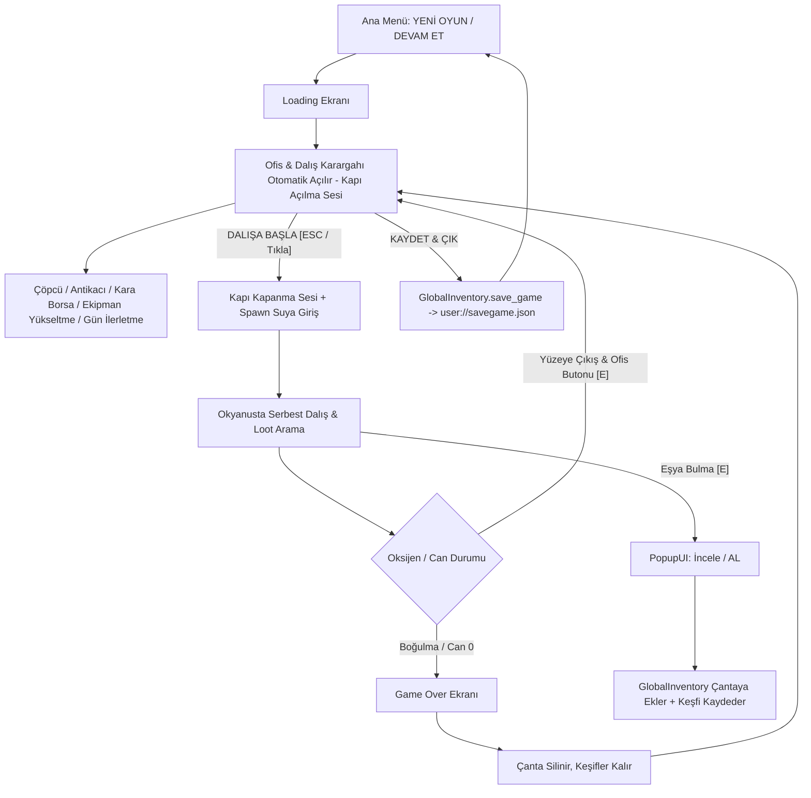

# Dive&Find — Proje Mimari ve Sistem Dokümantasyonu

Bu doküman, **Dive&Find** oyununun motor yapısını, sahne hiyerarşisini, kod mimarisini, veri modellerini, matematiksel formüllerini ve sistemler arası sinyal ağını detaylıca açıklar.

---

## 1. Oyun Döngüsü & Genel Bakış (Core Game Loop)

---

## 2. Autoload (Singleton) Sistemleri

Proje genelinde `project.godot` üzerinden 3 temel Autoload tanımlıdır:

| Autoload Adı | Script Dosyası | Sorumluluk Alanı | Temel Değişkenler & Sinyaller |
| :--- | :--- | :--- | :--- |
| **`GlobalInventory`** | [`Scripts/global_inventory.gd`](file:///home/hakan/dive&find/Scripts/global_inventory.gd) | Çanta içeriği, keşif defteri, `.tres` önbelleği ve **Tam Oyun Save/Load Motoru** | `collected_items: Array[ItemData]` `discovered_items: Dictionary` `save_game()`, `apply_save_to_game()`, `apply_save_to_player()`, `has_save()` Signals: `inventory_updated`, `collection_updated(item)` |
| **`GlobalEconomy`** | [`Scripts/GlobalEconomy.gd`](file:///home/hakan/dive&find/Scripts/GlobalEconomy.gd) | Para (Zurna) yönetimi, harcama ve bakiye sorgulama | `money: int` Signals: `money_changed(new_amount)` |
| **`GlobalSoundManager`** | [`Scripts/global_sound_manager.gd`](file:///home/hakan/dive&find/Scripts/global_sound_manager.gd) | SFX bus ses yönetimi, Spotify shuffle müzik çaları, kapı sesleri (`door_open`, `door_close`) | `sfx_paths: Dictionary` `play_sfx(sound_name)` Buses: `"Music"`, `"SFX"` |
| **`GlobalTime`** | [`Scripts/global_time.gd`](file:///home/hakan/dive&find/Scripts/global_time.gd) | Dinamik gün ve saat döngüsü (10:00 başlangıç, 19:00 mesai sonu, 15dk adımlar), dalış kilidi, günlük bilanço takibi | `current_day`, `current_hour`, `current_minute` `start_new_day()`, `is_dive_allowed()` |
| **`DevConsole`** | [`Scripts/dev_console.gd`](file:///home/hakan/dive&find/Scripts/dev_console.gd) | Küresel hile ve geliştirici konsolu (`é` / `~` tuşu), komut geçmişi, modüler komut sistemi | `money`, `upgrade`, `upgrade_all`, `fill_inv`, `god`, `surface`, `tp`, `office`, `die`, `time`, `add_time`, `time_speed`, `skip_day` Layer: `128` |

---

## 3. Geliştirici & Hile Konsolu Komutları

| Komut | Parametre | Açıklama | Örnek Kullanım |
| :--- | :--- | :--- | :--- |
| **`help`** | - | Tüm kayıtlı komutları listeler | `help` |
| **`clear`** | - | Konsol ekranını temizler | `clear` |
| **`money`** | `<miktar>` | Cüzdana Zurna ekler / çıkarır | `money 5000` |
| **`upgrade`** | `<tube|fins|goggles|bag|flashlight> [seviye]` | Seçilen ekipmanın seviyesini ayarlar veya +1 artırır | `upgrade tube 5`, `upgrade flashlight 10` |
| **`upgrade_all`**| `[seviye]` | 5 ekipmanı birden o seviyeye ayarlar veya +1 artırır | `upgrade_all 4` |
| **`flashlight`** / **`fener`** | `[seviye\|on\|off]` | Feneri açıp kapatır veya doğrudan istenen seviyeye çeker | `flashlight`, `flashlight on`, `flashlight 15` |
| **`battery`** / **`batarya`** | `[miktar]` | Fener bataryasını tamamen doldurur veya istenen değere ayarlar | `battery`, `battery 50` |
| **`fill_inv`** | - | Çantayı kapasitesi dolana kadar rastgele eşyalarla doldurur | `fill_inv` |
| **`god`** | - | Ölümsüzlük modunu açar/kapatır (Can ve oksijen tükenmez) | `god` |
| **`surface`** | - | Karakteri anında su yüzeyine (0 metreye) ışınlar | `surface` |
| **`tp`** | `<metre>` | Karakteri belirtilen derinliğe anında ışınlar | `tp 700` |
| **`office`** | - | Nerede olunursa olunsun Ofis Karargahını anında açar | `office` |
| **`die`** | - | Karakteri anında öldürüp Game Over ekranını tetikler | `die` |
| **`time`** | `<saat> [dakika]` | Oyun saatini doğrudan ayarlar | `time 18 45` |
| **`add_time`** | `<dakika>` | Saati belirtilen dakika kadar ileri sarar | `add_time 30` |
| **`time_speed`**| `<çarpan>` | Zaman akış hızını hızlandırır/yavaşlatır | `time_speed 5.0` |
| **`skip_day`** | - | Günü anında 19:00'a sarıp Gün Özeti Ekranını açar | `skip_day` |

---

## 4. Dinamik Gün & Saat Döngüsü (Day & Time Loop)

- **Mesai Başlangıcı:** `10:00` (Ofis ve dalış açık)
- **Mesai Sonu / Dalış Kesintisi:** `19:00` (Ofiste yeni dalışlar kilitlenir, "GÜNÜ BİTİR & İLERLET" vurgulanır)
- **Zaman Akışı:** Her `30` gerçek saniyede bir saat `15` oyun dakikası ilerler (Bir tam günlük dalış mesaisi ~`18` dakika sürer). Saat hem okyanusta hem ofiste küresel olarak kesintisiz akar.
- **Erken Gün Bitirme Uyarısı:** Mesai (19:00) bitmeden "Günü İlerlet" basıldığında onay paneli çıkar; teyit edilirse gün erken kapatılır.
- **Gün Özeti & Bilanço Ekranı ([`Scenes/day_summary.tscn`](file:///home/hakan/dive&find/Scenes/day_summary.tscn)):**
  - Günlük toplam kazanç (+Zurna)
  - Yapılan toplam dalış sayısı
  - Satılan eşya adedi
  - Ulaşılan en derin nokta
  - Çanta durumu
  - "YENİ GÜNE BAŞLA ☀️" tıklandığında oyun otomatik kaydedilir, havalı bir `loading_screen` (1.6 sn) geçişi çalışır ve yeni güne (Saat 10:00) ofisten başlanır.

---

## 3. Kayıt ve Yükleme Sistemi (Save / Load)

- **Merkez**: [`Scripts/global_inventory.gd`](file:///home/hakan/dive&find/Scripts/global_inventory.gd)
- **Kayıt Yolu**: `user://savegame.json`
- **Kaydedilen Veriler**:
  - `current_day` (Mevcut gün sayısı)
  - `current_hour`, `current_minute` (Mevcut saat ve dakika)
  - `money` (Cüzdandaki toplam Zurna)
  - `equipment` (`tube_level`, `fins_level`, `goggles_level`, `backpack_level`)
  - `inventory_paths` (Çantadaki eşyaların `.tres` dosya yolları)
  - `inventory_locked` (Çantadaki eşyaların kilit durumları - Array[bool])
  - `save_time` (Kayıt tarihi ve saati)
- **Ana Menü Entegrasyonu**:
  - **"YENİ OYUN"**: `GlobalInventory.start_new_game()` çağırır. Diskteki kaydı siler, çantayı boşaltır, parayı sıfırlar (0), `GlobalTime`'ı Gün 1 ve saat 10:00'a resetler (`reset_to_new_game()`), mesai kilidini kaldırır, oyuncu ekipmanlarını varsayılana (Tüp 1, Palet 0, Gözlük 0, Çanta 0) çeker ve ofiste başlatır.
  - **"DEVAM ET"**: Kayıtlı oyun varsa aktifleşir; fare üzerine gelince detaylı kayıt özeti tooltip'i gösterir (Gün, Para, Eşya, Ekipman Seviyeleri, Tarih) ve ofiste başlatır.
- **Ofis Entegrasyonu**:
  - "KAYDET & ÇIK" tıklandığında anlık durum diske yazılır, kapı kapanma sesi çalar ve ana menüye dönülür.

---

## 4. Veri Modelleri & Kategori Renk Sistemi

### 4.1. Eşya Verisi — `ItemData`
- **Script**: [`Scripts/ItemData.gd`](file:///home/hakan/dive&find/Scripts/ItemData.gd) (`extends Resource`, `class_name ItemData`)
- **Dosyalar**: `res://all_items_tres/*.tres` (30 Adet Tanımlı Eşya)
- **Kategori Dağılımı ve Standart Renkler**:

| Kategori (`category`) | Görsel Renk Tonu | Hex / RGBA | Anlamı & Kabul Eden Dükkan |
| :--- | :--- | :--- | :--- |
| **`Trash`** | Gri / Taş | `Color(0.65, 0.65, 0.65)` | Düşük değerli atıklar $\rightarrow$ **ÇÖPCÜ** |
| **`Resource`** | Cyan / Açık Mavi | `Color(0.25, 0.75, 0.95)` | Hammaddeler (Craft için ayrılmıştır, dükkanlarda satılmaz) $\rightarrow$ **LABORATUVAR** |
| **`Rare Found`** | Mor / Magenta | `Color(0.75, 0.40, 0.95)` | Nadir buluntular $\rightarrow$ **ANTİKACI** |
| **`Valuable`** | Altın Sarısı | `Color(0.95, 0.80, 0.20)` | Yüksek değerli eşyalar $\rightarrow$ **ANTİKACI** |
| **`Special`** | Mercan / Kırmızı | `Color(0.95, 0.30, 0.45)` | Özel buluntular $\rightarrow$ **KARA BORSA** |

### 4.2. Ekipman Geliştirme Verisi — `EquipmentUpgradeData`
- **Script**: [`Scripts/EquipmentUpgradeData.gd`](file:///home/hakan/dive&find/Scripts/EquipmentUpgradeData.gd)
- **Formül**: $\text{Cost} = \text{round}(\text{base\_cost} \times \text{cost\_multiplier}^{\text{level}})$

| Ekipman | Başlangıç | Max Level | Base Cost | Cost Multiplier | Açıklama & Etki |
| :--- | :--- | :--- | :--- | :--- | :--- |
| **Oksijen Tüpü** | Lvl 1 | **Sınırsız (-1)** | **`35 Zurna`** | **`1.50`** | Her seviyede $+1.25$ verimlilik |
| **Palet (Hız)** | Lvl 0 | **`20`** | 25 Zurna | `1.65` | Her seviyede $+55\text{ px/s}$ yüzme hızı |
| **Gözlük (Görüş)** | Lvl 0 | **`9`** | **`100 Zurna`** | **`2.10`** | Her seviyede $-0.04$ min zoom (Lvl 9'da max zoom out: 0.09) |
| **Çanta** | 5 Slot | **`20`** | 20 Zurna | `1.50` | Her seviyede $+5$ slot kapasite (Max 105 slot) |

---

## 5. Oynanış ve Karakter Fiziği — `player_controller.gd`

- **Sınıf**: [`Scripts/player_controller.gd`](file:///home/hakan/dive&find/Scripts/player_controller.gd) (`extends CharacterBody2D`, Grup: `"player"`)
- **Spawn**: Su yüzeyinin $60\text{px}$ üstünden $450\text{px/s}$ hızla anında ve dinamik dalış.
- **Ekipman Seviyeleri**: `GlobalInventory.apply_save_to_player(self)` ile kayıtlı oyundan otomatik yüklenir.
- **Hareket & Yüzme**: `max_speed` ($220 + \text{fins\_level} \times 55$), `acceleration` ($600 + \text{fins\_level} \times 137.5$), `friction`, `sink_speed`, `max_sink_velocity`.
- **Hızlı Yüzme / Depar (Shift Sprint)**:
  - **Tetikleyici**: `[Shift]` tuşu (yalnızca hareket ederken ve $O_2 > 0$ iken aktifleşir).
  - **Hız & İvmelenme**: `sprint_speed_bonus = 110.0 px/s`, `sprint_accel_multiplier = 1.45x` (taban hız $220 \rightarrow 330\text{ px/s}$, +%50 hız artışı).
  - **Oksijen Tüketimi**: `sprint_oxygen_multiplier = 2.6x` (su altında depar atarken tüp 2.6 kat daha agresif tükenir).
  - **Dinamik HUD Senkronizasyonu**: Dalgıç depar attığı an `get_surface_return_info()` içindeki aktif tüketim anında 2.6 katına çıkar, HUD'daki kalan süre (`oxygen_seconds_left`) 0ms gecikmeyle anında düşer ve yanına `⚡` depar rozeti eklenir (`🫧 O2: ~11s ⚡`). Yüzeye dönüş uyarısı (`time_to_surface`) taban hızı baz alarak gösterge histerezisini (alarm titremesi) önler.
  - **Animasyon Senkronizasyonu**: Depar anında bacak çırpma animasyon hızı tavanı $\%25$ artarak (`max_anim_speed * 1.25`) akıcı ve tatmin edici bir yüzüş hissiyatı verir.
- **Kamera & Görüş**: Başlangıç zoom $0.45$, min zoom $0.45 - (\text{goggles\_level} \times 0.04)$.
- **Yüzey Sekme Kuvveti**: `InfiniteMapManager.water_surface_y` üstüne çıkmaya çalıştıkça aşağı iten yay kuvveti (`surface_push_force`).
- **Derinlik & Oksijen Dengesi**:
  $$\text{depth\_m} = \max\left(0, \frac{\text{global\_position.y} - \text{water\_surface\_y}}{\text{pixels\_per\_meter}}\right)$$
  $$\text{drain\_rate} = \text{base\_oxygen\_drain\_rate} \times \left(\frac{1.0 + \frac{\text{depth\_m}}{250.0}}{1.0 + (\text{tube\_level} - 1) \times 1.25}\right) \times (\text{sprint\_oxygen\_multiplier if sprinting else } 1.0)$$
- **Yüzeye Dönüş & Güvenlik Analizi (`get_surface_return_info()`):**
  - Dalgıcın anlık derinliğinden yüzeye dikey çıkış süresi: $t_{\text{surface}} = \frac{\text{dist\_y}}{\text{base\_max\_speed}}$
  - Çıkış esnasında derinlik azaldığı için ortalama tüketim hızı: $\text{drain}_{\text{avg}} = \frac{\text{drain}_{\text{current}} + \text{drain}_{\text{surface}}}{2}$
  - Yüzeye varış için gereken asgari oksijen: $\text{O2}_{\text{needed}} = t_{\text{surface}} \times \text{drain}_{\text{avg}}$
  - Güvenlik Payı & Toast Uyarısı: $\text{current\_oxygen} \le \text{O2}_{\text{needed}} \times 1.25$ olduğunda uyarı, $\le \text{O2}_{\text{needed}}$ olduğunda acil durum toast ve ses bildirimi tetiklenir; HUD üzerinde kalan süre dinamik gösterilir.
- **Can & Boğulma**: Oksijen $\%15$ altındayken yavaş, $\%0$ iken agresif can kaybı. Can sıfırlanınca `Scenes/game_over.tscn` açılır.

---

## 6. Sonsuz Harita & Katman Mimarisi — `map_maker.gd`

- **Script**: [`Scripts/map_maker.gd`](file:///home/hakan/dive&find/Scripts/map_maker.gd) (`class_name InfiniteMapManager`)
- **Katmanlar**: Sky $\rightarrow$ lvl0 (Yüzey) $\rightarrow$ lvl1-lvl7 (Okyanus Katmanları) $\rightarrow$ Ground (Zemin).
- **Dinamik Yükleme**: Kamera hareketine göre chunk'lar dinamik yüklenir ve silinir.

---

## 7. Eşya Üretim ve Katman Havuzlama — `item_spawner.gd`

- **Script**: [`Scripts/item_spawner.gd`](file:///home/hakan/dive&find/Scripts/item_spawner.gd) (`class_name ItemSpawner`)
- **Katman Eşleşmesi (Derinlik)**:
  - Katman 1: `Trash`
  - Katman 2: `Trash`, `Resource`
  - Katman 3: `Resource`, `Rare Found`
  - Katman 4: `Resource`, `Rare Found`, `Valuable`
  - Katman 5-6: `Valuable`, `Resource`
  - Katman 7: `Valuable`, `Resource` + Ultra Nadir **`Special`** (`special_item_chance = 0.05` / %5 bağımsız zar filtresi)
- **Günlük Akıntı & Restock Döngüsü (Tükenme & Yenilenme)**:
  - **Aynı Gün İçi Tüketim**: Bir chunk o gün spawn edildiğinde `_spawned_chunk_indices_today` sözlüğüne işlenir. Oyuncu o gün 2 chunk uzağa yüzüp dönse bile o bölgede aynı gün tekrar eşya doğmaz (border-hopping sonsuz farm exploiti engellendi).
  - **Yeni Gün Yenilenmesi**: `GlobalTime.day_changed` tetiklendiğinde `_spawned_chunk_indices_today.clear()` çalışır, okyanus akıntıları gelir ve tüm okyanus baştan taze eşyalarla donatılır.
- Ağırlıklı rastgele seçim: `rarity` (weight) üzerinden derinlik katmanlarına göre hesaplanır. Katman 7'de her eşya doğuşunda %5 zar atılarak Özel (Special) kategori seçilir, aksi halde katmanın normal değerli/hammadde havuzu kullanılır.

---

## 8. Kullanıcı Arayüzü (UI/UX) & Menü Mimarisi

### 8.1. Ana Menü ([`Scripts/main_menu.gd`](file:///home/hakan/dive&find/Scripts/main_menu.gd) & `Scenes/main_menu.tscn`)
- **YENİ OYUN & DEVAM ET**:
  - `DEVAM ET`: Kayıtlı oyun varsa aktif, fare üzerinde detaylı save özeti tooltip'i (Gün, Para, Eşyalar, Ekipmanlar, Kayıt Tarihi).
  - `YENİ OYUN`: Sıfırdan temiz bir başlangıç açar.
  - **Toggle Panel Mimarisi:** Ana menüdeki `Koleksiyon`, `Ayarlar` ve `Bilgi` butonları toggle (aç/kapa) mantığıyla çalışır. Açık olan bir pencere varken butona tekrar basıldığında kapanır; başka bir pencere açıldığında önceki pencere otomatik temizlenir. Üst üste birden fazla pencere yığılması engellenmiştir.
- **Sürüm Yönetimi & Yenilikler Paneli**:
  - `@export var game_version: String = "Pre-Alpha 1.6 (Afterjam Remaster)"` değişkeni hem `VersionLabel` hem Bilgi panelini senkronize eder.
  - **Yenilikler & Güncellemeler Paneli (`ChangelogPanel` / `ChangelogText`):** Ana menünün sağ tarafında Pre-Alpha 1.6 sürüm notlarını (Güncellemeler ve Fixler olarak ayrılmış şekilde) BBCode renkli formatta oyuncuya sunar.

### 8.2. Ofis & Dalış Karargahı ([`Scripts/office_menu.gd`](file:///home/hakan/dive&find/Scripts/office_menu.gd) & `Scenes/office_menu.tscn`)
- **Tam Ekran Opak Yatay Düzen**:
  - Oyun açılışında otomatik olarak oyuncuyu karşılar (Kapı açılma sesiyle).
  - **Üst Bar**: Başlık, Gün Sayacı, "GÜNÜ İLERLET ☀️" (Erken gün onay popup'lı), Zurna Cüzdan Rozeti, "KAYDET & ÇIK" (`GlobalInventory.save_game`).
  - **Canlı Tüccar Rozetleri (Loot Badges & Glow)**:
    - Çantadaki eşyaları anlık tarayarak Çöpçü (`🟢 3 Hurda (+180 Z)`), Antikacı (`🟢 1 Antika (+90 Z)` - Ham maddeler craft için hariç tutulur) ve Kara Borsa (`🔴 1 Özel (+300 Z)`) kartlarının üstünde canlı rozetler gösterir.
    - Satılabilir eşyası olan tüccarlar şık bir nabız / nefes alma animasyonuyla (`Pulse Glow Tween`) hafifçe parıldar.
    - Ekipman Atölyesi kartı, cüzdandaki para herhangi bir geliştirmeye yetiyorsa parıldayan `✨ Yükseltme Hazır!` rozeti takar.
  - **Alt Menü Toggle & Dalış Temizliği (`_close_all_submenus()`):**
    - Ofis içindeki tüm satıcılar (Çöpçü, Antikacı, Kara Borsa), tesisler (Atölye, Laboratuvar, Pazar), Çanta ve Koleksiyon butonları toggle mantığına sahiptir; aynı butona tekrar basıldığında pencere kapanır.
    - Bir alt menü açıkken "Dalışa Başla" basıldığında veya ofis kapandığında `_close_all_submenus()` tetiklenerek okyanusta sahnelerin açık kalması tamamen engellenir.
  - **ESC Kapatma Hiyerarşisi**: Açık bir tüccar, çanta veya koleksiyon penceresi varsa `ESC` önce o alt pencereyi kapatır; alt pencere yoksa dalışı başlatır.
  - **Rastgele Dalış Konumu (Keşif Varyansı)**: `@export var ocean_spawn_x_variance: float = 3000.0` ile ofisten her dalışa geçildiğinde dalgıç merkez x: 16 koordinatının sağına veya soluna rastgele saparak (±3000 px aralığında) suya girer. Bu sayede her dalışta farklı bir su altı bölgesi keşfedilir.
  - **Alt Tesisler Bölgesi**: Ekipman Mağazası, Laboratuvar, Satış Pazarı.
  - **Alt Bar**: Çanta [I], Koleksiyon [C], Dinamik Toast Bildirimleri, Dalışa Başla [ESC].

---

## 8. Okyanus HUD & Kompakt Arayüz Mimarisi (`canvas_layer.gd`)

- **Sağ Üst Action Bar & Bağlamsal Eylemler:**
  - `💰 0 Zurna`: Koyu ahşap ve eskitilmiş altın çerçeveli kompakt cüzdan rozeti.
  - `🎒 Çanta [I] (%d/%d)`: Çanta butonu ve klavye kısayolu ([I] / [Tab]). Çanta dolduğunda kırmızı uyarı tonu alır.
  - `🚤 Tekneye Çık [E]` (Bağlamsal Ofise Dönüş): Dalgıç suyun dibindeyken ekranda gereksiz yer kaplamaz, tamamen gizlenir (`modulate.a = 0.0`). Yüzeye yaklaşıldığında yumuşakça parıldayarak belirir ve klavyeden `[E]` tuşuyla da tekneye binilebilir.
- **Kompakt Ekipman Dock'u (`EquipmentDock`):**
  - Eski 260x220 dev kutu yerine sağ altta 195x50 boyutlarında ultra hafif ve ferah yatay dock.
  - Atölyedeki orijinal ikonlar kullanılır (`oksijen_tupu.png`, `palet.png`, `dalis_gozluk.png`, `canta.png`, `flaslight.png` [Fener]).
  - Her ikonun altında anlık seviye (`Lv.0` - `Lv.10`), üzerine gelindiğinde detaylı bilgilendirme tooltip'i gösterilir.
- **Responsive Anchor Düzeni:**
  - `TimePanel` ekranın tam üst ortasına (`anchors_preset = 5`) kilitlendi, her ekran oranında merkezlenir.
  - `Depth` göstergesi sol alt köşeye bağlandı (`anchors_preset = 2`).
- **Canlı Yüzey & Derinlik Takibi:**
  - `⚓ DERİNLİK: 45m  |  ↑ Yüzey: 45m` formatı ile oyuncunun yüzeye olan mesafesi anlık bildirilir. Yüzeydeyken `⚓ YÜZEYDESİN (0m)` yazar.
- **Kritik Oksijen Nabız Alarmı:**
  - Oksijen %25'in altına düştüğünde oksijen göstergesi kırmızı nabız gibi parıldayarak (`Pulse Tween`) oyuncuyu uyarır.

---

## 9. Sahne ve Script Çapraz Referans Tablosu

| Sahne (`.tscn`) | Bağlı Script (`.gd`) | Açıklama |
| :--- | :--- | :--- |
| `Scenes/main_menu.tscn` | `main_menu.gd` | Ana menü (Yeni Oyun, Devam Et + Tooltip, Ayarlar, Sürüm) |
| `Scenes/main.tscn` | `canvas_layer.gd`, `player_controller.gd`, `map_maker.gd`, `item_spawner.gd` | Ana dalış dünyası ve HUD |
| `Scenes/office_menu.tscn` | `office_menu.gd` | Ofis & Dalış Karargahı (Tam Ekran Yatay Hub, Kaydet & Çık) |
| `Scenes/loading_screen.tscn` | `loading_screen.gd` | Yükleme ekranı & `.tres` önbellekleyicisi |
| `Scenes/pickup.tscn` | `popupui.gd` | Eşya inceleme & alma pop-up'ı (Keşfedilmemiş eşyalar için nabız animasyonlu `✨ YENİ KEŞİF` rozeti, önizleme modu) |
| `Scenes/inventory.tscn` | `inventory.gd` | Çanta arayüzü & toplam değer |
| `Scenes/inventory_slot.tscn` | `inventory_slot.gd` | Kategori renkli dinamik slot |
| `Scenes/equstore.tscn` | `equstore.gd` | Ekipman mağazası |
| `Scenes/equipment_slot.tscn` | `equipment_slot.gd` | Ekipman yükseltme hücresi |
| `Scenes/copcu.tscn` | `item_seller.gd` | Sadece Trash kategorisi satış dükkanı |
| `Scenes/antikaci.tscn` | `item_seller.gd` | Çöp hariç normal & değerli eşya satışı |
| `Scenes/kara_borsa.tscn` | `item_seller.gd` | Özel kategori eşya satışı (Koyu kırmızı temalı, 2 kolonlu optimize responsive düzen) |
| `Scenes/collection.tscn` | `collection.gd` | Keşif defteri (Önizleme kartı açılışlı) |
| `Scenes/collection_slot.tscn` | `collection_slot.gd` | Keşif defteri hücresi (Tıklanabilir keşifler) |
| `Scenes/game_over.tscn` | `game_over.gd` | Boğulma / ölüm ekranı |
| `Scenes/laboratory.tscn` | `laboratory.gd` | Kompakt sentez/crafting tezgahı & JSON tarif okuyucusu |
| `Scenes/pazar.tscn` | `item_seller.gd` | Üretilen Crafted eşyaların satıldığı ihracat pazarı |
| `all_items_tscn/item_temp.tscn` | `interactable_item.gd` | Haritadaki toplanabilir eşya tabanı |

---

## 10. Envanter (Çanta) & Satış Ekranı QOL Mimarisi

- **Eşya Kilitleme / Koruma Sistemi (Right-Click Lock 🔒):**
  - Çantada veya tüccar ekranında slot üzerine **Sağ Tık** yapıldığında eşyaya kilit vurulur (`is_locked: bool`).
  - Kilitlenen slotların sağ üst köşesinde `🔒` rozeti (`LockBadge`) belirir.
  - **Güvenli Satış (Hepsini Sat Koruması):** `item_seller.gd` içindeki "HEPSİNİ SAT" butonu kilitli eşyaları kesinlikle satmaz, toplam satış tutarını da yalnızca kilitsiz eşyalardan hesaplar. Tüm eşyalar kilitliyse buton devre dışı kalarak `TÜMÜ KİLİTLİ 🔒` yazar.
  - Tekli satış butonuna kilitli bir eşyayla basıldığında satış engellenir ve `error` SFX çalar.
  - Kilit durumları kayıt dosyasına (`user://savegame.json -> inventory_locked`) kaydedilir ve geri yüklenir.
- **Akıcı Hover Önizleme (Instant Preview):**
  - Fare bir slotun üzerine geldiği an (`mouse_entered`), sağdaki detay paneli anında güncellenir. Tıklama zorunluluğu kalkmıştır.
- **Çanta Otomatik Sıralama (Sort):**
  - Çantaya eklenen `🔄 Sırala` butonu tek tıkla çantayı Fiyata Göre (`sort_inventory_by_value()`) veya Türe/Kategoriye Göre (`sort_inventory_by_category()`) dizer.
- **Çanta Doluluk Uyarısı (Audio + Visual Shake):**
  - Çanta tamamen doluyken su altında eşya alınmaya çalışıldığında `GlobalSoundManager.play_sfx("error")` çalar ve "DOLU" butonu kırmızı parıldayarak sağa-sola titrer (`Micro-Shake Tween`).
- **Çantadan Eşya Bırakma / Atma (`🗑️ Bırak`):**
  - Çantada seçilen eşyayı çıkarmak için `DetailPanel` altına `🗑️ Bırak` butonu entegre edildi.
  - **Kilit Koruması:** Kilitli (🔒) eşyalar kaza sonucu atılamaz; buton pasifleşir (`Kilitli eşya atılamaz! 🔒`).
  - **Bağlamsal Bırakma:**
    - **Ofisteyken:** Eşya çantadan doğrudan çöpe atılır/silinir (`GlobalInventory.remove_item()`). Buton metni: `🗑️ Çantadan At`.
    - **Dalıştayken:** Eşya oyuncunun okyanustaki konumuna `item_name` eşleştirmesi üzerinden orijinal sahnesiyle (`all_items_tscn/*.tscn`), orijinal boyut ve ölçeğiyle (`scale` korunarak) fiziksel toplanabilir obje olarak spawn olur. Sahnesi bulunmayan özel/craft eşyalarında `item_temp.tscn` kullanılarak sprite ~220px standart oyun içi boyutuna normalize edilir. Dalgıç dilerse sonradan tekrar toplayabilir. HUD üzerinden `🌊 [Eşya] denize bırakıldı.` bildirimi verilir. Buton metni: `🗑️ Denize Bırak`.
  - **Slot Seçim Göstergesi & İpucu:**
    - Slot tıklandığında altın sarısı çerçeve (`SelectedBorder`, 3px altın kenarlık ve hafif ışıma efekti) ile aktif olarak seçildiği belirginleştirilir.
    - Fare başka bir slota hover yaptığında o slot anlık incelenebilir, fare ayrıldığında ise seçili slotun detaylarına otomatik geri dönülür.
    - Alt kısma `💡 Sol Tık: Eşyayı Seç / Bırak  •  Sağ Tık (Mobilde Basılı Tut): Kilitle 🔒` bilgilendirme ipucu eklendi.
  - **Açıklama Metni Sığdırma:** `DescLabel` font boyutu 13px ve yüksekliği 75px olarak ayarlandı, oyundaki en uzun eşya açıklamaları dahi taşma yapmadan panele tam oturur.

---

## 11. Koleksiyon Kitabı & Ekipman Atölyesi QOL Mimarisi

- **Koleksiyon Kitabı Kategori Sekmeleri (`CategoryTabs`):**
  - Üst kısma yerleştirilen `[Hepsi] [🗑️ Çöp] [🧪 Madde] [🏛️ Nadir] [💎 Değerli] [🔴 Özel]` butonları ile 30 eşyalık defter tek tıkla filtrelenir.
  - Seçili kategoriye göre anlık kategori ilerlemesi (`Hammaddeler: 4 / 6 Keşfedildi`) ve genel defter tamamlama yüzdesi (`ProgressBar`) eşzamanlı gösterilir.
  - Aktif filtre sekmesi görsel vurgu alır.
- **Ekipman Atölyesi Stat Kazanç Önizlemesi (`StatPreviewLabel`):**
  - Her ekipman hücresinde bir sonraki yükseltmenin getireceği somut kazanç yeşil renkle açıkça belirtilir:
    - Oksijen Tüpü: `Oksijen: x1.00 ➔ x2.25`
    - Sırt Çantası: `Kapasite: 5 ➔ 10 Slot`
    - Palet: `Hız: +0 ➔ +25 px/s`
    - Dalış Gözlüğü: `Görüş: Lvl 0 ➔ 1`
  - Maksimum seviyeye ulaşan ekipmanlarda `MAKSİMUM SEVİYE` etiketi ve pasif `MAX` butonu gösterilir.
- **Canlı Bakiye ve Yetersiz Para Hesabı:**
  - Paranın yetmediği durumlarda buton pasifleşir ve eksik tutar anlık yazılır: `YETERSİZ (-45 Z)` + detaylı tooltip.
- **Geliştirme Hissiyatı & HUD Senkronizasyonu:**
  - Yükseltme satın alındığında kart hafifçe büyüyüp yerine oturur (`play_upgrade_feedback()`) ve `upgrade` SFX çalar.
  - Atölyede veya geliştirici konsolunda (`upgrade`, `upgrade_all`) ekipman (çanta, tüp, palet, gözlük) geliştirildiğinde `GlobalInventory.inventory_updated.emit()` tetiklenerek okyanus HUD'ındaki çanta kapasitesi (`🎒 Çanta [I] (0/10)`) ve ekipman seviye etiketleri (`Lv.X`) anında güncellenir.
- **Koleksiyon Kitabı Sıfır-Gecikme (RAM Önbellek Mimarisi):**
  - Oyun açılırken `GlobalInventory._ready()` aşamasında tüm eşya `.tres` dosyaları RAM önbelleğine (`_all_items_cache`) bir kez yüklenir.
  - `collection.gd` arayüzü açıldığında veya kategori sekmeleri arasında geçiş yapıldığında diske hiçbir okuma yapılmaz (`get_all_items(false)`), eşyalar hafızada bir kez sıralanıp anında gösterilir. Ana menüde veya oyunda donma/kasma tamamen sıfırlanmıştır.

---

## 12. Juice, Polish & Mikro-Etkileşim Mimarisi

- **Rolling Money Counter (Akıcı Bakiye Sayacı):**
  - Hem okyanus HUD'ında (`canvas_layer.gd`) hem de Ofis menüsünde (`office_menu.gd`), bakiye artışı veya azalışında değer aniden değişmek yerine `Tween.TRANS_QUAD` ile 0.45 saniye içinde yumuşakça yuvarlanarak hedef tutara ulaşır.
- **Floating Cash / Kayan Altın Efekti (`_spawn_floating_cash`):**
  - Dükkanlarda tekli veya toplu satış yapıldığında (`item_seller.gd`) ya da bakiye arttığında, butonun veya cüzdanın üzerinden yukarı doğru süzülerek sönen altın rengi `+X Zurna` kayan etiketleri belirir.
- **Micro-Punch Dokunsal Buton Tepkisi (`_setup_button_juice`):**
  - Butonların üzerine gelindiğinde `scale ➔ 1.03-1.04` hafif kabarma, tıklandığında `scale ➔ 0.95 ➔ 1.0` yaylanma tepkisi vererek arayüze fiziksel ve tatmin edici bir dokunsal hissiyat kazandırır.
- **Bağlamsal Tuş Kısayolları (Seamless Controls):**
  - Dalıştayken `[I]` veya `[Tab]` tuşu ile çanta açma/kapatma.
  - Su yüzeyindeyken `[E]` tuşu ile doğrudan tekneye çıkıp ofis karargahına geçiş.

---

## 13. Yükleme Ekranı & Gerçek Asenkron Yükleme Mimarisi (`loading_screen.gd`)

- **Şeffaf & Atmosferik Okyanus Tasarımı (`loading_screen.tscn`):**
  - Eski koyu kahverengi hantal kutu kaldırılarak Ana Menü ile tam görsel uyum sağlandı.
  - 3 katmanlı okyanus paralaksı (`SkyTexture`, `OceanTexture`, `DeepTexture`) ve saydam koyu okyanus filtresi (`BackgroundTint`).
  - Merkezde neon cyan ışıltılı `Dive & Find` logosu ve parıldayan `✦ DALIŞA HAZIRLANIYOR ✦` rozeti.
- **Gerçek Asenkron Sahne Yükleme (`ResourceLoader.load_threaded_request`):**
  - Sahte `Tween` bar yerine Godot'nun yerleşik asenkron yükleyicisi bağlandı. `ResourceLoader.load_threaded_get_status()` ile diskten RAM'e aktarılan gerçek dosya boyutu/yüzdesi okunur.
  - Sahne belleğe tam olarak yüklendiğinde `get_tree().change_scene_to_packed()` ile sıfır donmayla geçiş yapılır.
- **SFX Pre-Caching & Ses Takılmalarının Sıfırlanması:**
  - [`global_sound_manager.gd`](file:///home/hakan/dive&find/Scripts/global_sound_manager.gd) içinde `preload_all_sfx()` ve `_sfx_cache` eklendi. Tüm ses efektleri loading esnasında RAM'e alınarak oyun içindeki ilk etkileşim takılmaları (audio stutter) önlendi.
- **Yatay Geniş Loading Bar & Aşama Durumları:**
  - Ekranın alt kenarı boyunca uzanan ince, şık ve neon turkuaz dolgulu ProgressBar (`#00e5ff`).
  - Dinamik yüzde sayacı (`%0 ➔ %100`) ve aşamalı teknik durum metni (`Eski kalıntılar taranıyor...` ➔ `Ses dosyaları ve harita katmanları hazırlanıyor...` ➔ `Dalışa Hazır!`).
- **Sinematik Geçişler (Fade-to-Black & Fade-in):**
  - Yükleme tamamlandığında 0.25sn yumuşak kararma (`Fade to Black`) ile pürüzsüz çıkış.
  - Ofis karargahı (`office_menu.gd`) açıldığında `$Background.modulate.a` 0.35 saniyede soluktan nete gelerek (`Fade-in`) sinematik bir giriş hissi sunar.
- **Modüler İpucu Sistemi ([`Data/loading_tips.json`](file:///home/hakan/dive&find/Data/loading_tips.json)):**
  - İpuçları koda gömülmek yerine bağımsız JSON dosyasında tutulur. Koda dokunmadan kolayca genişletilebilir.
  - Her yükleme ekranı açılışında rastgele bir oynanış ipucu seçilip gösterilir.

---

## 14. Laboratuvar (Crafting) & Satış Pazarı Mimarisi

- **`Crafted` Kategori Entegrasyonu:**
  - `ItemData.category` enum'ına `"Crafted"` eklendi (`#ff8c00` amber/turuncu zanaat rengi).
  - `inventory_slot.gd`, `popupui.gd`, `inventory.gd` ve `item_seller.gd` arayüzlerine tam uyum sağlandı.
  - **Önemli Kural:** `Crafted` eşyalar `ItemSpawner` havuzuna **asla dahil edilmez**, okyanusta doğal olarak spawn olmaz. Sadece Laboratuvarda üretilir ve Pazarda satılır.
- **Modüler Tarif Fihristi ([`Data/recipes.json`](file:///home/hakan/dive&find/Data/recipes.json)):**
  - Tarifler kod dışından JSON ile tanımlanır. Yeni tarif eklemek için kod değiştirmeye gerek yoktur.
  - Her tarif; id, ad, açıklama, çıktı `.tres` yolu, Zurna masrafı ve gerekli malzeme listesini (`ingredients`) içerir.
- **Kompakt Laboratuvar & Sentez Masası ([`Scenes/laboratory.tscn`](file:///home/hakan/dive&find/Scenes/laboratory.tscn) & [`Scripts/laboratory.gd`](file:///home/hakan/dive&find/Scripts/laboratory.gd)):**
  - 860x540 kompakt ofis tasarımında açılan sentez penceresi.
  - Sol taraf: Tarif fihristi (kartlar üzerinde anlık malzeme stok durumu `2/2 ✅` ve üretilebilirlik vurgusu).
  - Sağ taraf: Seçili ürün detayları, çanta stoğu, Zurna maliyeti ve üretim butonu.
  - **Kilit Güvenliği (Right-Click Lock 🔒):** Çantada kilitlenmiş eşyalar asla craft malzemesi olarak harcanmaz.
  - **Net Slot Hesabı (Çanta Doluluk Fixi):** Üretim öncesi `net_slot_change = 1 - total_consumed` hesabı yapılır. Malzemeler harcandığında yer açılıyorsa çanta başlangıçta full olsa dahi craft'a izin verilir.
  - **Görsel Geri Bildirim:** Üretimde yeşil `✨ +1 [Eşya Adı]` kayan metin efekti, mikro-punch yaylanması ve `upgrade` SFX.
- **Satış Pazarı ([`Scenes/pazar.tscn`](file:///home/hakan/dive&find/Scenes/pazar.tscn)):**
  - `item_seller.gd` motorunu `shop_filter = "CraftedOnly"` ile kullanan ihracat dükkanı.
  - Üretilen eşyaların toplu satışı, kilit koruması ve kayan altın kazanç efektleri hazır olarak çalışır.
- **Aktif Tarifler ve Ürünler:**
  - `İşlenmiş Plastik Bobini` (65 Z) ➔ 3x Pet şişe + 2x Poşet + 2 Zurna ([`all_items_tres/geri_donusum_plastigi.tres`](file:///home/hakan/dive&find/all_items_tres/geri_donusum_plastigi.tres))
  - `Ananas Suyu` (160 Z) ➔ 2x Ananas? + 5 Zurna ([`all_items_tres/ananas_suyu.tres`](file:///home/hakan/dive&find/all_items_tres/ananas_suyu.tres))
  - `Preslenmiş Alüminyum Bloğu` (220 Z) ➔ 2x Bükük kola + 2x Bükük pepsi + 1x Monster Kutusu + 1x Bükük Çatal + 10 Zurna ([`all_items_tres/aluminyum_blogu.tres`](file:///home/hakan/dive&find/all_items_tres/aluminyum_blogu.tres))
  - `Tropikal Radyoaktif Kokteyl` (550 Z) ➔ 1x Gizemli Şişe + 2x Ananas? + 1x Monster Kutusu + 15 Zurna ([`all_items_tres/radyoaktif_kokteyl.tres`](file:///home/hakan/dive&find/all_items_tres/radyoaktif_kokteyl.tres))
  - `Restore Edilmiş Tablo` (6500 Z) ➔ 1x Kırık Altın Çerçeve + 1x Zoktayın Saç Renginde Boya + 1x Isırılmış Kitap + 150 Zurna ([`all_items_tres/restore_tablo.tres`](file:///home/hakan/dive&find/all_items_tres/restore_tablo.tres))
- **Koleksiyon Defteri Entegrasyonu:**
  - `collection.gd` ve `collection_slot.gd` içine `Crafted` (amber/turuncu zanaat rengi) eklendi.
  - Koleksiyon arayüzüne `🔨 Üretilen` sekmesi ([`Scenes/collection.tscn`](file:///home/hakan/dive&find/Scenes/collection.tscn)) entegre edildi.
  - Laboratuvarda ürün üretildiğinde `resource_path` kaybı engellenerek `GlobalInventory._mark_discovered()` tetiklemesi sağlandı; üretilen ürün anında koleksiyon defterinde keşfedilmiş olarak açılır.

---

## 15. Mobil & Dokunmatik Uyumluluk Mimarisi (Cross-Platform / Hybrid Input)

- **Tek Kod Tabanı (Single Codebase, Zero PC Overhead):**
  - Proje klonlanmadan, PC geliştirme akışını (WASD + Fare) %100 koruyarak hibrit girdi desteği sunar.
  - Mobil kontroller yalnızca `OS.has_feature("mobile")` veya `DisplayServer.is_touchscreen_available()` aktif olduğunda yüklenir; masaüstünde sıfır görsel ve işlemci maliyeti vardır.
- **Proje Seviyesi Dokunmatik Ayarları ([`project.godot`](file:///home/hakan/dive&find/project.godot)):**
  - `display/window/handheld/orientation = 0` (landscape - sabit yatay ekran kilidi).
  - `DisplayServer.screen_set_orientation(SCREEN_LANDSCAPE)` ile açılışta kod seviyesinde yatay zorlama.
  - `pointing/emulate_mouse_from_touch = true` (Telefonda dokunmalar tüm butonları fare gibi tıklar).
  - `boot_splash/show_image = true` (İkonlu açılış ekranı).
- **İzole Mobil Kontrol Katmanı ([`Scenes/mobile_controls.tscn`](file:///home/hakan/dive&find/Scenes/mobile_controls.tscn) & [`Scripts/mobile_controls.gd`](file:///home/hakan/dive&find/Scripts/mobile_controls.gd)):**
  - **Dinamik Sanal Joystick:** Ekranın sol yarısına dokunulduğunda parmak hizasında beliren, 360° analog yüzüş açısı sağlayan vektörel analog stick. Ayarlar panelindeki `controls/joystick_scale` değeriyle dinamik olarak yeniden ölçeklenir.
  - **Akıllı İncele/Etkileşim Düğmesi (`🖐️ [Eşya Adı]`):** Sağ altta yer alır; dalgıç denizde bir eşyanın menziline girdiğinde dinamik olarak parlar ve detaylı inceleme penceresini açar.
  - **Mobil Depar Toggle Butonu (`⚡ DEPAR` / `⚡ AÇIK`):** İncele butonunun hemen solunda yer alır (80x60px). Tek dokunuşla depar modunu açar/kapatır (`mobile_sprint_active`). Aktifken altın rengi parlar, hareketsiz kalındığında oksijen harcamaz, oksijen bittiğinde otomatik kapanır.
  - **Hızlı Alma Butonu (`⚡ DİREKT AL` / `quick_pickup()`):** İncele butonunun hemen üstünde yer alır. Eşyayı popup açmadan doğrudan çantaya atar; çanta doluysa `❌ DOLU` olarak kilitlenir ve sesli/titreşimli geri bildirim verir.
  - **Mobil Kamera Zoom Tuşları (`🥽+` / `🥽-`):** Sağ orta kenarda yer alır; kamerayı kademeli yaklaştırıp uzaklaştıran kompakt butonlar.
  - **Entegrasyon ([`Scripts/player_controller.gd`](file:///home/hakan/dive&find/Scripts/player_controller.gd)):** `mobile_move_vector`, `mobile_sprint_active`, `zoom_in()` ve `zoom_out()` metodları ile mevcut PC kontrollerini bozmadan hibrit bağlanır.
- **Ayarlar Menüsü Joystick Ölçekleyici ([`Scenes/main_menu.tscn`](file:///home/hakan/dive&find/Scenes/main_menu.tscn) & [`Scripts/main_menu.gd`](file:///home/hakan/dive&find/Scripts/main_menu.gd)):**
  - Ayarlar panelinde yer alır; PC'de otomatik gizlenir (`not OS.has_feature("mobile")`). %70 ile %150 arasında analog joystick boyutunu hassas ayarlamayı sağlar.
- **Dengeleme & Oksijen Buff'ı ([`Scripts/player_controller.gd`](file:///home/hakan/dive&find/Scripts/player_controller.gd)):**
  - Erken oyun keşif süresini ferahlatmak için `base_oxygen_drain_rate` 3.0'dan **1.8**'e çekildi (taban dalış süresi ~56 saniye). `surface_oxygen_regen_rate` ise 25.0'dan **30.0**'a yükseltildi.
- **Mobil Kilit Mekanizması ([`Scripts/inventory_slot.gd`](file:///home/hakan/dive&find/Scripts/inventory_slot.gd)):**
  - Dokunmatik ekranlarda sağ tık olmadığı için **Uzun Basma (Long Press - 0.35s)** mekaniği entegre edildi. Oyuncu parmağını slota basılı tuttuğunda kilit açılır/kapanır; normal tıklamada ise detay açılır.
- **Dinamik Grid Uyarlaması ([`Scripts/collection.gd`](file:///home/hakan/dive&find/Scripts/collection.gd)):**
  - Mobilde parmak tıklamalarını rahatlatmak için koleksiyon defteri sütun sayısı otomatik olarak 6'ya uyarlanır.
- **Android APK Derleme Hattı (CachyOS / Linux):**
  - Android SDK Yolu: `/home/hakan/Android/Sdk` (`build-tools 34.0.0`, `platforms;android-34`, `platform-tools`).
  - Keystore'lar: Debug (`~/.local/share/godot/keystores/debug.keystore`), Release (`~/.local/share/godot/keystores/release.keystore`).
  - Java: OpenJDK 21 (`/usr/lib/jvm/java-21-openjdk`).
  - Paket: `com.smilegames.diveandfind`, sürüm: `0.5.0` (arm64-v8a ve armeabi-v7a).

---

## 16. Oksijen Yüzeye Dönüş Sistemi & Giriş Yükleme Protokolü

- **Yüzeye Dönüş Güvenlik Paneli (O2 Return HUD):**
  - [`Scenes/main.tscn`](file:///home/hakan/dive&find/Scenes/main.tscn) içerisindeki `StatusPanel` 126px yüksekliğe genişletilerek oksijen barı altına yüksek kontrastlı `O2ReturnLabel` yerleştirildi (`StyleBoxFlat_o2_hud`, 15px font, kalın kontur, merkez hizalı).
  - Su yüzeyindeyken (`depth_m < 2.0`) gizlenmek yerine güven durumu gösterir: `⚓ YÜZEYDESİN (Güvende)  │  🫧 O2: %d%%`.
  - Normal dalışta camgöbeği çerçeveli rozet: `⏱️ YÜZEY: Xs  │  🫧 O2: ~Ys`.
  - Dönüş sınırına yaklaşıldığında altın sarısı çerçeve: `⚠️ DİKKAT! Yüzey: Xs  │  O2: Ys`.
  - Kritik eşikte nabız atan kırmızı çerçeveli acil durum: `🚨 ACİL DÖNÜŞ! Yüzey: Xs > O2: Ys`.
  - Kritik eşikte ekranın üst merkezinde `WarningToast` uyarısı ve `error` SFX tetiklenir.
  - **Performans Optimizasyonu:** `_process` içindeki gereksiz label shaping çağrıları (`_refresh_equipment_panel`) kaldırıldı, metin güncellemeleri 12 Hz'e sınırlandı ve tema override'ları yerine hafif `self_modulate` yapısına geçildi.
  - **Sprite & Kamera Akıcılığı:** Yapay sprite offset tablosu kaldırıldı (`Vector2.ZERO`), kamera render interpolasyonunu pürüzsüz kılmak için `CAMERA2D_PROCESS_IDLE` modunda tutularak monitör yenileme hızı uyumsuzlukları giderildi.
- **Yükleme Ekranı Devam Protokolü (`loading_screen.gd`):**
  - Sadece Ana Menü'den oyuna girişte (`auto_change_scene == true`) çalışır.
  - İlerleme %100 olduğunda ekran ortasında altın çerçeveli, parlayan ve nefes alan (scale tween) belirgin bir çağrı paneli (`ContinuePrompt`, 20px font): `▶ DEVAM ETMEK İÇİN EKRANA DOKUNUN VEYA BİR TUŞA BASIN ◀`.
  - Durum çubuğunda ek olarak `✦ DALIŞA HAZIR! (Devam etmek için ekrana dokunun veya bir tuşa basın) ✦` metni belirir.
  - Herhangi bir klavye, fare tıkı, dokunmatik temas (`InputEventScreenTouch`) veya oyun kolu basımında `click` SFX ile sahne geçişi yapılır.
  - Gün sonu özetinden ofise dönüş gibi ara geçişlerde (`auto_change_scene == false`) akıcılığı bozmamak için bekleme yapılmaz.

---

## 17. Pre-Alpha 1.5 Sürüm Paketi Özeti
- **Sürüm Adı:** `Pre-Alpha 1.5 (Afterjam Remaster)`
- **Tamamlanan Maddeler:**
  1. Oksijen yüzeye çıkış süresi & güvenli dönüş HUD paneli (`O2ReturnLabel`) ve acil durum uyarı toast'u.
  2. Yükleme ekranı sonrası interaktif devam tetikleyicisi (dokunmatik & klavye destekli).
  3. Laboratuvarda çanta doluyken craft yapabilme slot hesabı düzeltmesi (`laboratory.gd`).
  4. Çantadan eşya atma / denize bırakma mekaniği (`inventory.gd` & `inventory.tscn`).
  5. Palet (Fins) yükseltme çarpanı buff'ı (+55 px/s ve ivmelenme ölçeklemesi).
  6. Ekipman yükseltmelerinde HUD çanta kapasitesinin anlık güncellenmesi (`GlobalInventory.inventory_updated`).
  7. Ana menü koleksiyon ekranı açılışındaki takılmayı önleyen pre-cache mekanizması.
  8. Günlük akıntı & tek seferlik chunk restock döngüsü (`item_spawner.gd`).
  9. Kara Borsa UI bozulmalarının (kayan ondalıklı anchor'lar, taşan etiketler) giderilmesi ve responsive 2-kolon düzene oturtulması.
  10. Dalış noktası yatay varyansı (`ocean_spawn_x_variance = 3000px`) ile her dalışta farklı açık deniz noktasına iniş.
  11. Yapay sprite titremesinin kaldırılması ve kameranın akıcı `CAMERA2D_PROCESS_IDLE` moduna alınması.
  12. Mobil dokunmatik kontrollerle tam uyumluluk (uzun basış kilitleme ipuçları, dokunmatik devam desteği).

---

## 18. Sonsuz Harita & Eşya Culling Mimarisi (Gözlük Unzoom & State Retention)

- **Sabit Görüş Simülasyon Zarfı (Zoom Decouple — `map_maker.gd`):**
  - Chunk yükleme/boşaltma sınırları anlık `cam.zoom` değerinden ayrıştırıldı.
  - `MAX_UNZOOM_REF = 0.08` (Maksimum Dalış Gözlüğü Lvl 9 unzoom eşiği) referans alınarak oyuncunun çevresinde sabit bir yatay simülasyon halkası ($\pm 4$ chunk) korunur.
  - Oyuncu gözlükle uzaklaşsa (unzoom) veya yakınlaşsa (zoom-in) chunk'lar **asla** silinip yeniden doğmaz; chunk oluşturma/silme yalnızca oyuncu yatayda fiziksel olarak yüzdüğünde gerçekleşir.
- **Sinyal Güdümlü Sıfır Gecikmeli Doğma (Zero-Lag Spawning — `item_spawner.gd`):**
  - Eski 1 saniyelik `Timer` polling döngüsü yerine `InfiniteMapManager.chunk_created` ve `chunk_destroyed` sinyalleri dinlenir.
  - Yeni bir chunk oluşturulduğu mikro-saniyede eşyalar aynı frame içinde yerleştirilir; hızlı yüzmede veya unzoom anında "1 saniyelik boş arazi" görme gecikmesi sıfırlandı.
- **Kalan Eşya Durumunu Saklama (Item State Retention — `_saved_chunk_items`):**
  - Bir chunk oyuncudan çok uzaklaşıp sahneden silinirken (`chunk_destroyed`), henüz toplanmamış `interactable_items` düğümleri taranır ve sahne referansı ile yerel koordinatları `_saved_chunk_items[chunk_x_index]` sözlüğünde hafif veri olarak saklanır.
  - Oyuncu daha sonra aynı gün içinde o chunk'a geri döndüğünde, silinmiş boş kabuk yerine kalan eşyalar birebir aynı koordinatlara anında geri yüklenir.
  - Oyuncunun daha önce topladığı eşyalar geri gelmez; sömürü (exploit) önlenir.
- **Günlük Akıntı Sıfırlaması (`_on_day_changed`):**
  - Yeni güne geçildiğinde `_saved_chunk_items` ve `_spawned_chunk_indices_today` tamamen temizlenir; okyanus akıntıları aktif chunk'ları ve tüm dünyayı taze ganimetlerle yeniler.

---

## 19. Dinamik Çevre Işığı & Kararma Mimarisi (Derinlik + Saat)

- **Script & Düğüm:** [`Scripts/ambient_light_controller.gd`](file:///home/hakan/dive&find/Scripts/ambient_light_controller.gd) (`AmbientLightController`, `extends CanvasModulate`), [`Scenes/main.tscn`](file:///home/hakan/dive&find/Scenes/main.tscn) içinde `AmbientLight` düğümü.
- **HUD İzolasyonu:** `CanvasModulate` yalnızca CanvasItem Layer 0 (deniz, zemin, eşyalar, dalgıç) katmanını tonlar; `CanvasLayer` üzerindeki HUD, oksijen/can barları ve menüler bundan kesinlikle etkilenmez ve %100 parlaklığını korur.
- **İki Boyutlu Kararma Eğrisi:**
  1. **Derinlik Ekseni ($0\text{m} \rightarrow 350\text{m}+$):**
     - $0\text{m}$: Berrak gün ışığı (`DAY_SURFACE: Color(1, 1, 1)`).
     - Gerçek okyanus fiziğine uygun olarak $350\text{m}$'de tam abis karanlığına (`DAY_ABYSS: Color(0.02, 0.035, 0.08)`) ulaşılır; ilk $50-150\text{m}$'de su hızla koyulaşır (`pow(depth_t, 0.75)`).
  2. **Saat/Zaman Ekseni ($10:00 \rightarrow 19:00$):**
     - $10:00 - 14:00$: Tam parlak gün ışığı.
     - $14:00 - 17:00$: Sıcak altın ikindi güneşi (`AFTERNOON_SURFACE: Color(0.88, 0.72, 0.55)`).
     - $17:00 - 19:00$: Yoğun gün batımı ve akşam alacakaranlığı (`DUSK_SURFACE: Color(0.14, 0.15, 0.26)`).
     - $19:00$ & $350\text{m}+$: Gece abisi (`NIGHT_ABYSS: Color(0.007, 0.01, 0.02)`).
- **Taban Aydınlık Güvencesi (`min_ambient_floor = 0.015`):**
  - Genel kararma kontrastı sertleştirildi; derinlikte fener olmadan ilerleme yüksek risk ve atmosferik gerilim sunar.
- **Yumuşak Geçiş:** Ani dakika atlamalarında ışık sıçramasını önlemek için `color.lerp(target_color, 3.5 * delta)` ile pürüzsüz geçiş sağlanır.

---

## 20. Dalış Feneri & Batarya Sistemi (Flashlight & Battery System)

- **Fener Ekipman Kaynağı (`flashlight_upgrade.tres`):**
  - `stat_key: "flashlight_level"`, Maks Seviye: 15, Başlangıç: Lvl 0 (Mağazadan 50 Zurna ile açılır, katsayı 1.35).
  - İkon: `res://Sprites/flaslight.png`.
  - Ekipman Mağazası (`equstore.tscn`) ve HUD Ekipman Dock'u (`EquipmentDock`) ile tam entegre.
- **Aç/Kapa (Toggle) & Yönlendirme:**
  - Klavye `[F]` tuşu ile açılıp kapatılır; klik sesi ve ses efektleri çalar.
  - Fener açıkken PC mouse imleci yönüne (`get_global_mouse_position()`) tok ve ağırlıklı bir hisle (`lerp_angle`) pürüzsüzce yönelir.
- **Prosedürel Homojen Konik Işık Dokusu:**
  - Harici raster kaplama bağımlılığı olmadan, GDScript üzerinden çalışma zamanında 512x512 anti-aliased homojen konik ışık dokusu (`_generate_cone_texture`) üretilir.
  - İçte aşırı parlayan elips/sıcak nokta oluşmasını engellemek için mesafenin %72'si ve açının %70'i düz plato yapıldı; halo ve hüzme `maxf` ile birleştirildi.
  - Göz alıcı/kör edici beyaz patlamayı önlemek için tepe yoğunluk 0.85'e ve ışık enerjisi 0.95'e çekildi; doğal ve berrak sualtı aydınlatması sağlandı.
  - Işığın pivotu `offset = Vector2.ZERO` olarak tam dalgıç merkezine kilitlidir; dalgıç etrafında 65px yumuşak gövde aurası bulunur.
- **Seviye İlerleme Matrisi (1-15 Seviye):**
  - **Işık Açısı:** Lvl 1: $95^\circ$ geniş hüzme $\rightarrow$ Lvl 15: $155^\circ$ panoramik projektör ($+4.286^\circ$ / seviye).
  - **Işık Menzili:** Lvl 1: $1050\text{px}$ $\rightarrow$ Lvl 15: $2600\text{px}$ (Gözlükle en geniş zoom out yapıldığında dahi ekranı ve ufku aydınlatan menzil, $+110.7\text{px}$ / seviye).
  - **Batarya Kapasitesi:** Lvl 1: $75\text{sn}$ (1dk 15sn) $\rightarrow$ Lvl 15: $200\text{sn}$ (3dk 20sn, $+8.93\text{sn}$ / seviye).
- **Batarya Tüketim & Şarj Döngüsü:**
  - Fener açıkken $1\text{sn/sn}$ sabit batarya tüketimi.
  - Batarya bittiğinde fener otomatik söner ve sesli klik uyarısı verir.
  - Su yüzeyinde (`surface_band`) teknedeki şarj ünitesi gibi $30\text{sn/sn}$ hızla solar/dinamo şarj olur (75sn batarya ~2.5 saniyede dolar).
- **HUD Barı (`StatusPanel/Battery`):**
  - Can ve Oksijen barlarının hemen altına `⚡ BATARYA` barı eklendi.
  - Renk geçişi: Dolu/Yüksek (>%50) Parlak Kehribar Sarısı (`Color(1.0, 0.85, 0.20)`) $\rightarrow$ Orta (%20-%50) Sıcak Turuncu $\rightarrow$ Kritik (<%20) Kırmızı.
- **Kayıt & Yükleme Entegrasyonu:**
  - `GlobalPlayerData`, `GlobalInventory` (`apply_save_to_player`), `day_summary.gd` ve `office_menu.gd` üzerinde `"flashlight_level"` anahtarı tam kalıcı hale getirildi.
- **Mağaza Stat Önizlemesi & Tooltip Entegrasyonu (`equipment_slot.gd`):**
  - Kart üzerinde: Lvl 0 için `Batarya: 0s ➔ 75s (95°)`, Lvl 1-14 için `Batarya: %ds ➔ %ds (+4°)`.
  - Hover Tooltip: Buton ve stat etiketine fareyle gelindiğinde detaylı metrikler (`Batarya Süresi`, `Işık Açısı`, `Işık Menzili`) gösterilir.

