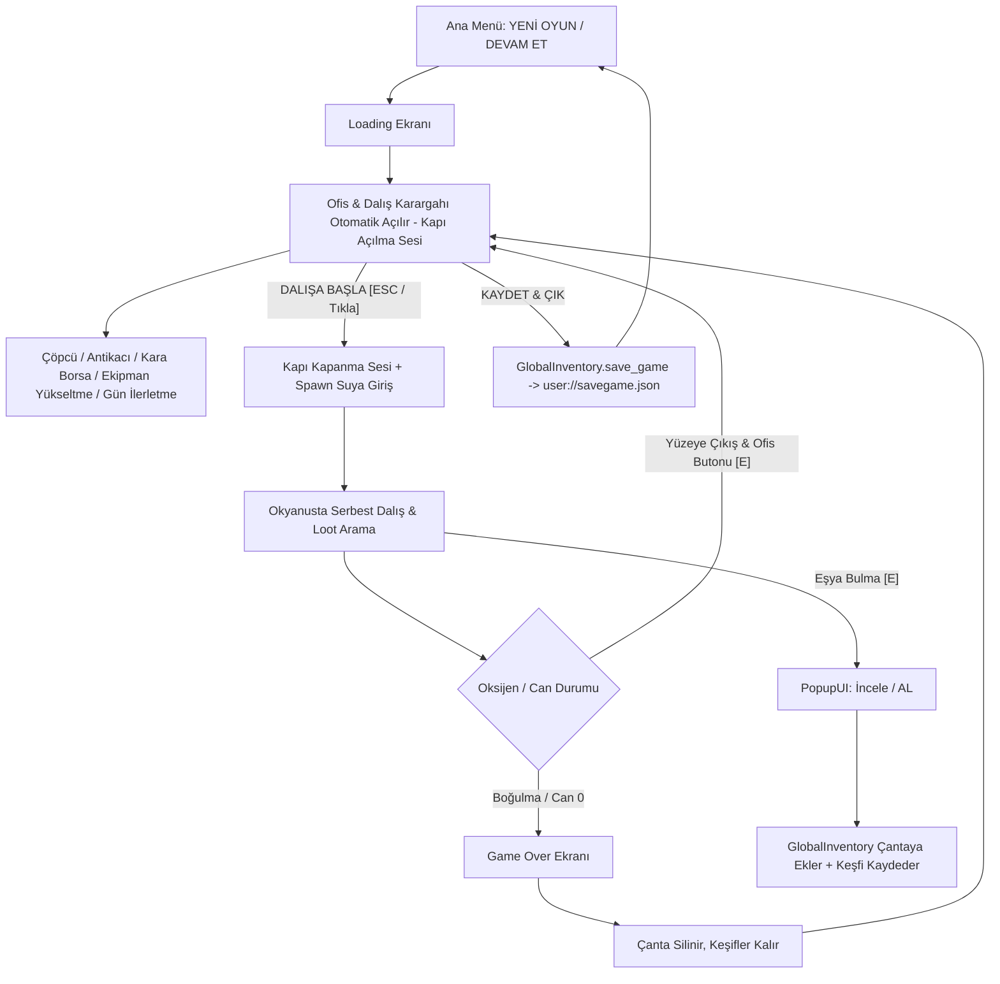

# Dive&Find — Proje Mimari ve Sistem Dokümantasyonu

Bu doküman, **Dive&Find** oyununun motor yapısını, sahne hiyerarşisini, kod mimarisini, veri modellerini, matematiksel formüllerini ve sistemler arası sinyal ağını detaylıca açıklar.

---

## 1. Oyun Döngüsü & Genel Bakış (Core Game Loop)

---

## 2. Autoload (Singleton) Sistemleri

Proje genelinde `project.godot` üzerinden 3 temel Autoload tanımlıdır:

| Autoload Adı | Script Dosyası | Sorumluluk Alanı | Temel Değişkenler & Sinyaller |
| :--- | :--- | :--- | :--- |
| **`GlobalInventory`** | [`Scripts/global_inventory.gd`](file:///home/hakan/dive&find/Scripts/global_inventory.gd) | Çanta içeriği, keşif defteri, `.tres` önbelleği ve **Tam Oyun Save/Load Motoru** | `collected_items: Array[ItemData]` `discovered_items: Dictionary` `save_game()`, `apply_save_to_game()`, `apply_save_to_player()`, `remove_items_bulk()`, `has_save()` Signals: `inventory_updated`, `collection_updated(item)` |
| **`GlobalEconomy`** | [`Scripts/GlobalEconomy.gd`](file:///home/hakan/dive&find/Scripts/GlobalEconomy.gd) | Para (Zurna) yönetimi, harcama ve bakiye sorgulama | `money: int` Signals: `money_changed(new_amount)` |
| **`GlobalSoundManager`** | [`Scripts/global_sound_manager.gd`](file:///home/hakan/dive&find/Scripts/global_sound_manager.gd) | SFX bus ses yönetimi, Spotify shuffle müzik çaları, kapı sesleri (`door_open`, `door_close`) | `sfx_paths: Dictionary` `play_sfx(sound_name)` Buses: `"Music"`, `"SFX"` |
| **`GlobalTime`** | [`Scripts/global_time.gd`](file:///home/hakan/dive&find/Scripts/global_time.gd) | Dinamik gün ve saat döngüsü (10:00 başlangıç, 19:00 mesai sonu, 15dk adımlar), dalış kilidi, günlük bilanço takibi | `current_day`, `current_hour`, `current_minute` `start_new_day()`, `is_dive_allowed()` |
| **`DevConsole`** | [`Scripts/dev_console.gd`](file:///home/hakan/dive&find/Scripts/dev_console.gd) | Küresel hile ve geliştirici konsolu (`é` / `~` tuşu & mobilde `[~] KONSOL` butonu). **DevCode Güvenlik Kilidi:** Ayarlar menüsünden gizli kod girilmedikçe kilitlidir; kilitliyken `é` tuşu ve ofisteki mobil konsol butonu tamamen devre dışıdır. | `is_unlocked: bool`, `is_dev_console_unlocked()`, `set_dev_unlocked(bool)` `money`, `upgrade`, `upgrade_all`, `fill_inv`, `god`, `surface`, `tp`, `office`, `die`, `time`, `add_time`, `time_speed`, `skip_day` Layer: `128` |

---

## 3. Geliştirici & Hile Konsolu & DevCode Güvenlik Sistemi

| Komut | Parametre | Açıklama | Örnek Kullanım |
| :--- | :--- | :--- | :--- |
| **`help`** | - | Tüm kayıtlı komutları listeler | `help` |
| **`clear`** | - | Konsol ekranını temizler | `clear` |
| **`money`** | `<miktar>` | Cüzdana Zurna ekler / çıkarır | `money 5000` |
| **`upgrade`** | `<tube|fins|goggles|bag|flashlight> [seviye]` | Seçilen ekipmanın seviyesini ayarlar veya +1 artırır | `upgrade tube 5`, `upgrade flashlight 10` |
| **`upgrade_all`**| `[seviye]` | 5 ekipmanı birden o seviyeye ayarlar veya +1 artırır | `upgrade_all 4` |
| **`flashlight`** / **`fener`** | `[seviye\|on\|off]` | Feneri açıp kapatır veya doğrudan istenen seviyeye çeker | `flashlight`, `flashlight on`, `flashlight 15` |
| **`battery`** / **`batarya`** | `[miktar]` | Fener bataryasını tamamen doldurur veya istenen değere ayarlar | `battery`, `battery 50` |
| **`fill_inv`** | - | Çantayı kapasitesi dolana kadar rastgele eşyalarla doldurur | `fill_inv` |
| **`god`** | - | Ölümsüzlük modunu açar/kapatır (Can ve oksijen tükenmez) | `god` |
| **`surface`** | - | Karakteri anında su yüzeyine (0 metreye) ışınlar | `surface` |
| **`tp`** | `<metre>` | Karakteri belirtilen derinliğe anında ışınlar | `tp 700` |
| **`office`** | - | Nerede olunursa olunsun Ofis Karargahını anında açar | `office` |
| **`die`** | - | Karakteri anında öldürüp Game Over ekranını tetikler | `die` |
| **`time`** | `<saat> [dakika]` | Oyun saatini doğrudan ayarlar | `time 18 45` |
| **`add_time`** | `<dakika>` | Saati belirtilen dakika kadar ileri sarar | `add_time 30` |
| **`time_speed`**| `<çarpan>` | Zaman akış hızını hızlandırır/yavaşlatır | `time_speed 5.0` |
| **`skip_day`** | - | Günü anında 19:00'a sarıp Gün Özeti Ekranını açar | `skip_day` |
| **`darkness`** / **`karartma`** | `[0.0-1.0\|reset\|abis\|day]` | Çevre aydınlığını/kararmasını test eder veya ayarlar | `darkness 0.05`, `darkness reset` |

---

## 4. Dinamik Gün & Saat Döngüsü (Day & Time Loop)

- **Mesai Başlangıcı:** `10:00` (Ofis ve dalış açık)
- **Mesai Sonu / Dalış Kesintisi:** `19:00` (Ofiste yeni dalışlar kilitlenir, "GÜNÜ BİTİR & İLERLET" vurgulanır)
- **Zaman Akışı:** Her `30` gerçek saniyede bir saat `15` oyun dakikası ilerler (Bir tam günlük dalış mesaisi ~`18` dakika sürer). Saat hem okyanusta hem ofiste küresel olarak kesintisiz akar.
- **Erken Gün Bitirme Uyarısı:** Mesai (19:00) bitmeden "Günü İlerlet" basıldığında onay paneli çıkar; teyit edilirse gün erken kapatılır.
- **Gün Özeti & Bilanço Ekranı ([`Scenes/day_summary.tscn`](file:///home/hakan/dive&find/Scenes/day_summary.tscn)):**
  - Günlük toplam kazanç (+Zurna)
  - Yapılan toplam dalış sayısı
  - Satılan eşya adedi
  - Ulaşılan en derin nokta
  - Çanta durumu
  - "YENİ GÜNE BAŞLA ☀️" tıklandığında oyun otomatik kaydedilir, havalı bir `loading_screen` (1.6 sn) geçişi çalışır ve yeni güne (Saat 10:00) ofisten başlanır.

---

## 3. Kayıt ve Yükleme Sistemi (Save / Load)

- **Merkez**: [`Scripts/global_inventory.gd`](file:///home/hakan/dive&find/Scripts/global_inventory.gd)
- **Kayıt Yolu**: `user://savegame.json`
- **Kaydedilen Veriler**:
  - `current_day` (Mevcut gün sayısı)
  - `current_hour`, `current_minute` (Mevcut saat ve dakika)
  - `money` (Cüzdandaki toplam Zurna)
  - `equipment` (`tube_level`, `fins_level`, `goggles_level`, `backpack_level`)
  - `inventory_paths` (Çantadaki eşyaların `.tres` dosya yolları)
  - `inventory_locked` (Çantadaki eşyaların kilit durumları - Array[bool])
  - `save_time` (Kayıt tarihi ve saati)
- **Ana Menü Entegrasyonu**:
  - **"YENİ OYUN"**: `GlobalInventory.start_new_game()` çağırır. Diskteki kaydı siler, çantayı boşaltır, parayı sıfırlar (0), `GlobalTime`'ı Gün 1 ve saat 10:00'a resetler (`reset_to_new_game()`), mesai kilidini kaldırır, oyuncu ekipmanlarını varsayılana (Tüp 1, Palet 0, Gözlük 0, Çanta 0) çeker ve ofiste başlatır.
  - **"DEVAM ET"**: Kayıtlı oyun varsa aktifleşir; fare üzerine gelince detaylı kayıt özeti tooltip'i gösterir (Gün, Para, Eşya, Ekipman Seviyeleri, Tarih) ve ofiste başlatır.
- **Ofis Entegrasyonu**:
  - "KAYDET & ÇIK" tıklandığında anlık durum diske yazılır, kapı kapanma sesi çalar ve ana menüye dönülür.

---

## 4. Veri Modelleri & Kategori Renk Sistemi

### 4.1. Eşya Verisi — `ItemData`
- **Script**: [`Scripts/ItemData.gd`](file:///home/hakan/dive&find/Scripts/ItemData.gd) (`extends Resource`, `class_name ItemData`)
- **Dosyalar**: `res://all_items_tres/*.tres` (30 Adet Tanımlı Eşya)
- **Kategori Dağılımı ve Standart Renkler**:

| Kategori (`category`) | Görsel Renk Tonu | Hex / RGBA | Anlamı & Kabul Eden Dükkan |
| :--- | :--- | :--- | :--- |
| **`Trash`** | Gri / Taş | `Color(0.65, 0.65, 0.65)` | Düşük değerli atıklar $\rightarrow$ **ÇÖPCÜ** |
| **`Resource`** | Cyan / Açık Mavi | `Color(0.25, 0.75, 0.95)` | Hammaddeler (Craft için ayrılmıştır, dükkanlarda satılmaz) $\rightarrow$ **LABORATUVAR** |
| **`Rare Found`** | Mor / Magenta | `Color(0.75, 0.40, 0.95)` | Nadir buluntular $\rightarrow$ **ANTİKACI** |
| **`Valuable`** | Altın Sarısı | `Color(0.95, 0.80, 0.20)` | Yüksek değerli eşyalar $\rightarrow$ **ANTİKACI** |
| **`Special`** | Mercan / Kırmızı | `Color(0.95, 0.30, 0.45)` | Özel buluntular $\rightarrow$ **KARA BORSA** |

### 4.2. Ekipman Geliştirme Verisi — `EquipmentUpgradeData`
- **Script**: [`Scripts/EquipmentUpgradeData.gd`](file:///home/hakan/dive&find/Scripts/EquipmentUpgradeData.gd)
- **Formül**: $\text{Cost} = \text{round}(\text{base\_cost} \times \text{cost\_multiplier}^{\text{level}})$

| Ekipman | Başlangıç | Max Level | Base Cost | Cost Multiplier | Açıklama & Etki |
| :--- | :--- | :--- | :--- | :--- | :--- |
| **Oksijen Tüpü** | Lvl 1 | **Sınırsız (-1)** | **`35 Zurna`** | **`1.50`** | Her seviyede $+1.25$ verimlilik |
| **Palet (Hız)** | Lvl 0 | **`20`** | 25 Zurna | `1.65` | Her seviyede $+55\text{ px/s}$ yüzme hızı |
| **Gözlük (Görüş)** | Lvl 0 | **`9`** | **`100 Zurna`** | **`2.10`** | Her seviyede $-0.04$ min zoom (Lvl 9'da max zoom out: 0.09) |
| **Çanta** | 5 Slot | **`20`** | 20 Zurna | `1.50` | Her seviyede $+5$ slot kapasite (Max 105 slot) |

---

## 5. Oynanış ve Karakter Fiziği — `player_controller.gd`

- **Sınıf**: [`Scripts/player_controller.gd`](file:///home/hakan/dive&find/Scripts/player_controller.gd) (`extends CharacterBody2D`, Grup: `"player"`)
- **Spawn**: Su yüzeyinin $60\text{px}$ üstünden $450\text{px/s}$ hızla anında ve dinamik dalış.
- **Ekipman Seviyeleri**: `GlobalInventory.apply_save_to_player(self)` ile kayıtlı oyundan otomatik yüklenir.
- **Hareket & Yüzme**: `max_speed` ($220 + \text{fins\_level} \times 55$), `acceleration` ($600 + \text{fins\_level} \times 137.5$), `friction`, `sink_speed`, `max_sink_velocity`.
- **Hızlı Yüzme / Depar (Shift Sprint)**:
  - **Tetikleyici**: `[Shift]` tuşu (yalnızca hareket ederken ve $O_2 > 0$ iken aktifleşir).
  - **Hız & İvmelenme**: `sprint_speed_bonus = 110.0 px/s`, `sprint_accel_multiplier = 1.45x` (taban hız $220 \rightarrow 330\text{ px/s}$, +%50 hız artışı).
  - **Oksijen Tüketimi**: `sprint_oxygen_multiplier = 2.6x` (su altında depar atarken tüp 2.6 kat daha agresif tükenir).
  - **Dinamik HUD Senkronizasyonu**: Dalgıç depar attığı an `get_surface_return_info()` içindeki aktif tüketim anında 2.6 katına çıkar, HUD'daki kalan süre (`oxygen_seconds_left`) 0ms gecikmeyle anında düşer ve yanına `⚡` depar rozeti eklenir (`🫧 O2: ~11s ⚡`). Yüzeye dönüş uyarısı (`time_to_surface`) taban hızı baz alarak gösterge histerezisini (alarm titremesi) önler.
  - **Animasyon Senkronizasyonu**: Depar anında bacak çırpma animasyon hızı tavanı $\%25$ artarak (`max_anim_speed * 1.25`) akıcı ve tatmin edici bir yüzüş hissiyatı verir.
- **Kamera & Görüş**: Başlangıç zoom $0.45$, min zoom $0.45 - (\text{goggles\_level} \times 0.04)$.
- **Yüzey Sekme Kuvveti**: `InfiniteMapManager.water_surface_y` üstüne çıkmaya çalıştıkça aşağı iten yay kuvveti (`surface_push_force`).
- **Derinlik & Oksijen Dengesi**:
  $$\text{depth\_m} = \max\left(0, \frac{\text{global\_position.y} - \text{water\_surface\_y}}{\text{pixels\_per\_meter}}\right)$$
  $$\text{drain\_rate} = \text{base\_oxygen\_drain\_rate} \times \left(\frac{1.0 + \frac{\text{depth\_m}}{250.0}}{1.0 + (\text{tube\_level} - 1) \times 1.25}\right) \times (\text{sprint\_oxygen\_multiplier if sprinting else } 1.0)$$
- **Yüzeye Dönüş & Güvenlik Analizi (`get_surface_return_info()`):**
  - Dalgıcın anlık derinliğinden yüzeye dikey çıkış süresi: $t_{\text{surface}} = \frac{\text{dist\_y}}{\text{base\_max\_speed}}$
  - Çıkış esnasında derinlik azaldığı için ortalama tüketim hızı: $\text{drain}_{\text{avg}} = \frac{\text{drain}_{\text{current}} + \text{drain}_{\text{surface}}}{2}$
  - Yüzeye varış için gereken asgari oksijen: $\text{O2}_{\text{needed}} = t_{\text{surface}} \times \text{drain}_{\text{avg}}$
  - Güvenlik Payı & Toast Uyarısı: $\text{current\_oxygen} \le \text{O2}_{\text{needed}} \times 1.25$ olduğunda uyarı, $\le \text{O2}_{\text{needed}}$ olduğunda acil durum toast ve ses bildirimi tetiklenir; HUD üzerinde kalan süre dinamik gösterilir.
- **Can & Boğulma**: Oksijen $\%15$ altındayken yavaş, $\%0$ iken agresif can kaybı. Can sıfırlanınca `Scenes/game_over.tscn` açılır.

---

## 6. Sonsuz Harita & Katman Mimarisi — `map_maker.gd`

- **Script**: [`Scripts/map_maker.gd`](file:///home/hakan/dive&find/Scripts/map_maker.gd) (`class_name InfiniteMapManager`)
- **Katmanlar**: Sky $\rightarrow$ lvl0 (Yüzey) $\rightarrow$ lvl1-lvl7 (Okyanus Katmanları) $\rightarrow$ Ground (Zemin).
- **Dinamik Yükleme**: Kamera hareketine göre chunk'lar dinamik yüklenir ve silinir.

---

## 7. Eşya Üretim ve Katman Havuzlama — `item_spawner.gd`

- **Script**: [`Scripts/item_spawner.gd`](file:///home/hakan/dive&find/Scripts/item_spawner.gd) (`class_name ItemSpawner`)
- **Katman Eşleşmesi (Derinlik)**:
  - Katman 1: `Trash`
  - Katman 2: `Trash`, `Resource`
  - Katman 3: `Resource`, `Rare Found`
  - Katman 4: `Resource`, `Rare Found`, `Valuable`
  - Katman 5-6: `Valuable`, `Resource`
  - Katman 7: `Valuable`, `Resource` + Ultra Nadir **`Special`** (`special_item_chance = 0.05` / %5 bağımsız zar filtresi)
- **Günlük Akıntı & Restock Döngüsü (Tükenme & Yenilenme)**:
  - **Aynı Gün İçi Tüketim**: Bir chunk o gün spawn edildiğinde `_spawned_chunk_indices_today` sözlüğüne işlenir. Oyuncu o gün 2 chunk uzağa yüzüp dönse bile o bölgede aynı gün tekrar eşya doğmaz (border-hopping sonsuz farm exploiti engellendi).
  - **Yeni Gün Yenilenmesi**: `GlobalTime.day_changed` tetiklendiğinde `_spawned_chunk_indices_today.clear()` çalışır, okyanus akıntıları gelir ve tüm okyanus baştan taze eşyalarla donatılır.
- Ağırlıklı rastgele seçim: `rarity` (weight) üzerinden derinlik katmanlarına göre hesaplanır. Katman 7'de her eşya doğuşunda %5 zar atılarak Özel (Special) kategori seçilir, aksi halde katmanın normal değerli/hammadde havuzu kullanılır.

---

## 8. Kullanıcı Arayüzü (UI/UX) & Menü Mimarisi

### 8.1. Ana Menü ([`Scripts/main_menu.gd`](file:///home/hakan/dive&find/Scripts/main_menu.gd) & `Scenes/main_menu.tscn`)
- **YENİ OYUN & DEVAM ET**:
  - `DEVAM ET`: Kayıtlı oyun varsa aktif, fare üzerinde detaylı save özeti tooltip'i (Gün, Para, Eşyalar, Ekipmanlar, Kayıt Tarihi).
  - `YENİ OYUN`: Sıfırdan temiz bir başlangıç açar.
  - **Toggle Panel Mimarisi:** Ana menüdeki `Koleksiyon`, `Ayarlar` ve `Bilgi` butonları toggle (aç/kapa) mantığıyla çalışır. Açık olan bir pencere varken butona tekrar basıldığında kapanır; başka bir pencere açıldığında önceki pencere otomatik temizlenir. Üst üste birden fazla pencere yığılması engellenmiştir.
- **Grafiksel Başlık & Sinematik Animasyonlar**:
  - `Sprites/header.png` (TextureRect): Ekranın üst-ortasında konumlandırılmış yüksek çözünürlüklü grafiksel başlık. Açılışta yumuşak düşüş animasyonu (`_animate_enter`), devamında ise `_update_title_bobbing` ile kesintisiz su altı dalga salınımı (`sin * 4.0px`) yapar.
  - `Sprites/game_bg.png` (SkyTexture): Tam ekranı kaplayan (`stretch_mode = 6` Cover) sabit ve berrak ana menü okyanus arka planı.
  - Menü butonları soldan kademeli kayma (`-70px` cubic out) ve ardışık buton fade-in geçişiyle açılır.
  - Sağ taraftaki Yenilikler paneli (`ChangelogPanel`) sağdan pürüzsüz kayarak yerleşir.
- **Sürüm Yönetimi & Yenilikler Paneli**:
  - `@export var game_version: String` değişkeni hem `VersionLabel` hem Bilgi panelini senkronize eder.
  - **Yenilikler & Güncellemeler Paneli (`ChangelogPanel` / `ChangelogText`):** Ana menünün sağ tarafında Pre-Alpha sürüm notlarını (kaydırılabilir, BBCode renkli formatta) oyuncuya sunar.
- **Koleksiyon Sıfırlama Güvenlik Onay Kutusu (`_show_reset_collection_confirmation`):**
  - Ayarlar panelindeki "KOLEKSİYONU SIFIRLA" butonuna tıklandığında doğrudan silmek yerine modal onay penceresi açılır.
  - Karartılmış arka plan (`0.75` alpha), altın kenarlı ahşap denizci paneli (`Color(0.12, 0.08, 0.05, 0.98)`), "VAZGEÇ" ve kırmızı "EVET, SIFIRLA 🗑️" butonları içerir.
  - Dışarıya tıklanarak veya `ESC` tuşuyla güvenli bir şekilde kapatılabilir. Sıfırlama onaylandığında buton üzerinde 1.5 saniye "SIFIRLANDI!" geri bildirimi verilir.

### 8.2. Ofis & Dalış Karargahı ([`Scripts/office_menu.gd`](file:///home/hakan/dive&find/Scripts/office_menu.gd) & `Scenes/office_menu.tscn`)
- **Tam Ekran Opak Yatay Düzen**:
  - Oyun açılışında otomatik olarak oyuncuyu karşılar (Kapı açılma sesiyle).
  - **Üst Bar**: Başlık, Gün Sayacı, "GÜNÜ İLERLET ☀️" (Erken gün onay popup'lı), Zurna Cüzdan Rozeti, Mobil Hile/Geliştirici Konsolu Butonu (`"[~] KONSOL"` — yalnızca `OS.has_feature("mobile")`), "KAYDET & ÇIK" (`GlobalInventory.save_game`).
  - **Canlı Tüccar Rozetleri (Loot Badges & Glow)**:
    - Çantadaki eşyaları anlık tarayarak Çöpçü (`🟢 3 Hurda (+180 Z)`), Antikacı (`🟢 1 Antika (+90 Z)` - Ham maddeler craft için hariç tutulur) ve Kara Borsa (`🔴 1 Özel (+300 Z)`) kartlarının üstünde canlı rozetler gösterir.
    - Satılabilir eşyası olan tüccarlar şık bir nabız / nefes alma animasyonuyla (`Pulse Glow Tween`) hafifçe parıldar.
    - Ekipman Atölyesi kartı, cüzdandaki para herhangi bir geliştirmeye yetiyorsa parıldayan `✨ Yükseltme Hazır!` rozeti takar.
  - **Alt Menü Toggle & Dalış Temizliği (`_close_all_submenus()`):**
    - Ofis içindeki tüm satıcılar (Çöpçü, Antikacı, Kara Borsa), tesisler (Atölye, Laboratuvar, Pazar), Çanta ve Koleksiyon butonları toggle mantığına sahiptir; aynı butona tekrar basıldığında pencere kapanır.
    - Bir alt menü açıkken "Dalışa Başla" basıldığında veya ofis kapandığında `_close_all_submenus()` tetiklenerek okyanusta sahnelerin açık kalması tamamen engellenir.
  - **ESC Kapatma Hiyerarşisi**: Açık bir tüccar, çanta veya koleksiyon penceresi varsa `ESC` önce o alt pencereyi kapatır; alt pencere yoksa dalışı başlatır.
  - **Rastgele Dalış Konumu (Keşif Varyansı)**: `@export var ocean_spawn_x_variance: float = 3000.0` ile ofisten her dalışa geçildiğinde dalgıç merkez x: 16 koordinatının sağına veya soluna rastgele saparak (±3000 px aralığında) suya girer. Bu sayede her dalışta farklı bir su altı bölgesi keşfedilir.
  - **Alt Tesisler Bölgesi**: Ekipman Mağazası, Laboratuvar, Satış Pazarı.
  - **Alt Bar**: Çanta [I], Koleksiyon [C], Dinamik Toast Bildirimleri, Dalışa Başla [ESC].

---

## 8. Okyanus HUD & Kompakt Arayüz Mimarisi (`canvas_layer.gd`)

- **Sağ Üst Action Bar & Bağlamsal Eylemler:**
  - `💰 0 Zurna`: Koyu ahşap ve eskitilmiş altın çerçeveli kompakt cüzdan rozeti.
  - `🎒 Çanta [I] (%d/%d)`: Çanta butonu ve klavye kısayolu ([I] / [Tab]). Çanta dolduğunda kırmızı uyarı tonu alır.
  - `🚤 Tekneye Çık [E]` (Bağlamsal Ofise Dönüş): Dalgıç suyun dibindeyken ekranda gereksiz yer kaplamaz, tamamen gizlenir (`modulate.a = 0.0`). Yüzeye yaklaşıldığında yumuşakça parıldayarak belirir ve klavyeden `[E]` tuşuyla da tekneye binilebilir.
- **Kompakt Ekipman Dock'u (`EquipmentDock`):**
  - Eski 260x220 dev kutu yerine sağ altta 195x50 boyutlarında ultra hafif ve ferah yatay dock.
  - Atölyedeki orijinal ikonlar kullanılır (`oksijen_tupu.png`, `palet.png`, `dalis_gozluk.png`, `canta.png`, `flaslight.png` [Fener]).
  - Her ikonun altında anlık seviye (`Lv.0` - `Lv.10`), üzerine gelindiğinde detaylı bilgilendirme tooltip'i gösterilir.
- **Responsive Anchor Düzeni:**
  - `TimePanel` ekranın tam üst ortasına (`anchors_preset = 5`) kilitlendi, her ekran oranında merkezlenir.
  - `Depth` göstergesi sol alt köşeye bağlandı (`anchors_preset = 2`).
- **Canlı Yüzey & Derinlik Takibi:**
  - `⚓ DERİNLİK: 45m  |  ↑ Yüzey: 45m` formatı ile oyuncunun yüzeye olan mesafesi anlık bildirilir. Yüzeydeyken `⚓ YÜZEYDESİN (0m)` yazar.
- **Kritik Oksijen Nabız Alarmı:**
  - Oksijen %25'in altına düştüğünde oksijen göstergesi kırmızı nabız gibi parıldayarak (`Pulse Tween`) oyuncuyu uyarır.

---

## 9. Sahne ve Script Çapraz Referans Tablosu

| Sahne (`.tscn`) | Bağlı Script (`.gd`) | Açıklama |
| :--- | :--- | :--- |
| `Scenes/main_menu.tscn` | `main_menu.gd` | Ana menü (Yeni Oyun, Devam Et + Tooltip, Ayarlar, Sürüm) |
| `Scenes/main.tscn` | `canvas_layer.gd`, `player_controller.gd`, `map_maker.gd`, `item_spawner.gd` | Ana dalış dünyası ve HUD |
| `Scenes/office_menu.tscn` | `office_menu.gd` | Ofis & Dalış Karargahı (Tam Ekran Yatay Hub, Kaydet & Çık) |
| `Scenes/loading_screen.tscn` | `loading_screen.gd` | Yükleme ekranı & `.tres` önbellekleyicisi |
| `Scenes/pickup.tscn` | `popupui.gd` | Eşya inceleme & alma pop-up'ı (Keşfedilmemiş eşyalar için nabız animasyonlu `✨ YENİ KEŞİF` rozeti, önizleme modu) |
| `Scenes/inventory.tscn` | `inventory.gd` | Çanta arayüzü & toplam değer |
| `Scenes/inventory_slot.tscn` | `inventory_slot.gd` | Kategori renkli dinamik slot |
| `Scenes/equstore.tscn` | `equstore.gd` | Ekipman mağazası |
| `Scenes/equipment_slot.tscn` | `equipment_slot.gd` | Ekipman yükseltme hücresi |
| `Scenes/copcu.tscn` | `item_seller.gd` | Sadece Trash kategorisi satış dükkanı |
| `Scenes/antikaci.tscn` | `item_seller.gd` | Çöp hariç normal & değerli eşya satışı |
| `Scenes/kara_borsa.tscn` | `item_seller.gd` | Özel kategori eşya satışı (Koyu kırmızı temalı, 2 kolonlu optimize responsive düzen) |
| `Scenes/collection.tscn` | `collection.gd` | Keşif defteri (Önizleme kartı açılışlı) |
| `Scenes/collection_slot.tscn` | `collection_slot.gd` | Keşif defteri hücresi (Tıklanabilir keşifler) |
| `Scenes/game_over.tscn` | `game_over.gd` | Boğulma / ölüm ekranı |
| `Scenes/laboratory.tscn` | `laboratory.gd` | Kompakt sentez/crafting tezgahı & JSON tarif okuyucusu |
| `Scenes/pazar.tscn` | `item_seller.gd` | Üretilen Crafted eşyaların satıldığı ihracat pazarı |
| `all_items_tscn/item_temp.tscn` | `interactable_item.gd` | Haritadaki toplanabilir eşya tabanı |

---

## 10. Envanter (Çanta) & Satış Ekranı QOL Mimarisi

- **Eşya Kilitleme / Koruma Sistemi (Right-Click Lock 🔒):**
  - Çantada veya tüccar ekranında slot üzerine **Sağ Tık** yapıldığında eşyaya kilit vurulur (`is_locked: bool`).
  - Kilitlenen slotların sağ üst köşesinde `🔒` rozeti (`LockBadge`) belirir.
  - **Güvenli Satış (Hepsini Sat Koruması):** `item_seller.gd` içindeki "HEPSİNİ SAT" butonu kilitli eşyaları kesinlikle satmaz, toplam satış tutarını da yalnızca kilitsiz eşyalardan hesaplar. Tüm eşyalar kilitliyse buton devre dışı kalarak `TÜMÜ KİLİTLİ 🔒` yazar.
  - Tekli satış butonuna kilitli bir eşyayla basıldığında satış engellenir ve `error` SFX çalar.
  - Kilit durumları kayıt dosyasına (`user://savegame.json -> inventory_locked`) kaydedilir ve geri yüklenir.
- **Akıcı Hover Önizleme (Instant Preview):**
  - Fare bir slotun üzerine geldiği an (`mouse_entered`), sağdaki detay paneli anında güncellenir. Tıklama zorunluluğu kalkmıştır.
- **Çanta Otomatik Sıralama (Sort):**
  - Çantaya eklenen `🔄 Sırala` butonu tek tıkla çantayı Fiyata Göre (`sort_inventory_by_value()`) veya Türe/Kategoriye Göre (`sort_inventory_by_category()`) dizer.
- **Çanta Doluluk Uyarısı (Audio + Visual Shake):**
  - Çanta tamamen doluyken su altında eşya alınmaya çalışıldığında `GlobalSoundManager.play_sfx("error")` çalar ve "DOLU" butonu kırmızı parıldayarak sağa-sola titrer (`Micro-Shake Tween`).
- **Çantadan Eşya Bırakma / Atma (`🗑️ Bırak`):**
  - Çantada seçilen eşyayı çıkarmak için `DetailPanel` altına `🗑️ Bırak` butonu entegre edildi.
  - **Kilit Koruması:** Kilitli (🔒) eşyalar kaza sonucu atılamaz; buton pasifleşir (`Kilitli eşya atılamaz! 🔒`).
  - **Bağlamsal Bırakma:**
    - **Ofisteyken:** Eşya çantadan doğrudan çöpe atılır/silinir (`GlobalInventory.remove_item()`). Buton metni: `🗑️ Çantadan At`.
    - **Dalıştayken:** Eşya oyuncunun okyanustaki konumuna `item_name` eşleştirmesi üzerinden orijinal sahnesiyle (`all_items_tscn/*.tscn`), orijinal boyut ve ölçeğiyle (`scale` korunarak) fiziksel toplanabilir obje olarak spawn olur. Sahnesi bulunmayan özel/craft eşyalarında `item_temp.tscn` kullanılarak sprite ~220px standart oyun içi boyutuna normalize edilir. Dalgıç dilerse sonradan tekrar toplayabilir. HUD üzerinden `🌊 [Eşya] denize bırakıldı.` bildirimi verilir. Buton metni: `🗑️ Denize Bırak`.
  - **Slot Seçim Göstergesi & İpucu:**
    - Slot tıklandığında altın sarısı çerçeve (`SelectedBorder`, 3px altın kenarlık ve hafif ışıma efekti) ile aktif olarak seçildiği belirginleştirilir.
    - Fare başka bir slota hover yaptığında o slot anlık incelenebilir, fare ayrıldığında ise seçili slotun detaylarına otomatik geri dönülür.
    - Alt kısma `💡 Sol Tık: Eşyayı Seç / Bırak  •  Sağ Tık (Mobilde Basılı Tut): Kilitle 🔒` bilgilendirme ipucu eklendi.
  - **Dinamik Açıklama Metni & Otomatik Sığdırma (Responsive Autowrap & Scaling):**
    - **Envanter (`inventory.tscn` & `inventory.gd`):** `RarityLabel` ve `ValueLabel` yatayda aynı satıra alınarak `DescLabel`'a 109px dikey alan (332px genişlik) açıldı. `autowrap_mode = AUTOWRAP_WORD_SMART` ve 130 karakter üzeri metinlerde otomatik 11px font küçültme koruması eklendi.
    - **İnceleme Pop-up'ı (`pickup.tscn` & `popupui.gd`):** `CardPanel` 490x280px boyutuna genişletildi, `DescLabel` 270x70px minimum boyuta çekilerek uzun açıklamalar için dinamik font ölçeklemesi uygulandı.
    - **Dükkanlar (`item_seller.tscn` & `item_seller.gd`):** Çöpçü, Antikacı ve Pazar ekranlarında `DescLabel` dikey alanı 110px'e genişletildi, font boyutu 15px'ten 12px'e normalize edildi ve dinamik küçültme ile taşma riski sıfırlandı.

---

## 11. Koleksiyon Kitabı & Ekipman Atölyesi QOL Mimarisi

- **Koleksiyon Kitabı Kategori Sekmeleri (`CategoryTabs`):**
  - Üst kısma yerleştirilen `[Hepsi] [🗑️ Çöp] [🧪 Madde] [🏛️ Nadir] [💎 Değerli] [🔴 Özel]` butonları ile 30 eşyalık defter tek tıkla filtrelenir.
  - Seçili kategoriye göre anlık kategori ilerlemesi (`Hammaddeler: 4 / 6 Keşfedildi`) ve genel defter tamamlama yüzdesi (`ProgressBar`) eşzamanlı gösterilir.
  - Aktif filtre sekmesi görsel vurgu alır.
- **Ekipman Atölyesi Stat Kazanç Önizlemesi (`StatPreviewLabel`):**
  - Her ekipman hücresinde bir sonraki yükseltmenin getireceği somut kazanç yeşil renkle açıkça belirtilir:
    - Oksijen Tüpü: `Oksijen: x1.00 ➔ x2.25`
    - Sırt Çantası: `Kapasite: 5 ➔ 10 Slot`
    - Palet: `Hız: +0 ➔ +25 px/s`
    - Dalış Gözlüğü: `Görüş: Lvl 0 ➔ 1`
  - Maksimum seviyeye ulaşan ekipmanlarda `MAKSİMUM SEVİYE` etiketi ve pasif `MAX` butonu gösterilir.
- **Canlı Bakiye ve Yetersiz Para Hesabı:**
  - Paranın yetmediği durumlarda buton pasifleşir ve eksik tutar anlık yazılır: `YETERSİZ (-45 Z)` + detaylı tooltip.
- **Geliştirme Hissiyatı & HUD Senkronizasyonu:**
  - Yükseltme satın alındığında kart hafifçe büyüyüp yerine oturur (`play_upgrade_feedback()`) ve `upgrade` SFX çalar.
  - Atölyede veya geliştirici konsolunda (`upgrade`, `upgrade_all`) ekipman (çanta, tüp, palet, gözlük) geliştirildiğinde `GlobalInventory.inventory_updated.emit()` tetiklenerek okyanus HUD'ındaki çanta kapasitesi (`🎒 Çanta [I] (0/10)`) ve ekipman seviye etiketleri (`Lv.X`) anında güncellenir.
- **Koleksiyon Kitabı Sıfır-Gecikme (RAM Önbellek Mimarisi):**
  - Oyun açılırken `GlobalInventory._ready()` aşamasında tüm eşya `.tres` dosyaları RAM önbelleğine (`_all_items_cache`) bir kez yüklenir.
  - `collection.gd` arayüzü açıldığında veya kategori sekmeleri arasında geçiş yapıldığında diske hiçbir okuma yapılmaz (`get_all_items(false)`), eşyalar hafızada bir kez sıralanıp anında gösterilir. Ana menüde veya oyunda donma/kasma tamamen sıfırlanmıştır.

---

## 12. Juice, Polish & Mikro-Etkileşim Mimarisi

- **Rolling Money Counter (Akıcı Bakiye Sayacı):**
  - Hem okyanus HUD'ında (`canvas_layer.gd`) hem de Ofis menüsünde (`office_menu.gd`), bakiye artışı veya azalışında değer aniden değişmek yerine `Tween.TRANS_QUAD` ile 0.45 saniye içinde yumuşakça yuvarlanarak hedef tutara ulaşır.
- **Floating Cash / Kayan Altın Efekti (`_spawn_floating_cash`):**
  - Dükkanlarda tekli veya toplu satış yapıldığında (`item_seller.gd`) ya da bakiye arttığında, butonun veya cüzdanın üzerinden yukarı doğru süzülerek sönen altın rengi `+X Zurna` kayan etiketleri belirir.
- **Micro-Punch Dokunsal Buton Tepkisi (`_setup_button_juice`):**
  - Butonların üzerine gelindiğinde `scale ➔ 1.03-1.04` hafif kabarma, tıklandığında `scale ➔ 0.95 ➔ 1.0` yaylanma tepkisi vererek arayüze fiziksel ve tatmin edici bir dokunsal hissiyat kazandırır.
- **Bağlamsal Tuş Kısayolları (Seamless Controls):**
  - Dalıştayken `[I]` veya `[Tab]` tuşu ile çanta açma/kapatma.
  - Su yüzeyindeyken `[E]` tuşu ile doğrudan tekneye çıkıp ofis karargahına geçiş.

---

## 13. Yükleme Ekranı & Gerçek Asenkron Yükleme Mimarisi (`loading_screen.gd`)

- **Yenilenen Atmosferik Tasarım ([`Scenes/loading_screen.tscn`](file:///home/hakan/dive&find/Scenes/loading_screen.tscn)):**
  - Eski 3 katmanlı parçalı arkaplan kaldırılarak Ana Menü ile birebir görsel uyumlu `res://Sprites/game_bg.png` (`stretch_mode = 6`) ve sinematik karanlık katmanı (`BackgroundTint`) entegre edildi.
  - Eski mavi metin kutusu yerine ekranın üst-orta alanında şık `res://Sprites/header.png` logo texture'ı ve yumuşak fade-in animasyonu konumlandırıldı.
  - Ortada modern, yarı şeffaf koyu cam efektli `TipCard` (İpucu Kartı) ve dinamik autowrap ile tüyolar gösterilir.
- **İki Dilli (TR / EN) Durum & İstem Metinleri ([`Scripts/loading_screen.gd`](file:///home/hakan/dive&find/Scripts/loading_screen.gd)):**
  - İlerleme aşama metinleri (`StageLabel`) aktif yerel dile (`tr` / `en`) göre dinamik güncellenir:
    - `%0 - %30`: `"Scanning ancient relics and treasures..."` / `"Eski kalıntılar ve hazineler taranıyor..."`
    - `%30 - %65`: `"Preparing city map and harbor animation..."` / `"Şehir haritası ve liman animasyonu hazırlanıyor..."`
    - `%65 - %95`: `"Checking diving gear and equipment..."` / `"Dalış ekipmanları kontrol ediliyor..."`
    - `%95+`: `"Ready to dive!"` / `"Dalışa hazır!"`
  - Devam istemi (`ContinuePrompt`): `"▶ TAP SCREEN OR PRESS ANY KEY TO CONTINUE ◀"` / `"▶ DEVAM ETMEK İÇİN EKRANA DOKUNUN VEYA BİR TUŞA BASIN ◀"`.
- **Gerçek Asenkron Sahne & Şehir Animasyonu Ön Yükleme Motoru (`ResourceLoader.load_threaded_request` & `CityMap.preload_batch`):**
  - Ana sahne (`main.tscn`) ile eşzamanlı olarak `res://Scenes/city_map.tscn` threaded olarak belleğe alınır (`CityMap.city_map_packed`).
  - Arka planda 120 adet 1280x720 animasyon karesi her frame 8'er adet (`CityMap.preload_batch(8)`) akıcı bir şekilde RAM'e aktarılır.
  - İlerleme çubuğu hem ana sahnenin hem de 120 animasyon karesinin yüklenme yüzdesini gerçek zamanlı birleştirir.
  - Devam istemi yalnızca tüm sahneler ve animasyon kareleri RAM'e %100 girdikten sonra açılır; oyuncu tuşa bastığında sahne geçişi **0.00 saniyede (sıfır takılma / anında)** gerçekleşir.
- **SFX Pre-Caching & Ses Takılmalarının Sıfırlanması:**
  - [`global_sound_manager.gd`](file:///home/hakan/dive&find/Scripts/global_sound_manager.gd) içinde `preload_all_sfx()` ve `_sfx_cache` eklendi. Tüm ses efektleri loading esnasında RAM'e alınarak oyun içindeki ilk etkileşim takılmaları (audio stutter) önlendi.
- **Yatay Geniş Loading Bar & Aşama Durumları:**
  - Ekranın alt kenarı boyunca uzanan ince, şık ve neon turkuaz dolgulu ProgressBar (`#00e5ff`).
  - Dinamik yüzde sayacı (`%0 ➔ %100`) ve aşamalı teknik durum metni.
- **Sinematik Geçişler (Fade-to-Black & Fade-in):**
  - Yükleme tamamlandığında ve tuşa basıldığında 0.15sn yumuşak kararma (`Fade to Black`) ile anında geçiş.
  - Ofis karargahı (`office_menu.gd`) açıldığında `$Background.modulate.a` 0.35 saniyede soluktan nete gelerek (`Fade-in`) sinematik bir giriş hissi sunar.
- **Modüler İpucu Sistemi ([`Data/loading_tips.json`](file:///home/hakan/dive&find/Data/loading_tips.json)):**
  - İpuçları koda gömülmek yerine bağımsız JSON dosyasında tutulur. Koda dokunmadan kolayca genişletilebilir.
  - Her yükleme ekranı açılışında rastgele bir oynanış ipucu seçilip gösterilir.

---

## 14. Laboratuvar (Crafting) & Satış Pazarı Mimarisi

- **`Crafted` Kategori Entegrasyonu:**
  - `ItemData.category` enum'ına `"Crafted"` eklendi (`#ff8c00` amber/turuncu zanaat rengi).
  - `inventory_slot.gd`, `popupui.gd`, `inventory.gd` ve `item_seller.gd` arayüzlerine tam uyum sağlandı.
  - **Önemli Kural:** `Crafted` eşyalar `ItemSpawner` havuzuna **asla dahil edilmez**, okyanusta doğal olarak spawn olmaz. Sadece Laboratuvarda üretilir ve Pazarda satılır.
- **Modüler Tarif Fihristi ([`Data/recipes.json`](file:///home/hakan/dive&find/Data/recipes.json)):**
  - Tarifler kod dışından JSON ile tanımlanır. Yeni tarif eklemek için kod değiştirmeye gerek yoktur.
  - Her tarif; id, ad, açıklama, çıktı `.tres` yolu, Zurna masrafı ve gerekli malzeme listesini (`ingredients`) içerir.
- **Kompakt Laboratuvar & Sentez Masası ([`Scenes/laboratory.tscn`](file:///home/hakan/dive&find/Scenes/laboratory.tscn) & [`Scripts/laboratory.gd`](file:///home/hakan/dive&find/Scripts/laboratory.gd)):**
  - 860x540 kompakt ofis tasarımında açılan sentez penceresi.
  - Sol taraf: Tarif fihristi (kartlar üzerinde anlık malzeme stok durumu `2/2 ✅` ve üretilebilirlik vurgusu).
  - Sağ taraf: Seçili ürün detayları, çanta stoğu, Zurna maliyeti ve üretim butonu.
  - **Kilit Güvenliği (Right-Click Lock 🔒):** Çantada kilitlenmiş eşyalar asla craft malzemesi olarak harcanmaz.
  - **Net Slot Hesabı (Çanta Doluluk Fixi):** Üretim öncesi `net_slot_change = 1 - total_consumed` hesabı yapılır. Malzemeler harcandığında yer açılıyorsa çanta başlangıçta full olsa dahi craft'a izin verilir.
  - **Görsel Geri Bildirim:** Üretimde yeşil `✨ +1 [Eşya Adı]` kayan metin efekti, mikro-punch yaylanması ve `upgrade` SFX.
- **Satış Pazarı ([`Scenes/pazar.tscn`](file:///home/hakan/dive&find/Scenes/pazar.tscn)):**
  - `item_seller.gd` motorunu `shop_filter = "CraftedOnly"` ile kullanan ihracat dükkanı.
  - Üretilen eşyaların toplu satışı, kilit koruması ve kayan altın kazanç efektleri hazır olarak çalışır.
- **Aktif Tarifler ve Ürünler (Dengelenmiş Ekonomi):**
  - `İşlenmiş Plastik Bobini` (38 Z) ➔ 3x Pet şişe + 2x Poşet + 3 Zurna (Maliyet: 22 Z, Kar: +16 Z) ([`all_items_tres/geri_donusum_plastigi.tres`](file:///home/hakan/dive&find/all_items_tres/geri_donusum_plastigi.tres))
  - `Ananas Suyu` (85 Z) ➔ 2x Ananas? + 5 Zurna (Maliyet: 45 Z, Kar: +40 Z) ([`all_items_tres/ananas_suyu.tres`](file:///home/hakan/dive&find/all_items_tres/ananas_suyu.tres))
  - `Preslenmiş Alüminyum Bloğu` (95 Z) ➔ 2x Bükük kola + 2x Bükük pepsi + 1x Monster Kutusu + 1x Bükük Çatal + 12 Zurna (Maliyet: 52 Z, Kar: +43 Z) ([`all_items_tres/aluminyum_blogu.tres`](file:///home/hakan/dive&find/all_items_tres/aluminyum_blogu.tres))
  - `Tropikal Radyoaktif Kokteyl` (295 Z) ➔ 1x Gizemli Şişe + 2x Ananas? + 1x Monster Kutusu + 15 Zurna (Maliyet: 165 Z, Kar: +130 Z) ([`all_items_tres/radyoaktif_kokteyl.tres`](file:///home/hakan/dive&find/all_items_tres/radyoaktif_kokteyl.tres))
  - `Restore Edilmiş Tablo` (3950 Z) ➔ 1x Kırık Altın Çerçeve + 1x Zoktayın Saç Renginde Boya + 1x Isırılmış Kitap + 150 Zurna (Maliyet: 2844 Z, Kar: +1106 Z) ([`all_items_tres/restore_tablo.tres`](file:///home/hakan/dive&find/all_items_tres/restore_tablo.tres))
- **Koleksiyon Defteri Entegrasyonu:**
  - `collection.gd` ve `collection_slot.gd` içine `Crafted` (amber/turuncu zanaat rengi) eklendi.
  - Koleksiyon arayüzüne `🔨 Üretilen` sekmesi ([`Scenes/collection.tscn`](file:///home/hakan/dive&find/Scenes/collection.tscn)) entegre edildi.
  - Laboratuvarda ürün üretildiğinde `resource_path` kaybı engellenerek `GlobalInventory._mark_discovered()` tetiklemesi sağlandı; üretilen ürün anında koleksiyon defterinde keşfedilmiş olarak açılır.

---

## 15. Mobil & Dokunmatik Uyumluluk Mimarisi (Cross-Platform / Hybrid Input)

- **Tek Kod Tabanı (Single Codebase, Zero PC Overhead):**
  - Proje klonlanmadan, PC geliştirme akışını (WASD + Fare) %100 koruyarak hibrit girdi desteği sunar.
  - Mobil kontroller yalnızca `OS.has_feature("mobile")` veya `DisplayServer.is_touchscreen_available()` aktif olduğunda yüklenir; masaüstünde sıfır görsel ve işlemci maliyeti vardır.
- **Proje Seviyesi Dokunmatik Ayarları ([`project.godot`](file:///home/hakan/dive&find/project.godot)):**
  - `display/window/handheld/orientation = 0` (landscape - sabit yatay ekran kilidi).
  - `DisplayServer.screen_set_orientation(SCREEN_LANDSCAPE)` ile açılışta kod seviyesinde yatay zorlama.
  - `pointing/emulate_mouse_from_touch = true` (Telefonda dokunmalar tüm butonları fare gibi tıklar).
  - `boot_splash/show_image = true` (İkonlu açılış ekranı).
- **İzole Mobil Kontrol Katmanı ([`Scenes/mobile_controls.tscn`](file:///home/hakan/dive&find/Scenes/mobile_controls.tscn) & [`Scripts/mobile_controls.gd`](file:///home/hakan/dive&find/Scripts/mobile_controls.gd)):**
  - **Dinamik Sanal Joystick:** Ekranın sol yarısına dokunulduğunda parmak hizasında beliren, 360° analog yüzüş açısı sağlayan vektörel analog stick. Ayarlar panelindeki `controls/joystick_scale` değeriyle dinamik olarak yeniden ölçeklenir.
  - **Akıllı İncele/Etkileşim Düğmesi (`🖐️ [Eşya Adı]`):** Sağ altta yer alır; dalgıç denizde bir eşyanın menziline girdiğinde dinamik olarak parlar ve detaylı inceleme penceresini açar.
  - **Mobil Depar Toggle Butonu (`⚡ DEPAR` / `⚡ AÇIK`):** İncele butonunun hemen solunda yer alır (80x60px). Tek dokunuşla depar modunu açar/kapatır (`mobile_sprint_active`). Aktifken altın rengi parlar, hareketsiz kalındığında oksijen harcamaz, oksijen bittiğinde otomatik kapanır.
  - **Hızlı Alma Butonu (`⚡ DİREKT AL` / `quick_pickup()`):** İncele butonunun hemen üstünde yer alır. Eşyayı popup açmadan doğrudan çantaya atar; çanta doluysa `❌ DOLU` olarak kilitlenir ve sesli/titreşimli geri bildirim verir.
  - **Mobil Kamera Zoom Tuşları (`🥽+` / `🥽-`):** Sağ orta kenarda yer alır; kamerayı kademeli yaklaştırıp uzaklaştıran kompakt butonlar.
  - **Entegrasyon ([`Scripts/player_controller.gd`](file:///home/hakan/dive&find/Scripts/player_controller.gd)):** `mobile_move_vector`, `mobile_sprint_active`, `zoom_in()` ve `zoom_out()` metodları ile mevcut PC kontrollerini bozmadan hibrit bağlanır.
- **Ayarlar Menüsü Joystick Ölçekleyici ([`Scenes/main_menu.tscn`](file:///home/hakan/dive&find/Scenes/main_menu.tscn) & [`Scripts/main_menu.gd`](file:///home/hakan/dive&find/Scripts/main_menu.gd)):**
  - Ayarlar panelinde yer alır; PC'de otomatik gizlenir (`not OS.has_feature("mobile")`). %70 ile %150 arasında analog joystick boyutunu hassas ayarlamayı sağlar.
- **Dengeleme & Oksijen Buff'ı ([`Scripts/player_controller.gd`](file:///home/hakan/dive&find/Scripts/player_controller.gd)):**
  - Erken oyun keşif süresini ferahlatmak için `base_oxygen_drain_rate` 3.0'dan **1.8**'e çekildi (taban dalış süresi ~56 saniye). `surface_oxygen_regen_rate` ise 25.0'dan **30.0**'a yükseltildi.
- **Mobil Kilit Mekanizması ([`Scripts/inventory_slot.gd`](file:///home/hakan/dive&find/Scripts/inventory_slot.gd)):**
  - Dokunmatik ekranlarda sağ tık olmadığı için **Uzun Basma (Long Press - 0.35s)** mekaniği entegre edildi. Oyuncu parmağını slota basılı tuttuğunda kilit açılır/kapanır; normal tıklamada ise detay açılır.
- **Dinamik Grid Uyarlaması ([`Scripts/collection.gd`](file:///home/hakan/dive&find/Scripts/collection.gd)):**
  - Mobilde parmak tıklamalarını rahatlatmak için koleksiyon defteri sütun sayısı otomatik olarak 6'ya uyarlanır.
- **Android APK Derleme Hattı (CachyOS / Linux):**
  - Android SDK Yolu: `/home/hakan/Android/Sdk` (`build-tools 34.0.0`, `platforms;android-34`, `platform-tools`).
  - Keystore'lar: Debug (`~/.local/share/godot/keystores/debug.keystore`), Release (`~/.local/share/godot/keystores/release.keystore`).
  - Java: OpenJDK 21 (`/usr/lib/jvm/java-21-openjdk`).
  - Paket: `com.smilegames.diveandfind`, sürüm: `0.5.0` (arm64-v8a ve armeabi-v7a).

---

## 16. Oksijen Yüzeye Dönüş Sistemi & Giriş Yükleme Protokolü

- **Yüzeye Dönüş Güvenlik Paneli (O2 Return HUD):**
  - [`Scenes/main.tscn`](file:///home/hakan/dive&find/Scenes/main.tscn) içerisindeki `StatusPanel` 126px yüksekliğe genişletilerek oksijen barı altına yüksek kontrastlı `O2ReturnLabel` yerleştirildi (`StyleBoxFlat_o2_hud`, 15px font, kalın kontur, merkez hizalı).
  - Su yüzeyindeyken (`depth_m < 2.0`) gizlenmek yerine güven durumu gösterir: `⚓ YÜZEYDESİN (Güvende)  │  🫧 O2: %d%%`.
  - Normal dalışta camgöbeği çerçeveli rozet: `⏱️ YÜZEY: Xs  │  🫧 O2: ~Ys`.
  - Dönüş sınırına yaklaşıldığında altın sarısı çerçeve: `⚠️ DİKKAT! Yüzey: Xs  │  O2: Ys`.
  - Kritik eşikte nabız atan kırmızı çerçeveli acil durum: `🚨 ACİL DÖNÜŞ! Yüzey: Xs > O2: Ys`.
  - Kritik eşikte ekranın üst merkezinde `WarningToast` uyarısı ve `error` SFX tetiklenir.
  - **Performans Optimizasyonu:** `_process` içindeki gereksiz label shaping çağrıları (`_refresh_equipment_panel`) kaldırıldı, metin güncellemeleri 12 Hz'e sınırlandı ve tema override'ları yerine hafif `self_modulate` yapısına geçildi.
  - **Sprite & Kamera Akıcılığı:** Yapay sprite offset tablosu kaldırıldı (`Vector2.ZERO`), kamera render interpolasyonunu pürüzsüz kılmak için `CAMERA2D_PROCESS_IDLE` modunda tutularak monitör yenileme hızı uyumsuzlukları giderildi.
- **Yükleme Ekranı Devam Protokolü (`loading_screen.gd`):**
  - Sadece Ana Menü'den oyuna girişte (`auto_change_scene == true`) çalışır.
  - İlerleme %100 olduğunda ekran ortasında altın çerçeveli, parlayan ve nefes alan (scale tween) belirgin bir çağrı paneli (`ContinuePrompt`, 20px font): `▶ DEVAM ETMEK İÇİN EKRANA DOKUNUN VEYA BİR TUŞA BASIN ◀`.
  - Durum çubuğunda ek olarak `✦ DALIŞA HAZIR! (Devam etmek için ekrana dokunun veya bir tuşa basın) ✦` metni belirir.
  - Herhangi bir klavye, fare tıkı, dokunmatik temas (`InputEventScreenTouch`) veya oyun kolu basımında `click` SFX ile sahne geçişi yapılır.
  - Gün sonu özetinden ofise dönüş gibi ara geçişlerde (`auto_change_scene == false`) akıcılığı bozmamak için bekleme yapılmaz.

---

## 17. Pre-Alpha 1.5 Sürüm Paketi Özeti
- **Sürüm Adı:** `Pre-Alpha 1.5 (Afterjam Remaster)`
- **Tamamlanan Maddeler:**
  1. Oksijen yüzeye çıkış süresi & güvenli dönüş HUD paneli (`O2ReturnLabel`) ve acil durum uyarı toast'u.
  2. Yükleme ekranı sonrası interaktif devam tetikleyicisi (dokunmatik & klavye destekli).
  3. Laboratuvarda çanta doluyken craft yapabilme slot hesabı düzeltmesi (`laboratory.gd`).
  4. Çantadan eşya atma / denize bırakma mekaniği (`inventory.gd` & `inventory.tscn`).
  5. Palet (Fins) yükseltme çarpanı buff'ı (+55 px/s ve ivmelenme ölçeklemesi).
  6. Ekipman yükseltmelerinde HUD çanta kapasitesinin anlık güncellenmesi (`GlobalInventory.inventory_updated`).
  7. Ana menü koleksiyon ekranı açılışındaki takılmayı önleyen pre-cache mekanizması.
  8. Günlük akıntı & tek seferlik chunk restock döngüsü (`item_spawner.gd`).
  9. Kara Borsa UI bozulmalarının (kayan ondalıklı anchor'lar, taşan etiketler) giderilmesi ve responsive 2-kolon düzene oturtulması.
  10. Dalış noktası yatay varyansı (`ocean_spawn_x_variance = 3000px`) ile her dalışta farklı açık deniz noktasına iniş.
  11. Yapay sprite titremesinin kaldırılması ve kameranın akıcı `CAMERA2D_PROCESS_IDLE` moduna alınması.
  12. Mobil dokunmatik kontrollerle tam uyumluluk (uzun basış kilitleme ipuçları, dokunmatik devam desteği).

---

## 18. Sonsuz Harita & Eşya Culling Mimarisi (Gözlük Unzoom & State Retention)

- **Sabit Görüş Simülasyon Zarfı (Zoom Decouple — `map_maker.gd`):**
  - Chunk yükleme/boşaltma sınırları anlık `cam.zoom` değerinden ayrıştırıldı.
  - `MAX_UNZOOM_REF = 0.08` (Maksimum Dalış Gözlüğü Lvl 9 unzoom eşiği) referans alınarak oyuncunun çevresinde sabit bir yatay simülasyon halkası ($\pm 4$ chunk) korunur.
  - Oyuncu gözlükle uzaklaşsa (unzoom) veya yakınlaşsa (zoom-in) chunk'lar **asla** silinip yeniden doğmaz; chunk oluşturma/silme yalnızca oyuncu yatayda fiziksel olarak yüzdüğünde gerçekleşir.
- **Sinyal Güdümlü Sıfır Gecikmeli Doğma (Zero-Lag Spawning — `item_spawner.gd`):**
  - Eski 1 saniyelik `Timer` polling döngüsü yerine `InfiniteMapManager.chunk_created` ve `chunk_destroyed` sinyalleri dinlenir.
  - Yeni bir chunk oluşturulduğu mikro-saniyede eşyalar aynı frame içinde yerleştirilir; hızlı yüzmede veya unzoom anında "1 saniyelik boş arazi" görme gecikmesi sıfırlandı.
- **Kalan Eşya Durumunu Saklama (Item State Retention — `_saved_chunk_items`):**
  - Bir chunk oyuncudan çok uzaklaşıp sahneden silinirken (`chunk_destroyed`), henüz toplanmamış `interactable_items` düğümleri taranır ve sahne referansı ile yerel koordinatları `_saved_chunk_items[chunk_x_index]` sözlüğünde hafif veri olarak saklanır.
  - Oyuncu daha sonra aynı gün içinde o chunk'a geri döndüğünde, silinmiş boş kabuk yerine kalan eşyalar birebir aynı koordinatlara anında geri yüklenir.
  - Oyuncunun daha önce topladığı eşyalar geri gelmez; sömürü (exploit) önlenir.
- **Günlük Akıntı Sıfırlaması (`_on_day_changed`):**
  - Yeni güne geçildiğinde `_saved_chunk_items` ve `_spawned_chunk_indices_today` tamamen temizlenir; okyanus akıntıları aktif chunk'ları ve tüm dünyayı taze ganimetlerle yeniler.

---

## 19. Dinamik Çevre Işığı & Kararma Mimarisi (Derinlik + Saat)

- **Script & Düğüm:** [`Scripts/ambient_light_controller.gd`](file:///home/hakan/dive&find/Scripts/ambient_light_controller.gd) (`AmbientLightController`, `extends CanvasModulate`), [`Scenes/main.tscn`](file:///home/hakan/dive&find/Scenes/main.tscn) içinde `AmbientLight` düğümü.
- **HUD İzolasyonu:** `CanvasModulate` yalnızca CanvasItem Layer 0 (deniz, zemin, eşyalar, dalgıç) katmanını tonlar; `CanvasLayer` üzerindeki HUD, oksijen/can barları ve menüler bundan kesinlikle etkilenmez ve %100 parlaklığını korur.
- **İki Boyutlu Kararma Eğrisi (Buffed Rates):**
  1. **Derinlik Ekseni ($0\text{m} \rightarrow 260\text{m}+$):**
     - $0\text{m}$: Berrak gün ışığı (`DAY_SURFACE: Color(1, 1, 1)`).
     - Gerçek okyanus fiziğine uygun olarak $260\text{m}$'de tam abis karanlığına (`DAY_ABYSS: Color(0.010, 0.018, 0.040)`) ulaşılır; ilk $30-100\text{m}$'de su daha hızlı ve tok koyulaşır (`pow(depth_t, 0.60)`).
  2. **Saat/Zaman Ekseni ($10:00 \rightarrow 19:00$):**
     - $10:00 - 13:00$: Tam parlak gün ışığı.
     - $13:00 - 16:30$: Sıcak altın ikindi güneşi (`AFTERNOON_SURFACE: Color(0.78, 0.60, 0.42)`).
     - $16:30 - 19:00$: Koyu gün batımı ve derin akşam alacakaranlığı (`DUSK_SURFACE: Color(0.06, 0.07, 0.14)`).
     - $19:00$ & $260\text{m}+$: Gece abisi (`NIGHT_ABYSS: Color(0.003, 0.005, 0.010)`).
- **Taban Aydınlık Güvencesi (`min_ambient_floor = 0.006`):**
  - Genel kararma kontrastı atmosferik olarak güçlendirildi; derinlikte fener olmadan ilerleme gerçek bir abis gerilimi sunar.
- **Geliştirici Konsol Test Kilidi (`override_brightness`):**
  - `dev_console.gd` üzerindeki `darkness <0.0-1.0>` komutu ile canlı çevre aydınlığı istenen değere anında zorlanabilir, `darkness reset` ile dinamik hesaplamaya geri dönülür.
- **Yumuşak Geçiş:** Ani dakika atlamalarında ışık sıçramasını önlemek için `color.lerp(target_color, 3.5 * delta)` ile pürüzsüz geçiş sağlanır.

---

## 20. Dalış Feneri & Batarya Sistemi (Flashlight & Battery System)

- **Fener Ekipman Kaynağı (`flashlight_upgrade.tres`):**
  - `stat_key: "flashlight_level"`, Maks Seviye: 15, Başlangıç: Lvl 0 (Mağazadan 50 Zurna ile açılır, katsayı 1.35).
  - İkon: `res://Sprites/flaslight.png`.
  - Ekipman Mağazası (`equstore.tscn`) ve HUD Ekipman Dock'u (`EquipmentDock`) ile tam entegre.
- **Aç/Kapa (Toggle) & Yönlendirme:**
  - Klavye `[F]` tuşu ile açılıp kapatılır; klik sesi ve ses efektleri çalar.
  - Fener açıkken PC mouse imleci yönüne (`get_global_mouse_position()`) tok ve ağırlıklı bir hisle (`lerp_angle`) pürüzsüzce yönelir.
- **Prosedürel Homojen Konik Işık Dokusu & Mobil GPU Optimizasyonu:**
  - Harici raster kaplama bağımlılığı olmadan, GDScript üzerinden çalışma zamanında 256x256 anti-aliased homojen konik ışık dokusu (`_generate_cone_texture`) üretilir (256x256 çözünürlük 512'ye göre %75 daha az VRAM/işlemci harcar, bilinear filtreleme ile kayıpsızdır).
  - Piksel başına 260.000 `img.set_pixel()` çağrısı yerine doğrudan `PackedByteArray` bayt tamponu kullanılarak doku sentez süresi ~300ms'den <3ms seviyesine düşürüldü.
  - İçte aşırı parlayan elips/sıcak nokta oluşmasını engellemek için mesafenin %72'si ve açının %70'i düz plato yapıldı; halo ve hüzme `maxf` ile birleştirildi.
  - Göz alıcı/kör edici beyaz patlamayı önlemek için tepe yoğunluk 0.85'e ve ışık enerjisi 0.95'e çekildi; doğal ve berrak sualtı aydınlatması sağlandı.
  - Işığın pivotu `offset = Vector2.ZERO` olarak tam dalgıç merkezine kilitlidir; dalgıç etrafında 32.5px yumuşak gövde aurası bulunur.
  - Işık yarıçapı scale faktörü: `_flashlight_light.texture_scale = target_range / 125.0`.
  - **Dinamik Enerji & Görünürlük Yönetimi:** `_update_flashlight_visual()` fonksiyonu fener açıkken hem `visible = true` hem de `energy = 0.95` atamasını garanti eder; kapalıyken enerjiyi 0.0 ve `visible = false` yaparak GPU ışık hesaplamasını tamamen durdurur. 256x256 önceden sentezlenen doku sayesinde ilk açılışta sıfır gecikmeyle anında yanar.
- **Seviye İlerleme Matrisi (1-15 Seviye):**
  - **Işık Açısı:** Lvl 1: $95^\circ$ geniş hüzme $\rightarrow$ Lvl 15: $155^\circ$ panoramik projektör ($+4.286^\circ$ / seviye).
  - **Işık Menzili:** Lvl 1: $1050\text{px}$ $\rightarrow$ Lvl 15: $2600\text{px}$ (Gözlükle en geniş zoom out yapıldığında dahi ekranı ve ufku aydınlatan menzil, $+110.7\text{px}$ / seviye).
  - **Batarya Kapasitesi:** Lvl 1: $75\text{sn}$ (1dk 15sn) $\rightarrow$ Lvl 15: $200\text{sn}$ (3dk 20sn, $+8.93\text{sn}$ / seviye).
- **Batarya Tüketim & Şarj Döngüsü:**
  - Fener açıkken $1\text{sn/sn}$ sabit batarya tüketimi.
  - Batarya bittiğinde fener otomatik söner ve sesli klik uyarısı verir.
  - Su yüzeyinde (`surface_band`) teknedeki şarj ünitesi gibi $30\text{sn/sn}$ hızla solar/dinamo şarj olur (75sn batarya ~2.5 saniyede dolar).
  - **İlk Satın Alımda Ful Batarya (0 ➔ 1+):** `flashlight_level` setter'ında seviye 0'dan 1'e yükseltildiği an `current_battery = max_battery` tetiklenir ve yeni alınan fener tam dolu teslim edilir.
- **UI Katman İzolasyonu & Sızıntı Önleme (Layer 0 Lock):**
  - `_flashlight_light.range_layer_min = 0` ve `range_layer_max = 0` olarak kilitlendi.
  - Oyun dünyası Layer 0'da kalırken, tüm arayüzler (`CanvasLayer` — Ofis, Çanta, İnceleme Pop-up'ı, Atölye, Dükkanlar vb.) Layer 1+ üzerinde izole edildi. Fener ışığının UI panellerini aydınlatması veya parlatması motor seviyesinde tamamen engellendi.
- **Ofise Dönüş & Dock Şarj Protokolü (`reset_flashlight_for_office`):**
  - Dalgıç tekne butonuna bastığında ([`canvas_layer.gd`](file:///home/hakan/dive&find/Scripts/canvas_layer.gd)) veya Ofis Menüsü açıldığında ([`office_menu.gd`](file:///home/hakan/dive&find/Scripts/office_menu.gd)), `turn_off_flashlight()` ve `reset_flashlight_for_office()` tetiklenir.
  - Ofise girildiğinde fener otomatik olarak kapatılır (`is_flashlight_on = false`), bataryası karargahta %100 tam şarja çekilir (`current_battery = max_battery`) ve HUD senkronize edilir. Ofiste fenerin açık kalması veya yeni dalışa açık fenerle başlanması engellendi.
- **UI & Duraklatma Sırasında Açı Dondurma:**
  - Ekranda modal pop-up (`popup_ui`), ofis (`office_menu`) veya oyun duraklatması (`get_tree().paused`) varken, fenerin fare imlecini takip ederek UI arkasında dönmesi engellendi; son bakış açısı korunur.
- **HUD Barı (`StatusPanel/Battery`) & Ekipman Dock Entegrasyonu:**
  - Can ve Oksijen barlarının hemen altına `⚡ BATARYA` barı eklendi.
  - Renk geçişi: Dolu/Yüksek (>%50) Parlak Kehribar Sarısı (`Color(1.0, 0.85, 0.20)`) $\rightarrow$ Orta (%20-%50) Sıcak Turuncu $\rightarrow$ Kritik (<%20) Kırmızı.
  - HUD Ekipman Dock'undaki `FlashlightSlot/Level` (`flashlight_level_label`), `main.tscn` ve `canvas_layer.gd` üzerinden canlı olarak dalgıcın fener seviyesiyle (`Lv.0` - `Lv.15`) senkronize edildi.
- **Kayıt & Yükleme Entegrasyonu:**
  - `GlobalPlayerData`, `GlobalInventory` (`apply_save_to_player`), `day_summary.gd` ve `office_menu.gd` üzerinde `"flashlight_level"` anahtarı tam kalıcı hale getirildi.
- **Mağaza Stat Önizlemesi & Tooltip Entegrasyonu (`equipment_slot.gd`):**
  - Kart üzerinde: Lvl 0 için `Batarya: 0s ➔ 75s (95°)`, Lvl 1-14 için `Batarya: %ds ➔ %ds (+4°)`.
  - Hover Tooltip: Buton ve stat etiketine fareyle gelindiğinde detaylı metrikler (`Batarya Süresi`, `Işık Açısı`, `Işık Menzili`) gösterilir.

---

## 21. Hibrit Hızlı Alma Mekaniği & Bilgi Menüsü Genişletmesi

- **PC Sağ Tık ile Hızlı Alma (`interactable_item.gd`):**
  - Mobildeki `⚡ DİREKT AL` mekaniği PC ortamına Sağ Tık (`MOUSE_BUTTON_RIGHT`) olarak uyarlandı.
  - Okyanustaki toplanabilir eşyalara doğrudan veya hover rozeti üzerine sağ tıklandığında pop-up açılmadan eşya direkt çantaya atılır (`quick_pickup()`).
  - Çanta doluyken sağ tık yapılırsa `error` SFX çalar ve `[!] Çantan Dolu!` uyarısı çıkar.
  - Menzil (250px) dışındayken sağ tık yapılırsa `error` SFX, `[!] Çok Uzaktasın!` toast'u ve eşya üzerinde anlık kırmızı parlama (flash) tetiklenir.
  - Eşya hover rozeti `[E] İncele  •  [Sağ Tık] Direkt Al` formatına güncellendi; `panel_container.gui_input` ile rozetin kendisine tıklanması da desteklendi.
- **Genişletilmiş Ana Menü Bilgi & Kontrol Rehberi (`main_menu.tscn`):**
  - Ana menüdeki Bilgi & Yardım paneli 720x500 boyutuna genişletildi.
  - PC kontrolleri (WASD, Shift Depar, Sol Tık/E İncele, Sağ Tık Hızlı Alma, F Fener, Zoom, I/Tab Çanta, C Koleksiyon, Çantada Sağ Tık Kilit, Yüzeyde Tekneye Çıkış, ESC) ve Mobil dokunmatik kontroller tam liste olarak BBCode formatında dokümante edildi. (Konsol tuşu gizlendi).

---

## 22. Mobil Fener & 3 Modlu Yönlendirme (Aiming) Mimarisi

- **2x2 Sağ Alt Kontrol Matrisi ([`Scenes/mobile_controls.tscn`](file:///home/hakan/dive&find/Scenes/mobile_controls.tscn)):**
  - Sağ alttaki dokunmatik arayüz simetrik 2x2 grid yapısına oturtuldu:
    - Üst Satır: `[ 🔦 FENER ] (85x60)`  •  `[ ⚡ DİREKT AL ] (190x60)`
    - Alt Satır: `[ ⚡ DEPAR ] (85x60)`  •  `[ 🖐️ İNCELE ] (190x60)`
  - Fener açıkken kehribar sarısı parlar (`🔦 AÇIK`), kapalıyken normal (`🔦 FENER`), fener yokken (`flashlight_level == 0`) `🔦 YOK` rozetiyle pasifleşir.
  - **Dinamik StyleBox Koruması:** `_ready()` içinde `_btn_normal_style`, `_btn_pressed_style`, `_btn_disabled_style` önbelleğe alınır. Buton durumu değiştiğinde `remove_theme_stylebox_override` yerine önbellekteki özel StyleBox atanır; butonların gri varsayılan temaya düşmesi engellenir.
- **Ayarlar Menüsü Mobil Seçicisi ([`Scenes/main_menu.tscn`](file:///home/hakan/dive&find/Scenes/main_menu.tscn) & [`Scripts/main_menu.gd`](file:///home/hakan/dive&find/Scripts/main_menu.gd)):**
  - PC'de tamamen gizlenen, mobilde (`OS.has_feature("mobile")`) açılan `FlashlightAimRow` eklendi.
  - 3 modlu `OptionButton` ile `user://settings.cfg` (`controls/mobile_flashlight_aim`) altına kaydedilir:
    1. `🕹️ Yüzüş Yönü (Joystick)`: Dalgıcın hareket açısını takip eder, durunca son yönde kalır.
    2. `👆 Dokunmatik (Serbest Aim)`: Ekranın sağ yarısına dokunup sürüklendiğinde parmak yönüne bakar.
    3. `✨ Akıllı Hibrit (Joystick + Dokunma)`: Dokunma olduğunda parmak hedefine, dokunma bırakıldığında yüzüş yönüne döner.
- **Dalgıç Koordinat Motoru ([`Scripts/player_controller.gd`](file:///home/hakan/dive&find/Scripts/player_controller.gd) & [`Scripts/mobile_controls.gd`](file:///home/hakan/dive&find/Scripts/mobile_controls.gd)):**
  - Dalgıcın kamera ekran koordinatı (`get_global_transform_with_canvas().origin`) üzerinden dokunma açısı çözümlenir, `player_controller.mobile_aim_angle` değişkenine aktarılır ve fener `lerp_angle` ile tok/pürüzsüz biçimde hedefe döner.

---

## 23. Eşya Keşfi & Arka Plan I/O Optimizasyonu (Async Collection Save)

- **Asenkron Disk Kaydı (`WorkerThreadPool` & `Mutex`):**
  - Eşyalar ilk kez keşfedildiğinde ([`GlobalInventory._mark_discovered`](file:///home/hakan/dive&find/Scripts/global_inventory.gd#L103)) çağrılan `_save_collection()`, ana render thread'ini disk yazması (`FileAccess.WRITE`) ile bloke etmeyecek şekilde yeniden yapılandırıldı.
  - `discovered_items` sözlüğü RAM'de anında güncellenir ve JSON metni ana thread'de serializasyondan geçtikten hemen sonra Godot'nun dahili `WorkerThreadPool` havuzuna devredilir.
  - Disk yazma ve kapatma (`fsync`) işlemleri arka plan iş parçacığında `_collection_save_mutex` korumasıyla thread-safe olarak yürütülür.
  - Mobil cihazlarda (Android flash depolama) yeni eşya keşfinde yaşanan 20–50 ms'lik anlık takılma (lag spike) tamamen sıfırlandı.
- **SFX Önbellek Garantisi (`preload_all_sfx`):**
  - [`GlobalSoundManager._ready`](file:///home/hakan/dive&find/Scripts/global_sound_manager.gd#L27) içine `preload_all_sfx()` eklenerek `pickup`, `click` ve `error` dahil tüm ses efektlerinin oyun başlangıcında RAM'e alınması garanti edildi.

---

## 24. Toplu Satış & Hızlı Geliştirme Performans Mimarisi (Zero-Lag Batching & Caching)

- **Toplu Eşya Silme & Tekil Sinyal Yürütümü (`remove_items_bulk`):**
  - [`Scripts/global_inventory.gd`](file:///home/hakan/dive&find/Scripts/global_inventory.gd) içine `remove_items_bulk(items: Array) -> int` metodu eklendi.
  - [`Scripts/item_seller.gd`](file:///home/hakan/dive&find/Scripts/item_seller.gd) içindeki `_on_sell_all_pressed()` fonksiyonu, eşyaları tek tek silip her adımda senkron `inventory_updated` yaymak yerine eşyaları topluca silerek sinyali en sonda **yalnızca 1 kez** yayar.
  - Böylece 15 eşyalı bir çantada tek karede (frame) $O(N^2)$ maliyetle 120 adet `InventorySlot` sahnesi üretip yok etme darboğazı sonlandırıldı; UI yalnızca 1 defa yeniden oluşturulur.
  - Satış hasılatı, günlük kazanç (`time_mgr.record_sale`), ses ve para efektleri matematiksel olarak birebir korunmuştur.
- **Laboratuvar Malzeme Tüketim Optimizasyonu:**
  - [`Scripts/laboratory.gd`](file:///home/hakan/dive&find/Scripts/laboratory.gd) içinde sentezlenen tariflerin gerektirdiği malzemeler de `remove_items_bulk` ile tek seferde silinerek ara sinyal fırtınası engellendi.
- **Tüccar Rozetleri Bellek Önbelleklemesi (`_cached_recipes`):**
  - [`Scripts/office_menu.gd`](file:///home/hakan/dive&find/Scripts/office_menu.gd) içindeki `_check_can_craft_any_recipe()` fonksiyonunun her `money_changed` ve `inventory_updated` sinyalinde `"res://Data/recipes.json"` dosyasını diskten senkron okuyup `JSON.parse` etmesi engellendi.
  - Tarifler `_ready()` anında 1 kez okunarak belleğe (`_cached_recipes`) alındı; rozet kontrollerinde disk I/O ve JSON parse süresi 0 ms'ye indirildi.
- **Ekipman Atölyesi Hızlı Tıklama Stabilizasyonu (`equstore.gd` & `equipment_slot.gd`):**
  - [`Scripts/equipment_slot.gd`](file:///home/hakan/dive&find/Scripts/equipment_slot.gd) içindeki `play_upgrade_feedback()` fonksiyonuna `_scale_tween` kontrolü eklendi; hızlı tıklandığında eski tween öldürülerek scale sıfırlanır, üst üste binen tween çakışmaları önlendi.
  - [`Scripts/equstore.gd`](file:///home/hakan/dive&find/Scripts/equstore.gd) içinde seviye güncellemesi ve bakiye harcaması temiz sıralamaya alındı.

---

## 25. Ofis İçi Hızlı Ayarlar, Dalış Pause Menüsü & Exploit Önleme Mimarisi

- **Ofis Hızlı Ayarlar Butonu ([`Scenes/office_menu.tscn`](file:///home/hakan/dive&find/Scenes/office_menu.tscn) & [`Scripts/office_menu.gd`](file:///home/hakan/dive&find/Scripts/office_menu.gd)):**
  - Sağ üst başlık alanına (`RightHeader`), `SaveExitButton` yanına yalnızca çark simgesi içeren (`⚙️`, 44x44) `SettingsButton` entegre edildi.
  - Oyuncunun ses, görüntü veya kontrolleri değiştirmek için ana menüye çıkıp oyunu yeniden yüklemesi gerekliliği ortadan kaldırıldı.
  - Tıklandığında modüler [`Scenes/settings_menu.tscn`](file:///home/hakan/dive&find/Scenes/settings_menu.tscn) katmanını açar. ESC ile alt menüler hiyerarşik olarak kapatılabilir.
- **Dalış İçi Pause Menüsü ([`Scenes/pause_menu.tscn`](file:///home/hakan/dive&find/Scenes/pause_menu.tscn) & [`Scripts/pause_menu.gd`](file:///home/hakan/dive&find/Scripts/pause_menu.gd)):**
  - **Katman & Duraklatma:** `layer = 125`, `process_mode = Node.PROCESS_MODE_ALWAYS`. Açıldığında oyun dünyasını tamamen duraklatır (`get_tree().paused = true`), kapandığında otomatik devam ettirir (`_exit_tree`).
  - **Erişim:** Okyanusta serbest dalış esnasında [`Scripts/canvas_layer.gd`](file:///home/hakan/dive&find/Scripts/canvas_layer.gd) üzerinden `KEY_ESCAPE` tuşu ile tetiklenir (envanter, açık popup veya ofis menüsü yokken).
  - **Görsel Tasarım:** Karartılmış arka plan gölge katmanı (`DimOverlay`, `Color(0, 0, 0, 0.72)`), altın çerçeveli ahşap kabin paneli (`StyleBoxFlat_pause_panel`), `⏸️ DURAKLATILDI` başlığı ve 3 fonksiyonel buton:
    1. `▶ DEVAM ET`: Menüyü kapatıp oyunu anında devam ettirir.
    2. `⚙️ AYARLAR`: Dalış sırasında oyundan çıkmadan ayarlar menüsünü (`layer = 129`) duraklatma ekranının üstüne açar.
    3. `🚪 ANA MENÜYE DÖN`: Ana menüye güvenli geçiş sağlar.
- **Yüzeye Çıkış Exploit Önleme Protokolü (Anti-Save-Scum Logic):**
  - **Tasarım Gerekçesi:** Dalgıç sualtındayken (özellikle oksijeni tükenmek üzereyken veya derinliklerdeyken) dalış ekranında "Kaydet & Çık" bulunması, yüzeye tekneye dönme ve hayatta kalma mekaniğini tamamen işlevsizleştireceğinden bu butona bilinçli olarak yer verilmemiştir.
  - **Onay Modalı (`_show_quit_confirmation`):** "🚪 ANA MENÜYE DÖN" tıklandığında `layer = 135` üzerinde koyu gölgeli bir teyit penceresi açılır:
    - *`⚠️ DALIŞTAN ÇIKILSIN MI?`*
    - *`"Bu dalışta topladığın ganimetler kaydedilmeyecektir! Son ofis kayıt durumuna geri dönülecektir. Ana menüye dönmek istediğinden emin misin?"`*
    - `DALIŞA DÖN` ve `EVET, ÇIK 🚪` butonları sunulur. Onay verildiğinde mevcut dalıştaki geçici loot çantadan silinmiş sayılarak oyun son ofis kaydındaki güvenli duruma döner; ana menü yüklenir.
- **Modüler Bağımsız Ayarlar Menüsü ([`Scenes/settings_menu.tscn`](file:///home/hakan/dive&find/Scenes/settings_menu.tscn) & [`Scripts/settings_menu.gd`](file:///home/hakan/dive&find/Scripts/settings_menu.gd)):**
  - `layer = 129` üzerinde çalışan, hem Ana Menü, hem Ofis Menüsü, hem de Dalış Pause Menüsü tarafından paylaşılan bağımsız sahne mimarisi.
  - Müzik & SFX ses seviyeleri (AudioServer dinamik bus yönetimi), Tam Ekran (Fullscreen) anahtarı, Mobil Joystick boyutu (%50 - %200), Mobil Fener Yönlendirme modu (Joystick / Dokunmatik / Hibrit), DevCode hile konsolu kilit açıcı LineEdit (`"mercedesforever"`) ve Koleksiyonu Sıfırla (onay pencereli) özelliklerini tek bir merkezden yönetir.

---

## 26. Gün Sonu Geçişi, Fener Dokusu & Kaynak Çakışma Düzeltmeleri

- **Gün Sonu Yükleme Ekranı Çökme Çözümü ([`Scripts/day_summary.gd`](file:///home/hakan/dive&find/Scripts/day_summary.gd) & [`Scripts/loading_screen.gd`](file:///home/hakan/dive&find/Scripts/loading_screen.gd)):**
  - Gün sonu özetinde "YENİ GÜNE BAŞLA" butonuna tıklandığında meydana gelen `_on_continue_pressed: Invalid assignment of property or key 'duration' on loading_screen.gd` motor çökmesi çözüldü.
  - `loading_screen.gd` içindeki asıl değişken olan `min_display_time` ile çağrı eşitlendi; ayrıca geriye ve ileriye dönük tam uyumluluk için `duration` property alias'ı (getter/setter) eklendi.
- **Eşya Kaynak Çakışması Önleme (`source_path` Mimarisi):**
  - Çantaya eşya eklenirken ([`Scripts/global_inventory.gd`](file:///home/hakan/dive&find/Scripts/global_inventory.gd)) ve Atölyede üretim yapılırken ([`Scripts/laboratory.gd`](file:///home/hakan/dive&find/Scripts/laboratory.gd)) `duplicate()` edilen `ItemData` nesnelerinin `resource_path` özelliğine dosya yolu yazılması, Godot 4 ResourceCache motorunda `Another resource is loaded from path ... (possible cyclic resource inclusion)` uyarısına yol açıyordu.
  - [`Scripts/ItemData.gd`](file:///home/hakan/dive&find/Scripts/ItemData.gd) sınıfına `source_path: String` alanı eklendi. `get_item_path()` yardımcı fonksiyonu ile nesnelerin orijinal `.tres` yolları `resource_path` çiğnenmeden takip edildi; motor uyarıları sıfırlandı.
- **Fener Geliştirme Dokusu Bellek Koruması (`_cone_texture_cache`):**
  - Fener geliştirildiğinde `PointLight2D` üzerindeki `ImageTexture` anında serbest kaldığı için RenderingServer'ın çizim sırasında `Parameter "t" is null` hatası vermesi engellendi.
  - Üretilen fener koni dokuları [`Scripts/player_controller.gd`](file:///home/hakan/dive&find/Scripts/player_controller.gd) içinde seviye bazlı `_cone_texture_cache` sözlüğünde kalıcı tutularak gereksiz CPU doku üretimleri ve render null RID hataları tamamen giderildi.

---

## 27. Akışkan Yüzme Fiziği, Dikey Süzülme & Dinamik Yüzüş Eğimi Reworku

- **Bağımsız Eksen Ayrıştırması (Decoupled Fluid Inertia - [`Scripts/player_controller.gd`](file:///home/hakan/dive&find/Scripts/player_controller.gd)):**
  - X ve Y eksenlerinin tek bir blokta birbirine fren yaptırması engellendi; her eksen kendi girdi ve sürtünme durumuna göre bağımsız işlenir.
  - Çapraz yüzüşten tek yöne geçişlerde (örn. `D + S` dikey dalışından sadece `D` yataya geçiş) dikey hız bir anda sertçe sıfırlanmaz; su sürtünmesiyle yumuşak, tok ve kavisli bir hidrodinamik dönüş sağlanır.
- **Dikey Snap Bug'ının Giderilmesi & Akışkan Dikey Süzülme:**
  - Eski kodda `min(velocity.y + sink_speed * delta, max_sink_velocity)` hesabı yüzünden aşağı dalıştan sonra tuş bırakıldığı an hız **1 tek karede (0.016 sn)** 220+'den doğrudan 40'a çakılıyordu (görünmez betona çarpma hissi).
  - Sistem `move_toward(velocity.y, max_sink_velocity, friction * delta)` yapısına geçirildi. Dalgıç aşağı daldıktan sonra tuşu bıraktığında suyun derinliklerine doğru ~0.35 saniye boyunca akıcı biçimde süzülür ve kademeli olarak doğal batma hızına (`max_sink_velocity = 40`) oturur.
  - Yukarı yüzüşten sonra tuş bırakıldığında momentum su direnci ve yerçekimi ile sönümlenir (`(friction + sink_speed * 3.0) * delta`), tepe noktasında hafifçe duraklar ve ardından sakin batışa geçer.
- **Asimetrik Dikey İvme (Gerçekçi Su Direnci Hissi):**
  - Yukarı yüzüş su kütlesine ve yerçekimine karşı yapıldığı için ivmelenme `base_accel * 0.92` (daha tok ve dirençli), aşağı dalış ise yerçekimiyle desteklendiği için `base_accel * 1.06` olarak dinamikleştirildi.
  - **Matematiksel Koruma:** `get_effective_max_speed()` ve palet (fins) seviye çarpanları (`fins_speed_per_level`), sprint bonusları ve oksijen formülleri %100 korunmuştur; ulaşılan son hız limitleri milimetrik olarak aynıdır.
- **Dinamik Yüzüş Eğimi (Sprite Dynamic Pitch / Tilt):**
  - Dalgıcın Sprite2D düğümü, dikey hız oranına bağlı olarak hareket yönüne doğru doğal bir açıyla ($\pm 12^\circ$) yumuşakça yatar (`lerp_angle(sprite.rotation, target_rotation, 8.0 * delta)`).
  - Sağa veya sola (`flip_h`) bakış durumuna göre kafa açısı otomatik dengelenir; yatay duruşa geçildiğinde pürüzsüzce sıfırlanır.
  - Fener (`PointLight2D`) ve çarpışma kutusu (`CollisionShape2D`) bağımsız düğümler olduğu için fenerin nişan alması veya fizik sınırları kesinlikle etkilenmez.

---

## 28. Ofis Şarj İstasyonu & Batarya Yönetim Mimarisi (Charging Station)

- **Ücretsiz Otomatik Şarjın Kaldırılması ([`Scripts/player_controller.gd`](file:///home/hakan/dive&find/Scripts/player_controller.gd)):**
  - Su yüzeyinde (`surface_battery_regen_rate`) ve ofise girildiğinde (`reset_flashlight_for_office`) çalışan bedava fener bataryası yenileme mekanikleri kaldırıldı.
  - Batarya artık yalnızca Ofis Şarj İstasyonu üzerinden (veya fener ilk kez 0 -> 1 satın alındığında) doldurulabilir.
  - `current_battery` seviyesi kayıt/yükleme sistemine ([`Scripts/global_inventory.gd`](file:///home/hakan/dive&find/Scripts/global_inventory.gd)), gün geçişine ([`Scripts/day_summary.gd`](file:///home/hakan/dive&find/Scripts/day_summary.gd)) ve ofis kaydına ([`Scripts/office_menu.gd`](file:///home/hakan/dive&find/Scripts/office_menu.gd)) tam entegre edilerek dalışlar ve günler arasında kalıcı hale getirildi.
- **Ofis Alt Bar Entegrasyonu ([`Scenes/office_menu.tscn`](file:///home/hakan/dive&find/Scenes/office_menu.tscn) & [`Scripts/office_menu.gd`](file:///home/hakan/dive&find/Scripts/office_menu.gd)):**
  - Alt kontrol barında `KoleksiyonButton` yanına `ChargeButton` (`⚡ ŞARJ ET`, 150x48) ve kompakt `BatteryBadge` (`PanelContainer`, 95x48) eklendi.
  - `BatteryBadgeLabel`: Dalgıcın anlık batarya yüzdesini (`🔋 %100`) canlı gösterir; seviyeye göre dinamik renk kodlamasına sahiptir (Yeşil: >%50, Sarı: %21-%50, Kırmızı: ≤%20). Fener yoksa gri renkte `⚡ Fener Yok` yazar.
  - Fener satın alınmamışsa (seviye 0) şarj butonuna tıklandığında hata sesi (`error`) ve toast bildirimi verilir (*"⚠️ Fenerin yok! Önce Ekipman Mağazasından satın almalısın."*).
- **Kompakt Şarj İstasyonu Modalı ([`Scenes/charge_station.tscn`](file:///home/hakan/dive&find/Scenes/charge_station.tscn) & [`Scripts/charge_station.gd`](file:///home/hakan/dive&find/Scripts/charge_station.gd)):**
  - **Boyut & Katman:** Ultra kompakt boyut (`390x260px`), `layer = 126`, karartmalı arka plan (`Backdrop`). ESC veya dış tık ile kapanır.
  - **Kullanıcı Arayüzü (B2 Modeli):**
    - Başlık: `⚡ ŞARJ İSTASYONU` ve `Dalış Feneri (Lv. X)`
    - Cüzdan Bakiye Göstergesi (`Bakiye: X Zurna`)
    - Canlı Batarya İlerleme Çubuğu (`%cur → %target`)
    - Hassas HSlider: Mevcut yüzde ile 100 arasında şarj miktarını anlık ayarlar.
    - Hızlı Kestirme Butonu: `MAX` butonu ile anında %100 seçimi.
    - Dinamik Eylem Butonu: `⚡ ŞARJ ET (X Zurna)`
  - **Kapasiteye Göre Dinamik Maliyet Formülü (Dynamic Saniye Başına Model):**
    $$\text{fark\_yüzde} = \text{hedef\_yüzde} - \text{mevcut\_yüzde}$$
    $$\text{şarj\_edilen\_saniye} = \frac{\text{fark\_yüzde}}{100} \times \text{maks\_batarya}$$
    $$\text{ücret} = \lceil \text{şarj\_edilen\_saniye} \times 0.30 \rceil \quad (\text{fark} > 0 \implies \min 1\text{ Zurna})$$
    - Seviye ilerledikçe batarya boyutuyla orantılı dengeli masraf:
      - **Lv. 1 (75s Kapasite):** Full dolum $\approx \mathbf{23\text{ Zurna}}$ (erken oyun bütçesine uygun).
      - **Lv. 5 (110s Kapasite):** Full dolum $\approx \mathbf{33\text{ Zurna}}$.
      - **Lv. 10 (155s Kapasite):** Full dolum $\approx \mathbf{47\text{ Zurna}}$.
      - **Lv. 15 (200s Kapasite):** Full dolum $\approx \mathbf{60\text{ Zurna}}$ (ileri safha dev projektör yatırımı).
  - **Satın Alma & Durum Senkronizasyonu:** `GlobalEconomy.spend_money()` ile bakiye düşülür, oyuncunun `current_battery` değeri güncellenip `_broadcast_battery()` tetiklenir, `upgrade` SFX çalar ve `battery_charged` sinyali ile ofis menüsü alt bar rozeti anında güncellenir.
- **Toast Bildirim Taşma & Ekran Strech Bug'ının Çözümü ([`Scenes/office_menu.tscn`](file:///home/hakan/dive&find/Scenes/office_menu.tscn) & [`Scripts/office_menu.gd`](file:///home/hakan/dive&find/Scripts/office_menu.gd)):**
  - Eski yapıda `ToastLabel` doğrudan `BottomBar` (`HBoxContainer`) içinde yer alıyordu. Uzun mesajlar geldiğinde (örn. *"⚠️ Fenerin yok! Önce Ekipman Mağazasından satın almalısın."*) `Label`'ın genişliği 480px'e fırlıyor, toplam bar genişliği 1400px+'e ulaşarak `VBox`, `MainMargin` ve `Background`'ı yatayda gerip ekran kenarlarını dışa taşırıyordu.
  - `ToastLabel` `BottomBar` içinden söküldü; yerine sadece esnek `Spacer` (`size_flags_horizontal = 3`) yerleştirilerek `BottomBar` genişliği 945px'te sabitlendi (taşma imkansız hale getirildi).
  - Toast bildirimi `Background` üzerinde bağımsız yüzen altın çerçeveli ahşap bir bildirim hapı (`ToastBanner: PanelContainer`, `anchors_preset = 7`) olarak konumlandırıldı; `mouse_filter = IGNORE` ve yumuşak fade-in/fade-out tween animasyonu ile sıfır düzen bozulması ve sıfır esneme garantilendi.
- **Anlık Ekipman Satın Alımı & Rozet Senkronizasyonu (`equipment_updated` Sinyali):**
  - Eski yapıda fener (veya herhangi bir ekipman) mağazadan (`equstore`) satın alındığında ofis alt barındaki batarya rozeti mağaza penceresi kapatılana kadar güncellenmiyordu (`tree_exited` gecikmesi).
  - [`Scripts/global_inventory.gd`](file:///home/hakan/dive&find/Scripts/global_inventory.gd) içine `signal equipment_updated(stat_key: String, new_level: int)` eklendi; [`Scripts/equstore.gd`](file:///home/hakan/dive&find/Scripts/equstore.gd) ve [`Scripts/player_controller.gd`](file:///home/hakan/dive&find/Scripts/player_controller.gd) seviye artışı gerçekleştiği mikrosaniyede bu sinyali yayar.
  - [`Scripts/office_menu.gd`](file:///home/hakan/dive&find/Scripts/office_menu.gd) `equipment_updated`, `inventory_updated` ve oyuncunun `battery_changed` sinyallerini doğrudan dinler; fener satın alındığı anda mağaza penceresini kapatmaya gerek kalmadan alt bardaki rozet anında `⚡ Fener Yok` halinden `🔋 %100` durumuna canlı olarak dönüşür.

---

## 29. Mobil Dalış Pause Butonu & HUD Entegrasyonu

- **Kompakt Mobil Duraklatma Düğmesi ([`Scenes/mobile_controls.tscn`](file:///home/hakan/dive&find/Scenes/mobile_controls.tscn) & [`Scripts/mobile_controls.gd`](file:///home/hakan/dive&find/Scripts/mobile_controls.gd)):**
  - Mobilde dalış esnasında oyunu duraklatıp ana menüye dönmek veya ayarları açmak için sağ üst köşeye (`anchor_left = 1.0, anchor_right = 1.0`, `offset_left = -64, offset_top = 66, offset_right = -20, offset_bottom = 110`) 44x44 piksel boyutunda `PauseButton` (`[ ⏸️ ]`) eklendi.
  - PC'de yer alan `Çanta [I]` butonunun tam 10px altına ve sağ kenarı ile simetrik hizaya konumlandırılarak parmakla erişimi kolaylaştırıldı, HUD göstergeleriyle çakışması önlendi.
  - Tıklandığında `click` SFX çalar ve HUD katmanındaki `toggle_pause_menu()` metodunu tetikler.
- **HUD Güvenlik Katmanı ([`Scripts/canvas_layer.gd`](file:///home/hakan/dive&find/Scripts/canvas_layer.gd)):**
  - `toggle_pause_menu()` metodu dışarıya açılarak açık bir eşya inceleme popup'ı (`popup_ui`) veya ofis menüsü varsa duraklatmayı engeller, açık çanta varsa güvenle kapatıp ardından `Scenes/pause_menu.tscn` sahnesini çağırır.
  - Oyun duraklatıldığında veya herhangi bir popup açıldığında mobil kontroller kendini otomatik olarak gizler (`visible = false`), oyun devam ettiğinde geri yüklenir.

---

---

## 31. Çoklu Platform Otomatik Build & Sürüm Yönetim Hattı (`build.py`)

- **Tek Komutla Çoklu Platform Derleme Hattı ([`build.py`](file:///home/hakan/dive&find/build.py)):**
  - Proje kökünde çalışan interaktif Python CLI derleme aracı (`python build.py`).
  - Terminalden çalıştırıldığında sırayla kullanıcıdan girdi alır:
    1. **Model Serisi:** (Varsayılan: `PreAlpha`)
    2. **Sürüm No:** (Varsayılan: `1.6.3`)
    3. **Android `version/code`:** Mevcut kodu (`export_presets.cfg`) okuyup otomatik `+1` önerir (örn. `6 → 7`). Enter ile doğrudan onaylanır veya özel değer girilebilir.
    4. **Android Paket Adı:** Mevcut paket adını (`package/unique_name`) gösterip değiştirme imkanı tanır.
    5. **Hedef Platform:** `[1] Windows Desktop`, `[2] Linux`, `[3] Android`, `[4] Tümü` (Varsayılan).
    6. **Derleme Türü:** `Release` (Varsayılan) veya `Debug`.
- **Otomatik Config & Sürüm Senkronizasyonu:**
  - [`export_presets.cfg`](file:///home/hakan/dive&find/export_presets.cfg) içindeki `version/code`, `version/name` ve `package/unique_name` değerlerini anında günceller.
  - [`Scripts/main_menu.gd`](file:///home/hakan/dive&find/Scripts/main_menu.gd) dosyasındaki `@export var game_version` değişkenini yeni sürüm metniyle (`Model Sürüm (Afterjam Remaster)`) otomatik eşitler.
- **Masaüstü Klasörleme & Çıktı Standardı:**
  - Kullanıcının masaüstü dizininde (`~/Masaüstü/`) sürüm adına özel bir klasör açar (`~/Masaüstü/{Model}_{Sürüm}/`).
  - Dosyaları standart formatta dışa aktarır:
    - `DiveFind_{Model}_{Sürüm}_Windows.exe`
    - `DiveFind_{Model}_{Sürüm}_Linux.x86_64`
    - `DiveFind_{Model}_{Sürüm}_Android.apk`
- **Canlı İlerleme ve Boyut Raporu:**
  - `godot --headless --export-release` (veya debug) sürecini arka planda çalıştırır, terminalde renkli ANSI çıktılarıyla canlı ilerleme durumunu gösterir ve bitişte geçen süre ile dosya boyutlarını (MB) raporlar.

---

## 32. Çeviri & Yerelleştirme Altyapısı (Localization Architecture)

- **Doğrudan Türkçe Metin Anahtar Sistemi (Direct String Keys):**
  - Godot 4'ün yerleşik `TranslationServer` ve `tr()` motoru temel alınarak yapay ID (`KEY_BTN_PLAY` vb.) bağımlılığı kaldırıldı; doğrudan Türkçe arayüz metinleri anahtar (`id`) olarak kullanıldı.
  - CSV'de karşılığı bulunmayan veya henüz çevrilmemiş metinler için Godot otomatik olarak Türkçe metnin kendisini (fallback) ekrana basar; oyun asla çökmez.
- **Otomatik Ayıklama & Çeviri Hattı ([`tools/generate_translations.py`](file:///home/hakan/dive&find/tools/generate_translations.py)):**
  - Tüm `.tscn` sahnelerini, `Data/loading_tips.json` dosyasını ve scriptlerdeki toast/modal metinlerini tarayarak [`Translations/translations.csv`](file:///home/hakan/dive&find/Translations/translations.csv) tablosunu üretir.
  - Eşyalar (`all_items_tres/*.tres`) bu aşamada hariç tutulmuş olup, arayüz, HUD, menüler, ayarlar, tüccarlar ve ipuçlarını kapsayan 316 benzersiz metin Türkçe ve İngilizce karşılıklarıyla derlenmiştir.
- **Godot İkili Çeviri Kaynakları (`.translation`):**
  - CSV import süreciyle Godot tarafından otomatik derlenen ikili kaynaklar:
    - `Translations/translations.en.translation`
    - `Translations/translations.tr.translation`
  - [`project.godot`](file:///home/hakan/dive&find/project.godot) dosyasında `[internationalization]` altında kayıt altına alınarak motor seviyesinde aktif hale getirilmiştir.
- **Geliştirici Konsolu Dil Test Komutu (`lang` / `dil`) ([`Scripts/dev_console.gd`](file:///home/hakan/dive&find/Scripts/dev_console.gd)):**
  - Özellik oyuncu arayüzüne (Ayarlar paneli) açılmadan önce geliştirici konsolu üzerinden sessiz ve kontrollü test imkanı sağlandı.
  - `lang en` / `dil en`: Çalışma zamanında dili İngilizceye geçirir (`TranslationServer.set_locale("en")`).
  - `lang tr` / `dil tr`: Dili Türkçeye döndürür (`TranslationServer.set_locale("tr")`).
  - Parametresiz çağrıldığında (`lang`) mevcut aktif yerel dil kodunu raporlar.
  - Canlı Arayüz Yenilemesi (`_refresh_active_uis`): `GlobalInventory.inventory_updated.emit()` sinyali ile açık olan Çanta, Satıcılar (`item_seller`), Laboratuvar (`laboratory_ui`) ve İnceleme pop-up'ları (`popup_ui`) çalışma zamanında kapatmaya gerek kalmadan canlı olarak yeni dile güncellenir.
- **Modüler Eşya Çeviri Mimarisi ([`Translations/item_translations.json`](file:///home/hakan/dive&find/Translations/item_translations.json) & [`Scripts/item_translator.gd`](file:///home/hakan/dive&find/Scripts/item_translator.gd)):**
  - **Veri Mantığı Bütünlüğü (Logic Preservation):** `.tres` kaynaklarındaki ve `recipes.json` içerisindeki `item_name` anahtarları Türkçe orijinal halleriyle korunarak zanaat (crafting), envanter sayımı ve kayıt dosyaları ile %100 uyumluluk sürdürülür.
  - **Dinamik Çeviri Çözümleyicisi (`ItemTranslator`):** `.tres` dosya yolunu (`source_path` / `resource_path`) anahtar alarak eşyaların aktif yerel dile (`tr` / `en`) göre başlık (`name`) ve açıklamalarını (`description` / `desc`) dinamik olarak çözer.
  - **Entegre UI Noktaları:**
    - **İnceleme & Toplama Pop-up'ı ([`Scripts/popupui.gd`](file:///home/hakan/dive&find/Scripts/popupui.gd)):** İsim, açıklama, nadirlik etiketi (`Common`, `Rare`, `Legendary` vb.) ve butonlar (`PICK UP [E]`, `LEAVE [ESC]`).
    - **Envanter ([`Scripts/inventory.gd`](file:///home/hakan/dive&find/Scripts/inventory.gd)):** Başlık, açıklama, kategori rozetleri (`[ TRASH ]`, `[ RESOURCE ]` vb.), değer etiketi (`Value: %s Zurna`) ve atma butonları (`🗑️ Discard` / `🗑️ Drop into sea`).
    - **Tüccarlar & Satış Menüleri ([`Scripts/item_seller.gd`](file:///home/hakan/dive&find/Scripts/item_seller.gd)):** Çöpçü (`Scavenger`), Antikacı (`Antiquarian`), Kara Borsa (`Black Market`) ve Pazar panellerinde dinamik pencere başlıkları (`_update_shop_header`), eşya isimleri, açıklamaları, kategori ve satış butonları (`SELL`, `SELL ALL`).
    - **Koleksiyon Kitabı ([`Scripts/collection_slot.gd`](file:///home/hakan/dive&find/Scripts/collection_slot.gd)):** Keşfedilen eşya slotlarının fare hover tooltip'leri.
    - **Mobil Dalış Kontrolleri ([`Scripts/mobile_controls.gd`](file:///home/hakan/dive&find/Scripts/mobile_controls.gd)):** Yakındaki eşyanın adı dokunmatik buton üzerinde dinamik olarak İngilizce/Türkçe gösterilir.
    - **Laboratuvar & Crafting ([`Scripts/laboratory.gd`](file:///home/hakan/dive&find/Scripts/laboratory.gd)):** Reçete listesi butonları, ürün başlığı/açıklaması ve malzeme gereksinimleri aktif dille listelenir.
    - **Karargah Dalış Butonu ([`Scripts/office_menu.gd`](file:///home/hakan/dive&find/Scripts/office_menu.gd)):** `🤿 START DIVE / OCEAN [ESC]` / `🤿 DIVE CLOSED (NIGHT)` ve gün ilerletme buton metinleri.
    - **Koleksiyon Kitabı ([`Scripts/collection.gd`](file:///home/hakan/dive&find/Scripts/collection.gd) & [`Scripts/collection_slot.gd`](file:///home/hakan/dive&find/Scripts/collection_slot.gd)):** Sekme butonları (`All`, `Trash`, `Resource`, `Rare`, `Valuable`, `Special`, `Crafted`), pencere başlığı (`Collection Book`), kategori keşif ilerlemesi (`%s: %d / %d Discovered` / `%s: %d / %d Keşfedildi`) ve alt toplam çubuğu (`Total Discovered: %d / %d (%%%d)` / `Toplam Keşif: %d / %d (%%%d)`) ile slot hover tooltip'leri tamamen iki dilli yapıldı; `popup_ui` grubuna eklenerek `refresh_ui()` ile anlık dil değişimine bağlandı.
    - **Karargah Ofis Menüsü ([`Scripts/office_menu.gd`](file:///home/hakan/dive&find/Scripts/office_menu.gd)):** Ana başlık (`OFFICE & DIVE HEADQUARTERS`), alt başlık, bölüm başlıkları (`TRADERS & ACQUISITIONS`, `FACILITIES & PRODUCTION`), tüccar kartları (`Scrapper`, `Antique Dealer`, `Black Market` isim ve açıklamaları), tesis kartları (`Equipment Shop`, `Laboratory`, `Marketplace` isim, açıklama ve `[ ACTIVE ]` rozeti) ile alt bar butonları (`🎒 INVENTORY [I]`, `📖 COLLECTION [C]`, `⚡ CHARGE`, `SAVE & QUIT`) `refresh_ui()` fonksiyonuyla çalışma zamanında dinamik yenilenir.
    - **Şarj İstasyonu ([`Scripts/charge_station.gd`](file:///home/hakan/dive&find/Scripts/charge_station.gd)):** Başlık (`⚡ CHARGE STATION`), batarya durum etiketleri (`BATTERY FULL (100%)`, `⚡ NO FLASHLIGHT`), maliyet hesaplama metinleri (`Cost: %d Zurna (+%ds / +%%%d)`) ve butonlar (`⚡ CHARGE (%d Zurna)`, `MAX`) eksiksiz çevrildi ve `popup_ui` grubuna dahil edildi.
    - **Oyun Bitti Ekranı ([`Scripts/game_over.gd`](file:///home/hakan/dive&find/Scripts/game_over.gd)):** Boğulma başlığı (`YOU DROWNED`), balıkçı kurtarma hikayesi (`The diver ran out of oxygen...`) ve onay butonu (`OK` / `TAMAM`) dinamik yerelleştirildi.
    - **Duraklatma Menüsü ([`Scripts/pause_menu.gd`](file:///home/hakan/dive&find/Scripts/pause_menu.gd)):** Duraklatma başlığı (`⏸️ PAUSED`), butonlar (`▶ CONTINUE`, `⚙️ SETTINGS`, `🚪 RETURN TO MAIN MENU`) ve dalıştan çıkış modalı (`⚠️ QUIT DIVE?`, `RETURN TO DIVE`, `YES, QUIT 🚪`) EN/TR çift dilli hale getirildi.
    - **Ayarlar Menüsü ([`Scripts/settings_menu.gd`](file:///home/hakan/dive&find/Scripts/settings_menu.gd)):** Müzik/SFX sesleri, tam ekran, dokunmatik joystick boyutu, mobil fener nişanlama seçenekleri (`🕹️ Swim Direction (Joystick)`, `👆 Free Touch Aim`, `✨ Smart Hybrid`), koleksiyon sıfırlama onay modalı ve geliştirici kodu butonları/bildirimleri `popup_ui` grubu altında canlı güncellenir.
    - **Yükleme Ekranı ([`Scripts/loading_screen.gd`](file:///home/hakan/dive&find/Scripts/loading_screen.gd)):** Yenilenmiş `game_bg.png` arkaplanı, `header.png` transparan logosu, durum metinleri (`Scanning ancient relics...`, `Preparing...`, `▶ TOUCH SCREEN OR PRESS ANY KEY TO CONTINUE ◀`) ve döner ipuçları `Data/loading_tips.json` üzerinden Türkçe ve İngilizce sunulur.
    - **Sürüm Notları & Yardım Kılavuzu ([`Scripts/main_menu.gd`](file:///home/hakan/dive&find/Scripts/main_menu.gd)):** 1.6.3 (%100 İngilizce desteği, eşya açıklamaları & hikaye düzeltmeleri, fiyatlandırma & nadirlik rework'ü, ana menü & yükleme ekranı UI yenilemesi, yeni oyun simgesi & splash screen), 1.6.2 & 1.6.1 yama notları ve temel oyun kontrolleri rehberi (PC & Dokunmatik) zengin metin BBCode formatıyla CSV'ye aktarılıp kusursuz çevrildi. Dinamik dil değişiminde canlı güncellenir.

---

## 33. Çift Dilli Yerelleştirme İlkesi (Bilingual Localization First Standard)

- **Geliştirme Kuralı:** Gelecekte oyuna eklenecek her yeni özellik, mekanik, UI ekranı, buton, etiket, toast bildirimi, modal ve eşya **ilk günden** Türkçe ve İngilizce desteğiyle tasarlanmalıdır.
- **İki Katmanlı Mimari Standartları:**
  1. **Statik UI ve Kod İçi Metinler:** Godot'un `tr("...")` mekanizması kullanılır. Yeni eklenen metinler [`tools/generate_translations.py`](file:///home/hakan/dive&find/tools/generate_translations.py) içerisindeki `TRANSLATION_MAP` tablosuna işlenir ve script çalıştırılarak [`Translations/translations.csv`](file:///home/hakan/dive&find/Translations/translations.csv) güncellenir.
  2. **Eşyalar ve Reçeteler:** Yeni `.tres` eşyaları eklenirken orijinal `item_name` Türkçe anahtar olarak korunur (kod ve save uyumluluğu için). Eşyanın TR ve EN isim/açıklaması [`Translations/item_translations.json`](file:///home/hakan/dive&find/Translations/item_translations.json) dosyasına kaydedilir. Arayüzde eşya gösterimi için daima `item.get_display_name()` ve `item.get_display_description()` kullanılır.
- **Canlı Dil Senkronizasyonu (`refresh_ui`):** Yeni oluşturulan her UI sahnesi (`CanvasLayer` / `Control`) `popup_ui` veya ilgili gruba eklenmeli ve dil değiştiğinde metinlerini anında güncelleyen bir `refresh_ui()` fonksiyonu içermelidir.

---

## 34. Kalıcı Dil Ayarı & İlk Açılış / Güncelleme Dil Seçim Modalı (Option A)

- **Kalıcı Dil Seçeneği (`user://settings.cfg`):**
  - Hem Bağımsız Ayarlar Menüsü ([`Scenes/settings_menu.tscn`](file:///home/hakan/dive&find/Scenes/settings_menu.tscn) & [`Scripts/settings_menu.gd`](file:///home/hakan/dive&find/Scripts/settings_menu.gd)) hem de Ana Menü içi Ayarlar Paneli ([`Scenes/main_menu.tscn`](file:///home/hakan/dive&find/Scenes/main_menu.tscn) & [`Scripts/main_menu.gd`](file:///home/hakan/dive&find/Scripts/main_menu.gd)) içerisine `LanguageRow` eklendi.
  - `Dil / Language` etiketi ve `OptionButton` ile `🇹🇷 Türkçe` (`tr`) ve `🇬🇧 English` (`en`) seçenekleri sunulur.
  - Dil değiştirildiğinde ayar `[general] language` anahtarına kaydedilir; `TranslationServer.set_locale()` ile motor dili değişir ve `DevConsole.refresh_active_uis()` tetiklenerek açık tüm arayüzler canlı güncellenir.
- **İlk Kurulum ve Sürüm Güncelleme Karşılama Modalı ([`Scripts/main_menu.gd`](file:///home/hakan/dive&find/Scripts/main_menu.gd)):**
  - **Tetiklenme Mantığı (`_should_show_language_prompt`):**
    - `user://settings.cfg` dosyası mevcut değilse (ilk kurulum),
    - VEYA `[general] language` anahtarı kaydedilmemişse,
    - VEYA dosyada kayıtlı `[general] last_version` oyunun güncel sürümünden (`game_version`, örn. `"Pre-Alpha 1.6.3"`) farklıysa (yeni güncelleme indirilmişse),
    - Fonksiyon `true` döner.
  - **Görsel Tasarım & Akış (Option A):**
    - Ana menü butonları, başlık ve changelog panelleri gizlenir.
    - Arka planda `game_bg.png` (`SkyTexture`) berrak şekilde görünür kalır.
    - Ortada derin deniz neon temalı (`#00e5ff` cyan çerçeveli, `#03070e` lacivert panelli) `🌐 DİL SEÇİMİ / LANGUAGE SELECTION` modalı açılır.
    - `res://Sprites/header.png` logosu ve `🇹🇷 Türkçe` ile `🇬🇧 English` seçim butonları yer alır.
    - Seçim yapıldığında dil motor seviyesinde uygulanır, `settings.cfg` içine `language` ve `last_version = game_version` işlenir; modal pürüzsüzce fade-out olarak ana menü giriş animasyonunu (`_play_entrance_animation`) başlatır.
    - Sonraki normal açılışlarda modal atlanır ve doğrudan ana menüye girilir.

---

## 35. Kapsamlı Ekonomi ve Eşya Fiyat Dengelemesi (Rebalancing)

- **Giderilen Hatalar & Mantıksal Düzeltmeler:**
  - `Anahtarlık` (`nahtarlık.tres`): 0 Zurna olan değeri **50 Z** seviyesine çekildi.
  - `Şnolkel` (`snokel.tres`): 15 Zurnadan **45 Z** seviyesine çıkarıldı (çöp eşyalarla arasındaki hiyerarşi sağlandı).
  - `Güneş Gözlüğü` (`sunglas.tres`): 115 Zurnadan **65 Z** seviyesine çekildi (Rare Found kademesine oturtuldu).
  - `İnci Kolye` (`kolye.tres`): 100 Zurnadan **220 Z** seviyesine çıkarıldı (Gözlükten ucuz kalma çarpıklığı giderildi).
  - `Araba Anahtarları Kademesi`: Toyota **40 Z**, BMW **85 Z**, Mercedes **180 Z** olarak kademelendirildi (Mercedes ile BMW arasındaki 5.5 katlık uçurum kapatıldı).
- **Erken Oyun Çöp Tabanı & Bağlantılı Zanaat (Crafting) Dengelemesi:**
  - Sığ sulardaki çöp fiyatları normalize edildi: Pet şişe 3 Z, Poşet 5 Z, Çatal/Kola/Pepsi 6 Z, Monster 10 Z, Isırılmış Kitap 12 Z.
  - İlk dalışta 5 slotluk çanta dolusu çöp toplayan oyuncunun geliri ~12 Z'den ~26-30 Z'ye yükselerek fener şarjı ve başlangıç ekipman yükseltmeleri akıcı hale getirildi.
  - Atölye zanaat ürünleri (`Data/recipes.json` ve `all_items_tres/*.tres`) artan hammadde maliyetlerine göre yeniden dengelendi:
    - `İşlenmiş Plastik Bobini`: 38 Z (Maliyet: 22 Z, Kar: +16 Z)
    - `Preslenmiş Alüminyum Bloğu`: 95 Z (Maliyet: 52 Z, Kar: +43 Z)
    - `Ananas Suyu`: 85 Z (Maliyet: 45 Z, Kar: +40 Z)
    - `Tropikal Radyoaktif Kokteyl`: 295 Z (Maliyet: 165 Z, Kar: +130 Z)
- **Special (Abis Eşyaları) Jackpot Törpüleme:**
  - Tek seferde oyun içi ekonomiyi çökerten 9.500 Z'lik tavan ödüller dengelendi:
    - Kanlı Bıçak? 3.200 Z, Altın Kuş 4.000 Z, Taş Heykel 4.000 Z, Charlie Kirk Planı 5.500 Z, MJ Plak 6.000 Z, Bronz Anahtarlık 7.000 Z, Kaslı Adam 7.500 Z.

---

## 36. Ayrık Kalite Kademesi (Rarity) ve Spawn Ağırlığı (Spawn Weight) Mimarisi

- **Sistemlerin Ayrıştırılması (Decoupling):**
  - Önceki yapıda `ItemSpawner` nesnesi `rarity` değerini ağırlıklı spawn ihtimali (yüksek = sık çıkar) olarak kullanırken, `PopupUI` aynı değeri RPG kalite kademesi (0: Yaygın, 6: İlahi) olarak yorumluyordu. Bu çarpıklık giderildi:
    - **`rarity: float` (0.0 - 6.0):** Yalnızca UI görsel göstergesi, renk aurası ve envanter değer sıralama önceliğini (`PopupUI`, `GlobalInventory`) belirler.
      - 0: Yaygın (Common) | 1: Sıradışı (Uncommon) | 2: Nadir (Rare) | 3: Epik (Epic) | 4: Efsanevi (Legendary) | 5: Mistik (Mythic) | 6: İlahi (Divine)
    - **`spawn_weight: float`:** Sadece harita chunk'larında (`ItemSpawner`) katman/kategori havuzu içerisinden o eşyanın çıkma bağıl ağırlığını belirler. Yüksek ağırlık = daha sık spawn. Zanaat (Crafted) eşyaları için `0.0`'dır (dünyada doğal olarak spawn olmazlar).
- **Kod Altyapısı Düzeltmeleri:**
  - [`Scripts/ItemData.gd`](file:///home/hakan/dive&find/Scripts/ItemData.gd): `@export var spawn_weight: float = 1.0` alanı eklendi.
  - [`Scripts/item_spawner.gd`](file:///home/hakan/dive&find/Scripts/item_spawner.gd): `_category_cache`, `_layer_pool_cache` ve `_pick_weighted_entry()` metotları `spawn_weight` üzerinden ağırlıklı seçim yapacak şekilde güncellendi (geriye dönük uyumluluk için `rarity` fallback korundu).
- **36 Eşyanın Güncel Dengeleme Tablosu:**
  - **Trash (Yaygın / Rarity 0):** Pet şişe (W: 10.0), Poşet (W: 8.0), Bükük Kola (W: 6.0), Bükük Pepsi (W: 6.0), Bükük Çatal (W: 5.0), Monster (W: 3.5), Isırılmış Kitap (W: 2.0).
  - **Resource:** Ananas (Rarity 1 - Sıradışı, W: 5.0).
  - **Rare Found:** Zoktay Saç Boyası (R: 1, W: 6.0), Toyota Anahtarı (R: 1, W: 5.0), Şnolkel (R: 1, W: 4.5), Güneş Gözlüğü (R: 2, W: 3.5), Anahtarlık (R: 2, W: 3.0), BMW Anahtarı (R: 2, W: 2.5), Ekonomi Kitabı (R: 2, W: 2.5), Anahtar (R: 3, W: 2.0), Şapka (R: 3, W: 1.0).
  - **Valuable:** Gizemli Şişe (R: 2, W: 6.0), Mercedes Anahtarı (R: 3, W: 4.0), İnci Kolye (R: 3, W: 3.5), Altın Bilezik (R: 4, W: 2.5), Kamera (R: 4, W: 2.0), AK-47 (R: 5, W: 1.0), Kırık Çerçeve (R: 5, W: 0.6).
  - **Special:** Kanlı Bıçak? (R: 5, W: 4.0), Altın Kuş Heykeli (R: 5, W: 3.5), Taş Heykel (R: 5, W: 3.5), Charlie Kirk Planı (R: 6, W: 2.0), Smooth Criminal Plak (R: 6, W: 1.8), Bronz Anahtarlık (R: 6, W: 1.2), Kaslı Adam (R: 6, W: 0.8).
  - **Crafted (W: 0.0):** İşlenmiş Plastik Bobini (R: 1), Ananas Suyu (R: 1), Alüminyum Bloğu (R: 2), Radyoaktif Kokteyl (R: 3), Restore Tablo (R: 5).

---

## 37. Açık Şehir Haritası Temeli & Modüler Pin (Waypoint) Mimarisi

- **Mimarinin Amacı & Faz 1 Temel Atma:**
  - Eski monolitik ve metin tabanlı `office_menu.gd` yapısını parçalayarak görsel, yaşayan bir liman kasabası döngüsüne geçişin ilk adımı atıldı.
  - Var olan oyun akışı ve eski ofis sistemi bozulmadan (`office_menu.tscn` %100 çalışır durumda tutularak), yeni şehir haritası izole bir geliştirme ve test modülü olarak inşa edildi.
- **Modüler Pin / Waypoint Bileşeni ([`Scenes/map_pin.tscn`](file:///home/hakan/dive&find/Scenes/map_pin.tscn) & [`Scripts/map_pin.gd`](file:///home/hakan/dive&find/Scripts/map_pin.gd)):**
  - İleride haritaya yeni binalar ve NPC'ler eklenmesini kolaylaştıran, sürükle-bırak şablonlu bileşen:
    - `@export var pin_id: String` (örn. `"scrapper"`, `"market"`, `"lab"`)
    - `@export var pin_title_tr / pin_title_en: String` (Çift dilli başlık)
    - `@export var pin_desc_tr / pin_desc_en: String` (Çift dilli açıklama)
    - `@export var pin_badge_color: Color` (Tematik neon halka rengi)
    - `@export var pin_icon_emoji: String` & `@export var pin_icon_texture: Texture2D`
    - `@export var target_scene: PackedScene` (Doğrudan açılacak sahne)
    - `@export var target_action: String` (Özel aksiyon, örn. `"shack_dive"`)
  - **Dinamik Etkileşim (Micro-Juice):**
    - Idle durumunda yumuşak nefes alma (idle pulse).
    - Fare üzerine gelince yukarı sıçrama (`position.y - 6px`), `scale: 1.15`, tık sesi ve pürüzsüz açılan bilgi kartı (`TooltipCard`).
    - Tıklamada basılma hissi (punch scale 0.92x -> 1.15x) ve `pin_clicked` sinyali.
- **Şehir Haritası Sahnesi ([`Scenes/city_map.tscn`](file:///home/hakan/dive&find/Scenes/city_map.tscn) & [`Scripts/city_map.gd`](file:///home/hakan/dive&find/Scripts/city_map.gd)):**
  - **12 FPS Animasyonlu Arkaplan & Statik RAM Önbellek Mimarisi:**
    - Arka plandaki statik görsel, `res://Sprites/map_anim/frame_0001.png` - `frame_0120.png` dizisinden oluşan 120 karelik (tam 10.0 saniye döngü) canlı animasyonla değiştirildi.
    - `static var _cached_map_frames: Array[Texture2D]` mimarisiyle kareler ilk girişte RAM'e alınır; sonraki girişlerde sıfır gecikmeyle (0ms) anında çalışır.
    - `TextureRect` (`MapTexture`) ve `MapContent` (`custom_minimum_size = Vector2(1184, 606)`) hiyerarşisi korunduğu için 8 mekan pininin binalar üzerindeki konumları ve oranları milimetrik olarak korunur.
    - `_process(delta)` içinde `ANIM_FRAME_TIME = 1.0 / 12.0` adımıyla kareler akar; `process_mode = PROCESS_MODE_ALWAYS` sayesinde oyun duraklatılmış (`paused = true`) olsa dahi animasyon akıcı şekilde oynamayı sürdürür.
  - **Senkron Şehir Ambiyansı (`Sounds/map_ambient.ogg`):**
    - 10.01 saniyelik rıhtım ve kasaba dalga/rüzgar ambiyansı tam animasyon döngüsüyle senkron akar (`loop = true`).
    - `bus = "SFX"` kanalından çalar; Ayarlar menüsündeki ses kaydırıcılarıyla %100 uyumludur ve arka plan müziğiyle katmanlı duyulur.
    - Şehre girişte 0.6s tatlı bir fade-in ile başlar; dükkan alt pencereleri açıkken kesintisiz çalar; İskele Barakası'na veya Ana Menü'ye geçişte 0.6s fade-out ile yumuşakça durdurulur.
  - **Oran Korumalı Çözünürlük Bağımsızlığı (Aspect Ratio Container):** Arka plandaki görsel `ratio = 1.95379` olan `AspectRatioContainer` içerisine yerleştirildi. Böylece 16:9, tablet veya geniş ekranlarda harita büyüyüp küçülse dahi binaların üzerindeki pinler asla kaymaz.
  - **Üst HUD Bar:**
    - `📍 PORTOVERO KASABASI / PORTOVERO TOWN`
    - `💰 %d Zurna` (Canlı `GlobalEconomy` animasyonlu tween bakiye)
    - `📅 GÜN %d` & `⏰ %s` (`GlobalTime` tam senkronizasyon)
    - `⏭️ DİNLEN / İLERLET` (Erken uyuma modalı ve gün özeti entegrasyonu)
    - `🎒 ÇANTA [I]` & `📖 KOLEKSİYON [C]` (Kısayol ve buton açılışları)
    - `⚙️ Ayarlar` & `🚪 HARİTADAN ÇIK`
  - **Mekan Pinleri Dağılımı:**
    - 🤿 **Liman İskelesi & Dalış** (x: 819, y: 440) -> Doğrudan denize dalış veya kulübe.
    - 🗑️ **Çöpcü** (x: 740, y: 380) -> `copcu.tscn`.
    - 💰 **Pazar Yeri** (x: 357, y: 268) -> `pazar.tscn`.
    - ⚙️ **Ekipman Mağazası** (x: 285, y: 250) -> `equstore.tscn`.
    - 🏺 **Antikacı** (x: 370, y: 140) -> `antikaci.tscn`.
    - 🧪 **Laboratuvar** (x: 590, y: 145) -> `laboratory.tscn`.
    - 🕶️ **Kara Borsa** (x: 610, y: 260) -> `kara_borsa.tscn`.
    - ⚡ **Şarj İstasyonu** (x: 875, y: 395) -> `charge_station.tscn`.
  - **Deniz ile Senkron Dinamik Işıklandırma (Dynamic Hourly / Half-Hourly Lighting):**
    - Okyanus yüzeyindeki atmosferle senkronize olarak, 15 ayrı anahtar renkten (`TIME_PALETTE`) oluşan akıcı bir zaman eğrisi kuruldu:
      - `10:00`: Berrak beyaz gündüz güneşi (`1.0, 1.0, 1.0`).
      - `11:30 - 13:00`: Hafif ısınan öğle ışığı.
      - `14:30 - 16:00`: Altın saat / zengin kehribar gün batımı başlangıcı.
      - `17:00 - 18:00`: Sıcak kızıl gün batımı ve mor-lacivert alacakaranlık.
      - `19:00 - 21:00`: Koyu akşamdan ay ışığı aydınlatmalı gece mavisine geçiş.
    - Saat değişimleri ve gün ilerletmeleri 0.8 saniyelik yumuşak `Tween` ile canlı olarak akar (`map_texture.modulate` üzerinden animasyonlu kareleri dinamik renklendirir).
  - **Geliştirici Konsolu Test Geçişi (`city` / `sehir` / `map`):**
    - Geliştirici konsoluna eklenen komutlarla (`city`, `sehir` veya `map`) oyunun herhangi bir anında yeni şehir haritası canlı olarak açılıp test edilebilir.

---

## 38. İskele Barakası & v1.7.0 Tam Şehir Entegrasyonu (Dock Shack & Full City Integration)

- **Merkezi Şehir Oyun Döngüsü (v1.7.0 Hub Architecture):**
  - Oyun başlangıcı veya kayıt yükleme ("DEVAM ET") artık doğrudan **Liman Kasabası Şehir Haritası**'na (`Scenes/city_map.tscn`) bağlanır.
  - Eski statik ofis menüsü yerine tüm pazar, ekipman, laboratuvar ve tüccar etkileşimleri şehir haritasındaki interaktif pinler üzerinden yürütülür.
  - Şehir Haritası'ndaki `🚪 HARİTADAN ÇIK` butonu; oyuncunun ilerlemesini (`GlobalEconomy.money`, `current_day`, ekipman seviyeleri) otomatik kaydedip yükleme ekranı ile doğrudan Ana Menü'ye (`Scenes/main_menu.tscn`) döner.

- **İskele Barakası & Dalış Hazırlık Hub'ı ([`Scenes/dock_shack.tscn`](file:///home/hakan/dive&find/Scenes/dock_shack.tscn) & [`Scripts/dock_shack.gd`](file:///home/hakan/dive&find/Scripts/dock_shack.gd)):**
  - Şehir Haritası'ndaki Liman İskelesi pini ile okyanus dalışı arasına denizci atmosferli **İskele Barakası** hub'ı entegre edildi.
  - **Canlı Ekipman Kartları (Saf HUD & Status):**
    - `Sırt Çantası`: Seviye ve güncel slot kapasitesi (`5 + bag_lvl * 5` slot, tıklanınca doğrudan çanta envanterini açar).
    - `Oksijen Tüpü`: Seviye ve O2 çarpanı (`1.0 + (tank_lvl - 1) * 1.25x` O2 verimliliği).
    - `Dalış Maskesi`: Seviye ve kamera zoom çarpanı (`1.0 + mask_lvl * 0.15x` zoom).
    - `Palet`: Seviye ve yüzüş hız artışı (`+fins_lvl * 55 px/s`).
    - `Dalış Feneri & Canlı Batarya`: Fener seviyesi, canlı batarya ilerleme çubuğu ve yüzde göstergesi (`%100`). Fener yoksa sönük kalır.
    - *Tek Doğruluk Kaynağı:* Tüm ekipman seviyeleri ve batarya `GlobalInventory.equipment_data` üzerinde tutulur; `get_equipment_stat()` ve `set_equipment_stat()` metotları ile hem oyuncu düğümü (`player`) hem de bağımsız sahne testlerinde (F6) `equstore` ve `dock_shack` arasında %100 senkron çalışır. Kartlar interaktif mikro-animasyona (`Tween` hover/click juice) ve bilgilendirici toast'lara sahiptir.
    - *Not:* Ekipman kartları saf gösterge olup üzerlerinden geliştirme yapılmaz; tüm ekipman alımları ve yükseltmeleri şehirdeki `⚙️ Ekipman Mağazası` üzerinden yürütülür.
  - **Aksiyon ve Alt Menü Yönetimi:**
    - `🤿 DALIŞA BAŞLA`: Dalgıcı doğrudan okyanus yüzeyine ışınlayarak dalışı başlatır ve oyunu unpause eder.
    - `🎒 ÇANTA`: Canlı eşya sayısını gösterir (`(X/Y)`), `layer = 95` ile envanteri açar.
    - `📖 KOLEKSİYON`: `layer = 95` ile koleksiyon defterini açar.
    - `🗺️ ŞEHRE ÇIK`: Şehir Haritası'na geri döner.
    - `⚙️ Ayarlar`: Ses, dil ve joystick seçeneklerini açar.
    - *Şarj Mimarisi:* Fener şarjı şehirdeki `⚡ Şarj İstasyonu` pinine bırakılmıştır; barakada çiftleme yapılmaz. Batarya düştüğünde baraka ipucu oyuncuyu şehre yönlendirir.
  - **Gece Dalış Koruması:** Saat 19:00 olduğunda dalış butonu `⚠️ DALIŞ KAPALI (GECE)` moduna geçer ve oyuncuyu günü ilerletmesi için şehre yönlendirir.
  - **Klavye & Kontrolcü Kısayolları:** `Space` / `Enter` (Dalış), `ESC` / `M` (Şehre Dön), `I` (Çanta), `C` (Koleksiyon).

- **Sinematik Yükleme Ekranı Geçişleri (`_play_transition`):**
  - Ortamlar arasındaki tüm geçişler ([`Scenes/loading_screen.tscn`](file:///home/hakan/dive&find/Scenes/loading_screen.tscn)) CanvasLayer 150 üzerinde `auto_change_scene = false` modu ile pürüzsüz siyah perde overlay'i üzerinden yürütülür:
    - Şehir Haritası ↔ İskele Barakası (1.0s)
    - Şehir Haritası ↔ Ana Menü (1.0s)
    - İskele Barakası ↔ Okyanus Dalışı (1.2s)
    - Okyanus Yüzeyi [Tekne] ↔ İskele Barakası (1.2s)
  - Sahne ağacı tamamen silinip baştan yüklenmediği için dalgıç fiziği, autoload verileri ve ses mikseri sıfır takılmayla korunur.

- **Mobil Dokunmatik Kontrol Çakışması Giderildi ([`Scripts/mobile_controls.gd`](file:///home/hakan/dive&find/Scripts/mobile_controls.gd)):**
  - Şehir Haritası ve İskele Barakası menülerinden çıkıldığında mobil joystick ve butonların ekranda istenmeyen şekilde belirmesi önlendi.
  - `mobile_controls.gd`, `hub_menu` ve `city_map` gruplarını dinamik denetler; dalgıç yalnızca fiilen okyanus suyunda yüzerken kontroller görünür hale gelir.

- **Geliştirici Konsolu Entegrasyonu ([`Scripts/dev_console.gd`](file:///home/hakan/dive&find/Scripts/dev_console.gd)):**
  - Konsola `shack`, `baraka` ve `iskele` komutları eklendi. Test esnasında haritayı açmadan doğrudan iskele barakasına geçiş yapılabilir.

---

## 39. Kapsamlı CPU, Bellek & Sıfır-Gecikme (Zero-Stutter) Optimizasyon Mimarisi

- **`InteractableItem` Lazy HoverBadge & Tek Geçişli [E] Etkileşimi ([`Scripts/interactable_item.gd`](file:///home/hakan/dive&find/Scripts/interactable_item.gd)):**
  - **Lazy UI Yükleme:** Dünya genelinde aktif chunk'larda bulunan ~1000 eşyanın `_ready()` anında 4000+ UI düğümü (`Node2D`, `PanelContainer`, `StyleBoxFlat`, `Label`) oluşturması engellendi. Rozetler yalnızca fare fiilen eşyanın üzerine girdiğinde (`_on_mouse_entered`) oluşturulur; sahnede boşta duran 1000 eşya için UI bellek ve sahne ağacı yükü sıfırlandı.
  - **Tek Geçişli (Single-Pass) Etkileşim:** `[E]` tuşuna basıldığında 1000 eşyanın her birinin ikişer kez `get_nodes_in_group` çağırarak $O(N^2)$ lag spike üretmesi çözüldü. İlk tetiklenen eşya `_find_best_interaction_target()` ile $O(N)$ tek geçişte menzildeki hover/en yakın eşyayı bulup etkileşimi başlatır ve `set_input_as_handled()` ile diğer 999 eşyanın döngüsünü anında keser.
  - **Sıfır Dizi GC:** `get_nodes_in_group("popup_ui").size() > 0` yerine `get_first_node_in_group("popup_ui") != null` kullanılarak gereksiz dinamik dizi tahsisleri giderildi.

- **Mobil Etkileşim Butonu 10 Hz Throttling ([`Scripts/mobile_controls.gd`](file:///home/hakan/dive&find/Scripts/mobile_controls.gd)):**
  - Mobil cihazlarda her render karesinde (60 FPS) 1000 eşyaya `distance_to` hesaplayan döngü, `_interact_scan_timer` ile 10 Hz (100 ms) aralığına bağlandı.
  - Dalgıcın eşyaya yaklaşımındaki buton tepkiselliği ve akıcılığı kusursuz korunurken mobil CPU mesafe hesaplama maliyeti %85 azaltıldı.
  - Hub kontrollerinde (`popup_ui`, `hub_menu`, `city_map`) `get_first_node_in_group` yapısına geçilerek her frame dizi üretimi engellendi.

- **HUD Etiket Düzeni Kirletilmesinin (Dirty Flag) Önlenmesi ([`Scripts/canvas_layer.gd`](file:///home/hakan/dive&find/Scripts/canvas_layer.gd)):**
  - `_process` içinden her frame çalışan `_refresh_equipment_panel()` çağrısı kaldırıldı.
  - Ekipman etiketleri (`Lv.X`), `GlobalInventory.equipment_updated` ve `inventory_updated` sinyallerine tam reaktif bağlanarak saniyede 300 string birleştirmesi ve Font Cache dirty flag maliyeti sıfırlandı.

- **Fener 60 Hz Fizik Döngüsü Dizi Temizliği ([`Scripts/player_controller.gd`](file:///home/hakan/dive&find/Scripts/player_controller.gd)):**
  - `_handle_battery_and_flashlight` içinde her fizik karesinde çalışan `get_nodes_in_group().size() > 0` kontrolleri, ilk düğümü bulan `get_first_node_in_group(...) != null` ile değiştirilerek saniyede 120 dizi tahsisi sıfırlandı.

- **Slot Başına `_process` Uyku Modu ([`Scripts/inventory_slot.gd`](file:///home/hakan/dive&find/Scripts/inventory_slot.gd)):**
  - Çantadaki tüm slotların (105 slota kadar) boşta beklerken her kare `_process` çalıştırması engellendi (`set_process(false)`).
  - Yalnızca dokunma/tıklama başladığında (`_gui_input`) `set_process(true)` açılır, uzun basma tetiklendiğinde veya parmak çekildiğinde işlemci tekrar uyutulur.

- **Koleksiyon ve Eşya Yolu $O(1)$ Sözlük Önbelleği ([`Scripts/global_inventory.gd`](file:///home/hakan/dive&find/Scripts/global_inventory.gd)):**
  - `get_item_path` ve `is_item_discovered` fonksiyonlarının her çağrıda tüm `.tres` listesini doğrusal taraması yerine `_item_name_to_path` sözlüğü üzerinden anlık $O(1)$ sorgu sağlandı.

---

## 40. Dinamik Su Altı Modulate Atmosfer Perdesi (Underwater Submersion Overlay)

- **HUD Altı Bağımsız Katman ([`Scenes/main.tscn`](file:///home/hakan/dive&find/Scenes/main.tscn) & [`Scripts/canvas_layer.gd`](file:///home/hakan/dive&find/Scripts/canvas_layer.gd)):**
  - `CanvasLayer`'ın en alt katmanına (HUD panellerinin ve metinlerinin arkasına) tam ekran `UnderwaterOverlay: ColorRect` eklendi (`mouse_filter = MOUSE_FILTER_IGNORE`).
  - Okyanus rengi: `Color(0.03, 0.28, 0.52, 1.0)` (Derin deniz mavisi).
  - Tıklamaları ve arayüz etkileşimlerini asla engellemez.
- **Modüler Aç/Kapa Anahtarı (`enable_underwater_overlay: bool = false`):**
  - İleride istenildiğinde kod silinmeden tek bir anahtarla aktif edilebilmesi için `@export var enable_underwater_overlay: bool = false` değişkeni eklendi.
  - Varsayılan olarak kapalıdır; kapalıyken `visible = false` ve `modulate.a = 0.0` tutularak sıfır işlemci ve grafik maliyetiyle bekletilir.

---

## 41. Şehir Haritası Waypoint Sabitleme & Piksel Titreme Giderimi (Map Pin Stabilization)

- **Alt-Piksel Ölçek Titremesinin Kaldırılması ([`Scripts/map_pin.gd`](file:///home/hakan/dive&find/Scripts/map_pin.gd)):**
  - Pinlerin boşta dururken (idle) sürekli `1.0` ile `1.04` arasında scale tween döngüsü çalıştırması (`_start_idle_pulse`) kaldırıldı.
  - Godot 2D piksel rasterizer'ının yuvarlak StyleBox çerçevesini ve emoji font gliflerini tamsayı piksel ızgarasına oturtmaya çalışmasından kaynaklanan 1 piksellik mikro-titreme ve yer değiştirme hissi tamamen sıfırlandı.
  - Pinler haritada kaya gibi sabit, jilet gibi net ve hareketsiz durur.
  - Fareyle üzerine gelindiğindeki (`hover`) yukarı sıçrama (`position:y - 6px`), büyüme (`scale = 1.15x`), tooltip kartı ve tıklamadaki elastik basılma hissi %100 korunmuştur.

---

## 42. İki Kademeli Geçiş Sistemi, Ayarlanabilir Otomatik Kayıt ve Evrensel Kayıt Bildirimi (Two-Tier Transitions & Save Feedback)

- **İki Kademeli Geçiş Mimarisi (Two-Tier Transitions - [`Scripts/city_map.gd`](file:///home/hakan/dive&find/Scripts/city_map.gd)):**
  - **Kademe 1: Hızlı Mikro-Geçiş (`_play_micro_transition` ~0.35s):**
    - Şehir içi binalar, dükkanlar ve tesisler (Çöpçü, Pazar, Antikacı, Ekipman Mağazası, Laboratuvar, Şarj İstasyonu) açılırken çalışır.
    - `CanvasLayer` (layer 135) üzerinde derin okyanus tonlu (`Color(0.01, 0.04, 0.08, 1.0)`) perde 0.14 saniyede kararır, sahneler arası anlık GPU/CPU takılmasını gizler, çift tıklamayı (`_is_transitioning`) engeller ve 0.16 saniyede açılarak menüyü oyuncuya sunar.
  - **Kademe 2: Tam Yükleme Ekranı (`_play_transition` ~1.0s):**
    - Büyük ortam geçişlerinde (Şehir Haritası ↔ Liman Barakası, Liman Barakası ↔ Okyanus Dalışı, Şehir Haritası ↔ Ana Menü) tam teşekküllü `Scenes/loading_screen.tscn` (layer 150) devreye girer.

- **Ayarlardan Açılıp Kapanabilen Otomatik Kayıt & Tek Merkezli Ayarlar Menüsü ([`Scenes/settings_menu.tscn`](file:///home/hakan/dive&find/Scenes/settings_menu.tscn) & [`Scripts/settings_menu.gd`](file:///home/hakan/dive&find/Scripts/settings_menu.gd)):**
  - Ana Menü içerisindeki eski gömülü `SettingsPanel` ve ~300 satırlık kopya kontrol kodu tamamen temizlendi.
  - Tıpkı `city_map`, `dock_shack` ve `pause_menu` gibi Ana Menü de doğrudan bağımsız `Scenes/settings_menu.tscn` örneğini (`popup_ui`, layer 129) spawn ederek çalışır.
  - Ayarlar paneline `AutosaveRow` (CheckButton) eklendi ve `user://settings.cfg` içinde `[general] autosave_enabled = true/false` olarak saklanır.
  - Şehir içi dükkan ve bina tıklamalarındaki gereksiz otomatik kayıt ve toast kirliliği tamamen kaldırıldı; mikro ve majör geçişler yalnızca görsel akış olarak çalışır.
  - Otomatik kayıt yalnızca anlamlı oyun kilometre taşlarında (Ana Menüye Çıkış / Dalış Sonu Gün Özeti / Gün Atlama) açık olması durumunda tetiklenir.
  - Çift dilli arayüz: TR "Otomatik Kayıt", EN "Auto-Save".

- **Evrensel Kayıt Bildirimi (Universal Save Toast - [`Scripts/global_inventory.gd`](file:///home/hakan/dive&find/Scripts/global_inventory.gd)):**
  - Oyun ne zaman ve hangi sahnede kaydedilirse kaydedilsin (manuel kayıt, gün atlama, menüye dönüş) `GlobalInventory` üzerinden `game_saved` sinyali yayılır ve `_show_save_toast()` tetiklenir.
  - `GlobalInventory` autoload bünyesindeki bağımsız yüksek seviye `CanvasLayer` (layer 160) üzerinde zarif, tıklama engellemeyen (`mouse_filter = MOUSE_FILTER_IGNORE`) bir panel belirir.
  - TR: `"💾 Oyun Kaydedildi"` / EN: `"💾 Game Saved"`.
  - 2 saniye boyunca ekranda kalıp yumuşak bir alfa animasyonuyla kaybolur.

