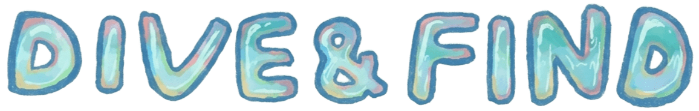
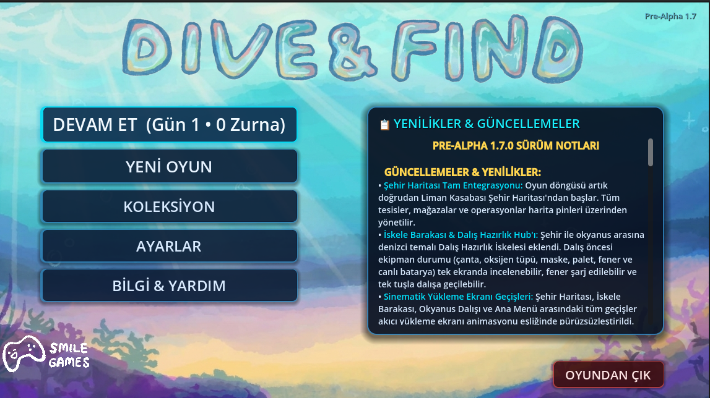
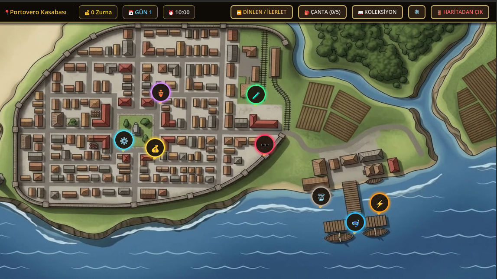
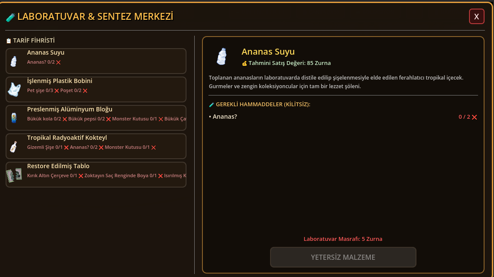
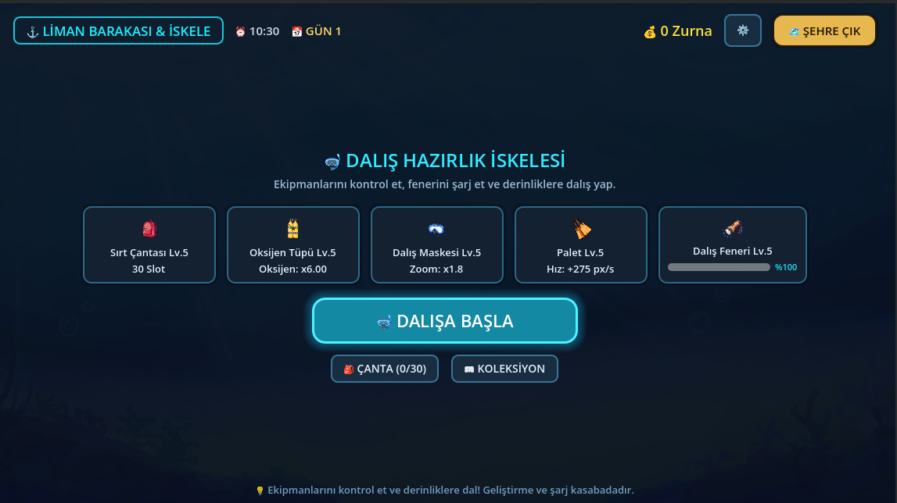
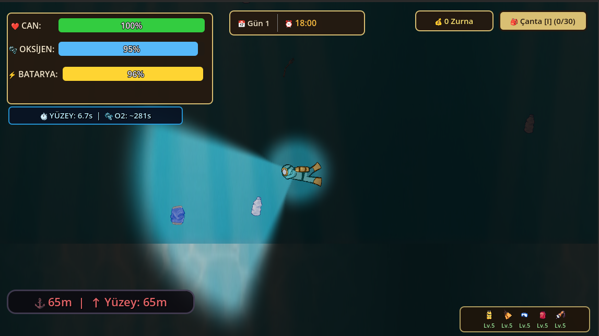
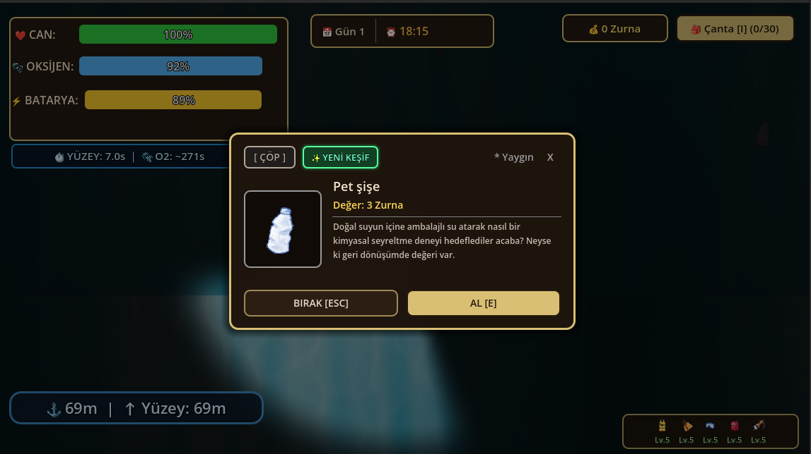

<p align="center">
  
</p>

# Dive&Find

**Dive&Find**, Godot ile geliştirilen 2D bir su altı keşif ve hayatta kalma oyunudur. Oyuncu dalış yapar, deniz tabanındaki eşyaları keşfeder, çantasını yönetir, buluntularını satar ve ekipmanını geliştirerek daha derine iner.

> Proje şu anda pre-alpha aşamasındadır. Oynanış, denge ve içerik aktif olarak değişebilir.

## Pre-Alpha 1.7 (Dev) önizleme

<p align="center">
  
  
  
</p>
<p align="center">
  
  
  
</p>

## Öne çıkanlar

- Oksijen, can, batarya ve derinlik riskini dengeleyen serbest dalış döngüsü
- Katmanlara göre eşya ve nadirlik dağıtan dinamik, sonsuz okyanus haritası
- Çanta, keşif defteri, eşya kilitleme, satış ve kayıt/yükleme sistemleri
- Oksijen tüpü, palet, dalış gözlüğü, çanta ve fener için ekipman geliştirmeleri
- Ofis karargâhı, tüccarlar, laboratuvar/crafting ve gün-sonu özeti
- Türkçe ve İngilizce çalışma zamanı yerelleştirme desteği

## Hızlı başlangıç

1. [Godot 4.7](https://godotengine.org/download/) veya uyumlu bir Godot 4 sürümü kurun.
2. Repoyu klonlayın:

   ```bash
   git clone https://github.com/hakankayaci-smilegames/dive-find.git
   ```

3. Godot Project Manager'dan `project.godot` dosyasını içe aktarın.
4. Editörde ana sahneyi çalıştırın (`F6` / `F5`).

Harici paket yöneticisi ya da ek bağımlılık kurulumu gerekmez. Oyun kayıtları Godot'nun kullanıcı veri dizinindeki `user://savegame.json` dosyasında tutulur; bu dosya repoya dahil değildir.

## Teknik yapı

Proje Godot 4.7, GDScript ve GL Compatibility renderer kullanır. Uygulama durumu, `project.godot` üzerinden tanımlanan Autoload singleton'larıyla paylaşılır:

| Sistem | Sorumluluk |
| --- | --- |
| `GlobalInventory` | Envanter, keşifler, eşya önbelleği ve save/load |
| `GlobalEconomy` | Zurna para birimi ve bakiye değişimleri |
| `GlobalSoundManager` | Müzik, SFX ve ses önbellekleme |
| `GlobalTime` | Gün/saat döngüsü, dalış erişimi ve gün özeti |
| `DevConsole` | Geliştirme komutları ve erişim kilidi |
| `ItemTranslator` | Eşya adları ile açıklamalarının yerelleştirilmesi |

Ana dalış dünyasında `player_controller.gd`, `map_maker.gd` ve `item_spawner.gd` birlikte çalışır: oyuncu hareketi ve oksijen takibi yapılır, görünür bölgelere göre harita chunk'ları oluşturulur ve derinliğe göre uygun eşya havuzları seçilir. Arayüz, ofis, envanter, mağazalar ve koleksiyon ekranları ayrı sahne/script çiftleri olarak tutulur.

Mimari, veri akışı, sahne bağlantıları, formüller ve performans kararlarının ayrıntılı kaynağı [PROJECT_ARCHITECTURE.md](PROJECT_ARCHITECTURE.md) belgesidir. Geliştirme ilkeleri için [GEMINI.md](GEMINI.md) dosyasına bakın.

## Dizin rehberi

| Yol | İçerik |
| --- | --- |
| `Scenes/` | Oyun, menü, ofis, mağaza ve HUD sahneleri |
| `Scripts/` | GDScript oyun sistemleri ve arayüz mantığı |
| `all_items_tres/` | Veri odaklı eşya kaynakları |
| `all_items_tscn/` | Toplanabilir eşya sahneleri |
| `Data/` | Tarifler ve yükleme ipuçları gibi JSON verileri |
| `Translations/` | Statik metinler ve eşya çevirileri |
| `Sprites/`, `Sounds/`, `Musics/` | Görsel ve ses varlıkları |

## Katkı yapmak

Katkılar memnuniyetle karşılanır. Küçük ve odağı net değişiklikler tercih edilir. Bir katkı hazırlarken:

1. Önce ilgili sahne, script ve [mimari belgesini](PROJECT_ARCHITECTURE.md) inceleyin.
2. Değişikliğinizi bağımsız bir branch'te yapın.
3. Godot editöründe ilgili akışı deneyin; hatanın nasıl yeniden üretildiğini veya değişikliğin nasıl doğrulandığını açıklayın.
4. Sahne, veri modeli veya mekanik etkileniyorsa `PROJECT_ARCHITECTURE.md` belgesini güncelleyin.
5. Yeni oyuncuya görünen metinlerde Türkçe ve İngilizce karşılıkları birlikte ekleyin.

Bir hata bildirirken Godot sürümünü, işletim sistemini, yeniden üretim adımlarını ve mümkünse konsol çıktısını ekleyin. Bir hata düzeltmesi gönderirken sorunun nedenini ve elle yaptığınız doğrulamayı PR açıklamasında belirtin.

## Export ayarları

`export_presets.cfg` bilerek repoda tutulmaz. Bu repo kaynak kodu ve geliştirme varlıkları içindir; yayın/export ayarları her geliştiricinin yerel ortamında oluşturulmalıdır. Derlenmiş export dosyaları da `.gitignore` tarafından dışarıda bırakılır.

## Lisans

Bu depoda henüz bir açık kaynak lisansı tanımlanmamıştır. Kod veya varlıkları yeniden kullanmadan önce proje sahibiyle iletişime geçin.
